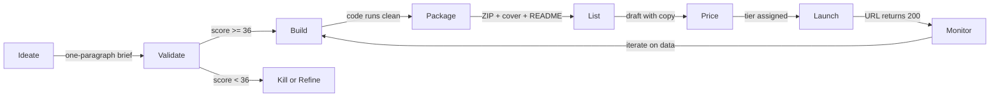
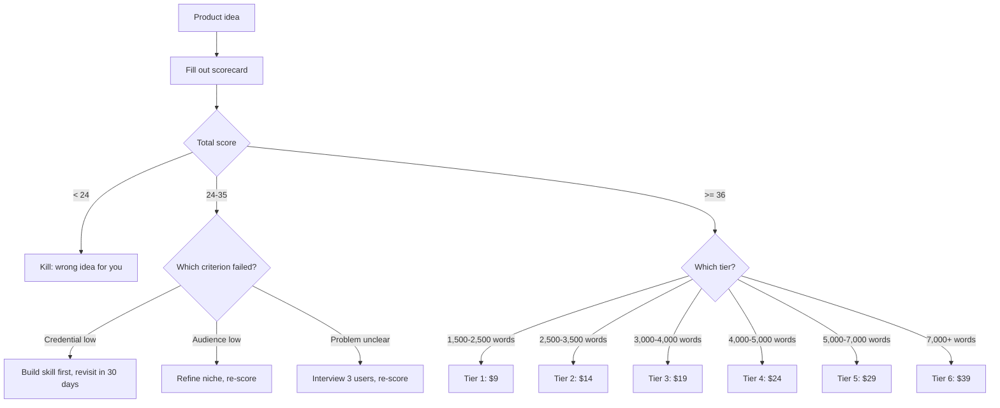
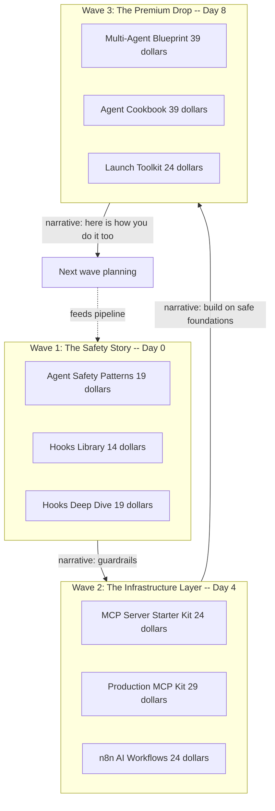
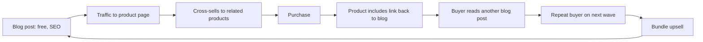

# Digital Product Launch Toolkit

> The repeatable system for building, pricing, listing, and launching digital products. Templates, checklists, scripts, and battle scars from shipping 17 products on Gumroad as Edgeless Labs.

---

## Chapter 1: The Product Pipeline

### Why a System Matters

Most creators ship their first product by brute force -- writing content, designing a cover, figuring out Gumroad's editor, and clicking publish. It works once. It doesn't work at scale.

This toolkit documents the system behind shipping 17 digital products on the Edgeless Labs Gumroad in under three months. Not because each product was quick to create, but because the launch process itself is a repeatable pipeline: ideation, validation, content creation, packaging, listing, pricing, cross-selling, and post-launch monitoring.

If you only take one idea away from this guide: **the launch process must be boring**. Everything interesting should happen during the build phase. If you are still making launch decisions at 2pm on publish day -- picking a price, rewriting the short description, wondering which cross-sells to add -- you are burning the attention you need for the next product.

### The Pipeline



Each stage has clear inputs, outputs, and quality gates. A product moves to the next stage only when the current stage's checklist is complete. Quality gates are the point -- they are the reason a skipped validation step does not propagate all the way into a dead listing three days later.

### Stage Definitions

**Ideate**: What problem does this product solve? Who has this problem? What exists already? The output is a one-paragraph product brief.

**Validate**: Does anyone actually want this? Check search volume for the topic, existing products in the space, questions in forums, Reddit, Discord. The output is a validation scorecard (see Chapter 2) with a total >= 36.

**Build**: Create the content. The output varies by product type: code plus docs for technical products, templates plus guides for process products, designs plus assets for creative products. The quality gate is "the quick start works on a clean machine in under five minutes."

**Package**: Structure the deliverables into a ZIP. Add README, CHANGELOG, LICENSE. Generate cover image. The output is a ready-to-upload file that matches the directory layout in Chapter 4.

**List**: Write the Gumroad listing. Short description, full description, cover image, tags, permalink. The output is a draft product page, not a published one.

**Price**: Set the price based on depth, audience, and competition. The output is a tier decision (see Chapter 3) and a final price tag.

**Launch**: Publish, verify, announce. The output is a live product that people can buy, a verified 200 response from the URL, and a matching update on your own website.

**Monitor**: Track views, conversions, refunds. Iterate on the listing if needed. The output is data-driven decisions about the next product in the pipeline, not panic-refreshing the sales page.

### Why Quality Gates

Every stage has a gate because every stage has a failure mode that is cheap to catch in place but expensive to catch later. A missed hardcoded API key in a ZIP is catastrophic. A missed validation step just wastes two days. A missed cross-sell loses 10% of your revenue forever. Gates turn those failures into checklist items, and checklist items do not get skipped at 11pm.

---

## Chapter 2: Validation Before Building

### The Validation Scorecard

Before spending eight hours building a product, spend thirty minutes scoring it:

| Criterion | Score (1-5) | Weight | Notes |
|-----------|------------|--------|-------|
| Problem clarity | ? | 3x | Can you describe the problem in one sentence? |
| Audience size | ? | 2x | Are there enough people with this problem? |
| Existing solutions | ? | 1x | No competition = no demand. Too much = saturated. Sweet spot: 2-5 competitors. |
| Your credential | ? | 3x | Have you solved this problem yourself? Can you prove it? |
| Build effort | ? | 2x | Can you build it in 1-3 days from existing work? |
| Price confidence | ? | 1x | Would you pay this price for this product? |

**Scoring**: Multiply each score by its weight. Total possible: 60. Launch threshold: 36+.

This scorecard is **weighted on purpose**. Most free launch advice treats all criteria equally, which rewards ideas that are well-researched but that you cannot credibly deliver. Here, Problem Clarity and Credential are each worth 3x -- meaning if you cannot explain the problem, or if you have not personally solved it, you physically cannot clear the threshold without scoring perfectly on everything else.

Products below 36 are not necessarily bad -- they need more validation or a different angle. The most common failure mode is a clear problem (score 5) that you cannot credibly solve (credential score 1). Expertise is the moat.

### The Validation Decision Tree



Notice the three distinct "retry" paths for a 24-35 score: they target the actual broken criterion, not the symptom. This is different from the generic "iterate on the idea" advice. If the credential is the problem, no amount of better copy will fix it.

### Where Validation Happens

- **Search volume**: Google Trends, Reddit search, "how to [topic]" autocomplete on Google and YouTube.
- **Forum questions**: Stack Overflow, Reddit, Discord servers, Hacker News, GitHub issues on adjacent projects.
- **Competitor analysis**: Gumroad search, Product Hunt, GitHub trending, existing paid newsletters in the space.
- **Direct asks**: "Would you pay $X for Y?" in relevant communities (be specific about the price, not "how much would you pay").

### Kill Criteria

Abandon a product idea if:

- You cannot articulate the buyer's problem in one sentence.
- The problem is solved well by a free resource (official docs, popular blog post, README).
- You do not have lived experience with the solution -- you would be writing from research, not from practice.
- The audience is too small to justify the build effort (fewer than 1,000 potential buyers globally).
- The competitor products in the space all have <10 sales (the market has been tested and found thin).

---

## Chapter 3: Content Creation by Tier

### The 6-Tier System

Price determines depth. Buyers at $9 expect a single-concept cheat sheet; buyers at $39 expect a comprehensive system with reference implementations. Mismatching depth to price is the single largest driver of refund requests.

The six-tier ladder below is the exact structure used across the Edgeless Labs catalog. Every row includes a real shipped product as the reference point -- you can go look at that Gumroad listing right now and see exactly what the tier delivers.

| Tier | Price | Word Count | File Count | What Justifies the Price | Real Example |
|------|-------|-----------|------------|---|---|
| 1. Starter | $9 | 1,500-2,500 | 2-4 | Single concept, immediately printable, card-sized reference | **Quick Reference Cards** -- 6 printable HTML cards (prompt patterns, CLAUDE.md anatomy, agent patterns, debugging, cost, hooks) |
| 2. Focused | $14 | 2,500-3,500 | 4-8 | One specific workflow, complete templates, copy-paste ready | **CLAUDE.md Template Pack** -- 14 project-specific templates (iOS, ML, API, DevOps, etc.) + **Hooks Library** -- 24 production hooks across 6 categories |
| 3. Targeted | $19 | 3,000-4,000 | 5-10 | Specific problem, complete solution, multiple example configs | **Agent Safety Patterns** -- guardrails from a $252 production loss + **Hooks Deep Dive** + **Prompt Testing Framework** + **Obsidian + Claude Setup Kit** |
| 4. Standard | $24 | 4,000-5,000 | 8-14 | Broader scope, multi-file kit with working examples, templates | **MCP Server Starter Kit** -- TS + Python templates, 8-chapter guide, 3 working servers + **AI Code Review Playbook** + **n8n AI Workflows** + **Launch Toolkit** (this product) |
| 5. Deep | $29 | 5,000-7,000 | 10-16 | Production-grade configs, deep technical content, reference infra | **Production MCP Kit** -- production-ready server patterns + **Generative Art Starter** -- pen plotter scoring v2.1, 105+ experiments, 75+ generators |
| 6. System | $39+ | 7,000-8,000 | 15-20 | Comprehensive architecture, reference implementations, multi-pattern | **Multi-Agent Blueprint** + **The Agent Cookbook** -- 16 chapters, 6 production patterns, 10 agent configs |

Each tier is a promise. A $9 Starter that tries to be a Focused product ($14) wastes the buyer's scan time -- they wanted a card, they got a chapter. A $24 Standard that is actually Focused ($14) produces refunds. The two most dangerous tiers are $14 and $24 because they sit at the edges of expectation and are the easiest to under-deliver against.

### Content Structure Template

Every product follows this structure regardless of tier:

```
product-name/
  README.md            -- Setup in < 5 minutes
  CHANGELOG.md         -- Version history (sets update expectations)
  LICENSE              -- MIT for code, custom for content
  content/
    guide.md           -- Main guide (the core deliverable)
    [code/templates/]  -- Working files
  listings/
    gumroad.md         -- Listing copy (copy-paste ready)
```

The guide follows a consistent chapter structure:

1. **The problem** -- why this exists.
2. **The approach** -- what we built and why this way.
3. **Core content** -- the meat: algorithms, patterns, templates, examples.
4. **Practical usage** -- how to apply it to your situation.
5. **Reference** -- configuration, troubleshooting, glossary.

### The "Battle Scars" Differentiator

Information is free. The docs are free. Blog posts are free. What buyers pay for is **curation and judgment from lived experience**.

Every product description must answer: "Why should I buy this instead of reading the docs?"

The answer is always some form of: "Because I ran this in production, lost real money, time, or data when it broke, and built the guardrails so you do not have to."

Agent Safety Patterns is literally priced at $19 because an agent lost $252 USDC on a mistake. That is the credential. "I know the name of the specific way this breaks."

Listing copy formula:

1. The pain (2 sentences -- what goes wrong when you wing it).
2. The credential (1 sentence -- why this author, what they have run).
3. What is inside (structured feature list, scannable).
4. Who it is for and who it is NOT for (filtering builds trust).
5. Guarantee (Gumroad's 30-day refund policy).

### Writing the Guide

Start from your existing work. The best digital products are extractions from real systems, not content written from scratch. The process:

1. **Identify the source**: what existing code, configs, docs, or processes does this product package?
2. **Extract the core**: pull out the reusable parts. Remove project-specific details.
3. **Add context**: the raw code is not enough. Explain the decisions -- why this approach, what alternatives exist, what pitfalls to avoid.
4. **Structure for scanning**: headers, code blocks, tables. Nobody reads a 5,000-word guide linearly. They scan for the section relevant to their problem.
5. **Test the quick start**: can someone go from ZIP to working output in under five minutes? If not, simplify.

---

## Chapter 4: Packaging and Covers

### The ZIP Structure

Every product ships as a ZIP containing:

| Asset | Format | Quality Bar |
|-------|--------|------------|
| Main guide | Markdown (+ PDF if tools available) | Passes the "would I pay for this" test |
| Code/templates | Working source files | Must run without modification |
| README.md | Markdown | Setup in < 5 minutes, prerequisites listed |
| CHANGELOG.md | Markdown | Version 1.0.0, sets expectation of updates |
| LICENSE | Plain text | MIT for code; content license as appropriate |

### Sidebar: Why We Ship ZIPs, Not Individual Files

Gumroad lets you attach multiple individual files to a single product. It is tempting. Do not use it. A ZIP has three structural advantages that loose files cannot replicate:

1. **Deterministic directory layout.** A ZIP preserves paths. Loose files land in the buyer's `~/Downloads` as a shotgun blast, and your carefully designed `content/` vs `templates/` vs `scripts/` hierarchy evaporates.
2. **Single-click quick start.** Double-click, unzip, open README. With loose files the buyer has to manually recreate the directory structure from context clues.
3. **Atomic versioning.** When you push v1.1 you replace one file, not seven. Buyers who re-download get a consistent set, not a Frankenstein mix of v1.0 and v1.1 files because they missed one.

The only exception: a single-file product like a printable PDF or a one-page cheat sheet. Then ship the raw file.

### Quality Gate Before Packaging

Before creating the ZIP, verify:

- [ ] All code runs without modification (tested on a clean environment)
- [ ] README quick start works end-to-end
- [ ] Guide word count meets the tier requirement
- [ ] No hardcoded paths, API keys, or personal details in any file
- [ ] CHANGELOG exists with version 1.0.0
- [ ] LICENSE file present
- [ ] No `.DS_Store`, `__pycache__`, `node_modules`, or `.env` files inside the ZIP

### Cover Image Generation

Cover images are the first thing buyers see in search results. Consistency across your catalog builds brand recognition.

The cover template (1280x1280 PNG):

- Product name (large, centered).
- One-line tagline.
- 1-2 stat badges (word count, file count, experiment count).
- Accent color unique to each product.
- Brand name in corner.

Automate cover generation. A script that renders HTML to PNG (via Playwright or Puppeteer) is faster and more consistent than designing each cover in Figma. Change the title and accent color, run the script, get a cover.

```python
# Cover generation pattern (pseudocode)
covers = [
    {"slug": "my-product", "title": "Product Name",
     "tagline": "One-line description", "color": "#3b82f6",
     "stats": ["5,000 words", "12 files"]},
]

for cover in covers:
    render_html_to_png(template, cover, output=f"covers/{cover['slug']}.png")
```

---

## Chapter 5: Gumroad Listing Optimization

### Anatomy of a High-Converting Listing

The listing page has four seconds to convince someone to keep reading. Structure matters more than eloquence.

**Short description** (shown in cards and search): one sentence, under 160 characters. Include the key differentiator. "24 production-ready Claude Code hooks across 6 categories (quality, workflow, safety, integrations, AI, DX)" is better than "A collection of useful hooks."

**Full description**: follow the formula from Chapter 3. Lead with pain, establish credibility, show what is inside, filter the audience.

**Pricing**: always display the price upfront. Gumroad supports "pay what you want" with a minimum -- use this sparingly, and only for genuine lead magnets. Fixed pricing signals confidence.

**Cover image**: 1280x1280 minimum. Must be readable at thumbnail size (400x400). Test by shrinking it in Preview.

### Cross-Sell Architecture

Every product should link to 2-3 related products. Gumroad supports this natively in the product editor.

Design your cross-sells as a product graph:

- **Entry products** ($9-14): low friction, builds trust.
- **Core products** ($19-24): the main value.
- **Deep products** ($29): technical depth for professional buyers.
- **System products** ($39+): comprehensive, for committed buyers.

The cross-sell path follows the buyer's journey: cheap -> medium -> premium. Never cross-sell from expensive to cheap (it signals that the expensive product was not complete).

### Sidebar: The Gumroad Permalink Mistake That Ate 3 Hours

On launch wave 2, the Hooks Library went live with the permalink `/l/ztaflt` -- Gumroad's auto-assigned random slug -- instead of the intended `/l/hooks-library`. The website, cross-sell links, launch tweet, and blog post CTA all pointed to `/l/hooks-library`. Every link 404'd.

The fix should have been simple: rename the permalink. It was not. Gumroad's permalink edit field appears to be a plain text input, but if the product has any buyer activity -- even a single test purchase -- the rename silently fails half the time and the old slug stays attached. In this case, resolving it meant: export buyer list, clone the product as a draft, set the intended permalink on the clone before any traffic, re-upload the ZIP, re-enter description and cross-sells, publish clone, redirect old product, then update every existing link. Three hours of unplanned work.

The lesson: **set the permalink once, set it correctly, and never attempt to rename after publish**. Use consistent, predictable permalink slugs chosen before the draft is saved:

- `production-mcp-kit`, not `prod-mcp-server-kit-v2`.
- Match your website's URL structure.
- Never change a permalink after launch -- it breaks existing links even if Gumroad appears to accept the change.

---

## Chapter 6: Pricing Strategy

### The Pricing Framework

Digital products have zero marginal cost, so pricing is about perceived value, not production cost. Three factors:

**1. Depth of content**: more comprehensive = higher price. A focused hook tutorial is $19. A full orchestration architecture is $39.

**2. Audience willingness to pay**: developers solving production problems will pay $29-39 without blinking. Hobbyists exploring a new interest resist anything over $19.

**3. Competitive positioning**: if the best alternative is a $49 course, your $29 product looks like a bargain. If the best alternative is a free blog post, your $9 product needs to clearly justify the premium.

### What Each Price Tier Actually Looks Like

Abstract tier tables are not useful. Here is what each price point actually buys, with a real Edgeless Labs product at each tier. You can look each of these up on `edgelessai.gumroad.com`.

**What $9 looks like -- Quick Reference Cards**
Six printable HTML cards: Core Prompt Patterns, CLAUDE.md Anatomy, Agent Design Patterns, Debugging Toolkit, Cost Optimization, Hooks Reference. Each card is one printed page, dark theme for screen, light theme for print. No guide, no video, no 30-chapter epic -- six cards you pin to the wall. Rationale: $9 is the "no decision" price. It has to be printable and immediately obvious.

**What $14 looks like -- CLAUDE.md Template Pack**
14 project-specific CLAUDE.md templates (mobile iOS, Android, ML/Data Science, API microservices, DevOps, full-stack Next.js, CLI tools, monorepos, game dev, embedded/IoT, security audits, open source, startup MVPs, technical writing). Drop one into a repo and start building. Rationale: $14 is for a complete kit that solves one specific recurring pain. Not a guide -- a set of drop-in files. **Hooks Library** at the same tier does the same thing: 24 production hooks, grouped, drop-in.

**What $19 looks like -- Agent Safety Patterns**
A focused 3,000-4,000 word guide on production guardrails, written after an agent lost $252 USDC in a real mistake. Includes the specific patterns that would have prevented it. Rationale: $19 is the "I have this exact problem right now" tier. **Prompt Testing Framework** ($19) is similar: a bash CLI runner + Python evaluator + 5 pre-built test suites. **Obsidian + Claude Setup Kit** ($19): pre-configured vault, 6 CLAUDE.md templates, 5 automation scripts.

**What $24 looks like -- MCP Server Starter Kit**
TypeScript and Python templates for building MCP servers. 8-chapter guide from architecture to deployment. Three working example servers (file search, database query, API proxy). Zero to running MCP server in under an hour. Rationale: $24 is the "kit with a guide" tier -- substantial enough to have real depth, broad enough to cover multiple languages or scenarios. **AI Code Review Playbook** ($24): 12 chapters, CI/CD integration, 10 language configs. **n8n AI Workflows** ($24): workflow templates + integration guide. **This product** is also $24 -- it is a kit (templates, scripts, checklists) plus a 5,000+ word guide.

**What $29 looks like -- Production MCP Kit**
Production-grade MCP server patterns: observability, rate limiting, auth, deployment configurations, error handling, real-world edge cases. This is deeper than the Starter Kit -- it assumes you can already build a server, and it teaches you how to run one. Rationale: $29 is the "professional depth" tier. Buyers are spending this for production-readiness, not tutorials. **Generative Art Starter** ($29) justifies the tier with 105+ scored pen plotter experiments and 75+ generators across an art scoring framework (v2.1).

**What $39 looks like -- The Agent Cookbook**
16 chapters on multi-agent AI patterns. Six production patterns (Builder-Validator, Fan-out, Pipeline, Ralph Loop, Supervisor, Consensus). Production concerns: errors, context, cost, testing, monitoring. 10 ready-to-use agent configurations. **Multi-Agent Blueprint** ($39) similarly packages a full architecture reference. Rationale: $39 is the "comprehensive system" tier. Buyers expect reference-implementation depth, enough to build their own production system from, not just tutorials.

### Price Anchoring with Bundles

After individual products are established (2+ weeks of sales data), create bundles:

- Bundle price = 60-70% of individual total.
- The bundle discount makes individual products look expensive, which paradoxically increases bundle conversion.
- Name bundles by use case ("Agent Infrastructure Bundle"), not by discount ("Save 40%").

### The $9 Entry Product Strategy

The hardest sale is the first one. Once someone has bought from you, they are 5-10x more likely to buy again. This is why a $9 entry product is powerful -- it is low enough that the purchase decision is trivial, but it establishes the buyer relationship.

Your $9 product should be:

- **Genuinely useful** (not a teaser for the "real" product).
- **Immediately usable** (opens, works, provides value in five minutes).
- **Related to your higher-priced products** (seeds the cross-sell).

Quick Reference Cards is the Edgeless Labs $9 entry. It is not a teaser for the Prompt Engineering OS ($29 Starter). It is complete on its own. It just happens to share an audience with every higher-tier product in the catalog, which is the entire point.

### When to Raise Prices

Raise prices when:

- Refund rate is < 5% (buyers feel they got value).
- You have added significant content since launch.
- Conversion rate is stable despite price increase tests.
- You have added content since the original launch (new chapters, new templates).

Never lower prices on an existing product. If you want to test lower pricing, create a "lite" version instead. Lowering prices signals that the original price was too high, which erodes trust with existing buyers.

---

## Chapter 7: Launch Sequencing

### Wave-Based Launches

Launching multiple products at once dilutes attention. Launch in waves of 2-3 products, spaced 3-5 days apart.

Each wave needs a narrative thread -- a reason these products go together:

- Wave 1: "The safety story" -- guardrails and protective hooks.
- Wave 2: "The infrastructure layer" -- servers and workflows.
- Wave 3: "The premium drop" -- comprehensive systems.

The narrative gives you something to write about. "We launched 7 products" is boring. "An AI agent lost $252, so we built safety patterns -- and here is what happened next" is a story.



Notice three things about this sequence. First, the waves are thematically coherent -- a buyer who buys into wave 1 has a reason to come back for wave 2. Second, the price ladder climbs across waves: trust is earned at $14-19 before the $39 premium drop. Third, each wave has a narrative hook that doubles as the launch post.

### Launch Day Checklist

For each product on launch day:

- [ ] Gumroad listing live and verified (URL returns 200)
- [ ] Cover image uploaded and rendering correctly
- [ ] Price set correctly
- [ ] Cross-sell links added (2-3 related products)
- [ ] Website updated (remove "Coming Soon" flag)
- [ ] Buy link on website navigates to live Gumroad page
- [ ] Download tested (buy your own product with a 100% discount code)
- [ ] Announcement posted (blog, social, newsletter)

### Post-Launch Monitoring

**Week 1**: check Gumroad analytics daily. Key metrics: views, conversion rate, refund rate.

- Views but no conversions: listing copy is not compelling. Rewrite the short description.
- Conversions but high refunds: product does not match expectations. Check listing accuracy.
- No views: discovery problem. Your traffic sources are not reaching the audience.

**Week 2-4**: check weekly. Look for:

- Which products have the highest conversion rate? Double down on similar topics.
- Which cross-sells get clicked? This reveals buyer intent.
- Any repeat buyers? They are your best audience for bundles and new products.

---

## Chapter 8: The Content Flywheel

### How Products Generate Content (and Vice Versa)

Every product generates three content assets:

1. **Launch blog post**: free content that drives SEO traffic to the product page.
2. **Listing page**: the sales copy itself, optimized for Gumroad's search.
3. **Social proof seed**: one specific, concrete result from using the product.



Each arrow is a measurable step. If the blog-to-product step is broken (no traffic converting), the loop stalls. If the cross-sell step is broken (single purchases, no repeat buyers), the lifetime value collapses. Instrument each arrow so you know which one is broken when revenue dips.

### Blog-to-Product Linking

Each blog post should include a subtle CTA linking to its companion product:

> "This post is adapted from [Product Name], which includes the full implementation code and templates."

Not a hard sell -- an acknowledgment that the blog post is a sample of the full product. The blog post proves the author's expertise; the product delivers the complete solution.

### Email as a Distribution Channel

If you have a mailing list (even a small one), every launch should include an email. The email follows a simple format:

1. **Subject**: the story hook, not the product name. "An AI agent lost $252" outperforms "New product: Safety Patterns."
2. **Body**: 3-4 sentences of context (the problem, what you built), then a link to the product or blog post.
3. **CTA**: one link, one action. Do not include 7 product links -- feature the star of this launch wave.

Even a 100-person list converts at 2-5% for relevant products. That is 2-5 sales per email, which compounds with every launch.

### Sustainable Cadence

Target: 2-3 new products per week, launched in waves every 7-10 days. This cadence works when most products are extractions from existing work (code, configs, workflows) rather than written from scratch.

The build schedule:

- **Day 1-2**: extract and write content for 2-3 products.
- **Day 3**: generate covers, create listings, package ZIPs.
- **Day 4**: launch wave, verify everything, announce.
- **Day 5-7**: monitor, iterate, plan next wave.

At this cadence, a 50-product catalog ships in roughly 15 weeks. The key is that most build time goes into the content, not the launch process -- the launch process is templated and takes under an hour per product once the content is ready.

---

## Chapter 9: Common Mistakes

### Mistake 1: Building Before Validating

The most expensive mistake. You spend 3 days building a product, write a beautiful listing, and launch to silence. The problem was not the product quality -- it was that nobody needed it.

Always validate first. Thirty minutes of research saves days of wasted effort. The validation scorecard (Chapter 2) exists specifically to catch this before you start building.

### Mistake 2: Pricing Based on Effort

"I spent 20 hours on this, so it should cost $49." Buyers do not care about your time. They care about the value they receive. A two-hour extraction from a production system can be worth more than a forty-hour tutorial written from research, because the extraction contains battle-tested decisions that tutorials cannot replicate.

Price based on the buyer's alternative cost: if your product saves them a week of figuring it out themselves, it is worth whatever their weekly rate is. For most developers, that is $2,000-4,000/week. Your $29 product is a bargain.

### Mistake 3: Overloading the First Version

Ship 1.0 with the core value and nothing else. No supplementary videos, no community access, no bonus templates. Each addition delays the launch and dilutes the core offering.

You can always add content in 1.1, 1.2, and so on. Updates give you a reason to email existing buyers ("We just added 3 new templates to your purchase"), which builds loyalty and generates word-of-mouth.

### Mistake 4: Dead Links on Your Website

Never remove a "Coming Soon" flag from your website until you have verified the Gumroad URL returns a 200 response with a working download. A buyer who clicks "Buy Now" and sees a 404 page will never return.

Use the included `scripts/verify-url.sh` before flipping any website flag. It reads a list of URLs, checks each one, and refuses to exit quietly if any fail.

### Mistake 5: No Cross-Selling

A customer who just bought one product is your warmest lead for the next one. If your product page does not suggest related products, you are leaving revenue on the table.

Add 2-3 cross-sell links to every listing. Position them as "if you liked this, you will find value in..." -- not as upsells, but as related resources from the same author they just trusted with their money.

### Mistake 6: Invisible Launches

You published the product. Great. Who knows about it? If your launch strategy is "put it on Gumroad and hope," you will see zero sales for weeks.

Every launch needs at least one announcement in a place where your audience gathers. This could be:

- A blog post on your own site (SEO value, permanent).
- A post in a relevant community (Reddit, Discord, forum).
- A tweet or post thread with the story behind the product.
- An email to your existing customer list.

The blog post is the highest-ROI option because it compounds over time through search traffic.

---

## Chapter 10: Shipped Catalog and Measuring Your Own Numbers

### What Actually Got Built

Instead of generic revenue ranges, here is the real Edgeless Labs catalog as the source of truth. Seventeen products across six tiers, organized into three launch waves, each wave with its own narrative thread.

**Wave 1 -- The safety story**

- **Agent Safety Patterns** ($19). Came directly from a $252 USDC production loss on an autonomous agent. The launch narrative was the incident itself, written as a post-mortem. Worked: the specificity of the dollar amount drove curiosity. Did not work: the emotional angle attracted browsers, not buyers -- needed a clearer "here is what you do about it" headline.
- **Hooks Library** ($14). 24 production hooks grouped into 6 categories. Cross-sold into Hooks Deep Dive. Worked: grouping the hooks into categories made the product feel much larger than "24 files." Did not work: the initial permalink was the random Gumroad slug `ztaflt`, which cost three hours to rescue (see Chapter 5 sidebar).
- **Hooks Deep Dive** ($19). The "why" behind the Library's "what." Worked: paired perfectly with the Library as a same-wave cross-sell. Did not work: without the Library in the basket, standalone buyers had a harder time justifying the depth.

**Wave 2 -- The infrastructure layer**

- **MCP Server Starter Kit** ($24). TypeScript and Python templates, 8-chapter guide, three working servers. Worked: the "running server in under an hour" promise is concrete and testable. Did not work: the dual-language scope made the guide slightly shallower than a single-language version would have been.
- **Production MCP Kit** ($29). The step above the Starter Kit. Worked: clear ladder -- buyers of the Starter Kit had a natural next purchase. Did not work: needed louder messaging that "Production" assumes you already built a basic server.
- **n8n AI Workflows** ($24). Workflow templates + integration guide. Worked: the n8n audience is underserved on Gumroad and converted well. Did not work: workflows tied to specific n8n versions age faster than language-agnostic guides.
- **Obsidian + Claude Setup Kit** ($19). Pre-configured vault + 6 CLAUDE.md templates + 5 automation scripts. Worked: the vault template alone saves hours of configuration. Did not work: audience overlap with Prompt Engineering OS created cannibalization in the first week.

**Wave 3 -- The premium drop**

- **The Agent Cookbook** ($39). 16 chapters, 6 production patterns, 10 agent configurations. Worked: the "cookbook" framing let buyers treat it as a reference they would return to. Did not work: $39 required clearer "who is this NOT for" copy to prevent refunds from beginners.
- **Multi-Agent Blueprint** ($39). Architecture reference. Worked: paired with the Cookbook as a "patterns + architecture" bundle. Did not work: overlap with the Cookbook needed sharper differentiation in the listing.
- **Prompt Engineering OS** ($29 Starter / $59 Pro / $99 Team). The flagship. 30 chapters, 136-page PDF. Worked: the tiered pricing let price-sensitive buyers enter at $29 while serious buyers paid $59-99. Did not work: the Team tier had no license enforcement, so it relied entirely on honor system.

**Always-on catalog (entry and focused tiers)**

- **Quick Reference Cards** ($9). Six printable cards. The $9 entry product. Job: convert browsers into first-time buyers. Worked: lowest-friction purchase in the catalog.
- **CLAUDE.md Template Pack** ($14). 14 project-specific templates. Job: solve one specific pain completely. Worked: dropped into a repo, shipped in minutes.
- **Claude Code Cheat Sheet** (free / pay-what-you-want). The lead magnet. Job: email capture. Worked: every free download went into the launch email list.
- **Prompt Testing Framework** ($19). Bash runner + Python evaluator + 5 test suites. Focused tier.
- **AI Code Review Playbook** ($24). 12 chapters, CI/CD integration, 10 language configs. Standard tier.
- **Generative Art Starter** ($29). 105+ pen plotter experiments, 75+ generators, scoring framework v2.1. Deep tier.
- **Launch Toolkit** ($24) -- this product. Standard tier. Job: sell the system behind all 16 products above.

### How to Measure Your Own Numbers

Do not copy other people's revenue numbers, including the ones above. Every audience is different. Instead, measure five metrics on your own catalog. Each has a specific formula and a specific location inside Gumroad analytics.

| Metric | Formula | Where to find it | Target |
|---|---|---|---|
| **Conversion rate** | sales / unique views | Gumroad Dashboard -> Analytics -> select product -> "Conversion" | 2-5% for paid, 8-15% for free |
| **Refund rate** | refunds / total sales (rolling 30 days) | Gumroad Dashboard -> Sales -> filter by "Refunded" | < 5% (above this, product mismatches listing) |
| **AOV (average order value)** | total revenue / total orders | Dashboard -> Analytics -> Overview -> "Average price" | Should rise as bundles and higher tiers are added |
| **Bundle lift** | (bundle AOV - single AOV) / single AOV | Compare the two in Analytics -> Products, filtered | 30-50% lift means bundles are working |
| **Cross-sell CTR** | cross-sell clicks / product page views | Dashboard -> Analytics -> select product -> "Discover" section (shows inbound from other products) | 5-10% means your graph is healthy |

Collect a baseline in the first two weeks, then re-measure every 30 days. The goal is not to hit absolute targets -- it is to see whether each metric is moving in the right direction after you make a change. If you rewrite a listing and conversion goes from 1.2% to 2.1%, keep the change. If you raise a price and refund rate jumps from 3% to 7%, revert it.

---

## Chapter 11: Scaling to 50 Products

### The Repeatable System

After launching 5-10 products, the system runs itself:

1. Pick 2-3 products from your pipeline (scored by validation).
2. Build content (1-2 days per product from existing infrastructure).
3. Generate covers (scripted, < 5 minutes).
4. Create Gumroad listings (templated, 20 minutes each).
5. Write companion blog post (30-60 minutes).
6. Launch in a wave with narrative thread.
7. Cross-sell from existing catalog.
8. Monitor, iterate, bundle.

### Maintaining a Product Pipeline

Keep a running list of potential products. For each, track:

- Title and one-line description.
- Validation score (update as you learn more).
- Source material (existing code, configs, blog posts).
- Estimated build effort.
- Target price tier.

Score the pipeline weekly. The highest-scored products get built next. Low-scored products stay in the pipeline until something changes (you gain the credential, the audience grows, a competitor exits).

### When to Bundle

Create bundles after individual products have 2+ weeks of sales data:

- **Thematic bundles**: group by use case ("Agent Infrastructure Bundle").
- **Tier bundles**: group by audience ("Starter Pack" for $9-19 products).
- **Complete bundle**: everything ("Ship Everything Bundle").

Bundle pricing: 60-70% of individual total. The discount needs to be large enough to be obviously better than buying individually, but not so large that it devalues the individual products.

### What Makes This Different From Free Resources

There is a lot of free launch advice on the internet. Justin Jackson's Product People content, Daniel Vassallo's solo-creator essays, Indie Hackers retros, and Gumroad's own blog all cover aspects of what is in this guide. If the free material were sufficient, you would not need this product. Three things differentiate this system:

**1. The scorecard is weighted, not flat.** Almost every free validation framework treats all criteria equally -- "good idea, big audience, you can build it." Equal weighting rewards researched ideas the author cannot credibly deliver. This scorecard weights Problem Clarity and Credential at 3x specifically to fail ideas where the author has no lived experience, which is the dominant failure mode of first-time creators.

**2. Wave sequencing has a narrative thread rule.** Free advice says "launch multiple products." It does not say "each wave must share a narrative hook that doubles as the launch post." The narrative rule is what turns 3 products into 1 coherent story, and 1 coherent story outperforms 3 separate launches every time.

**3. The pipeline has quality gates between stages, not just at the end.** Most launch checklists are a single pre-publish checklist. This system gates every stage transition (validation -> build, build -> package, package -> list), which makes mistakes cheap to catch in place instead of discovering them at 11pm on launch day.

These are not the only differences, but they are the three that change outcomes. Everything else in this guide -- pricing tiers, cover templates, cross-sell graph -- is table stakes. The weighted scorecard, the narrative wave, and the inter-stage gates are the novel contributions.

---

## Appendix A: Templates

### Product Brief Template

```markdown
## Product Brief: [Name]

**Problem**: [One sentence describing the problem]
**Audience**: [Who has this problem]
**Credential**: [Why you can solve it -- what you've built/broken/learned]
**Deliverables**: [What's in the ZIP]
**Price**: $[X] ([tier name])
**Validation score**: [X]/60
**Estimated build time**: [X] days
**Source material**: [What existing work this draws from]
```

### Listing Copy Template

```markdown
## Short Description
[One sentence, under 160 characters, includes key differentiator]

## Full Description
[2 sentences: the pain point]

[1 sentence: your credential]

**What you get:**

[Structured feature list with chapters/sections]

**Who this is for:**
- [Persona 1]
- [Persona 2]

**Who this is NOT for:**
- [Anti-persona 1]
- [Anti-persona 2]

[Technical requirements: language version, dependencies]

## Call to Action
[One sentence: the promise]
```

### CHANGELOG Template

```markdown
# Changelog

## 1.0.0 (YYYY-MM-DD)

Initial release.

- [Key deliverable 1]
- [Key deliverable 2]
- [Key deliverable 3]
```

## Appendix B: Checklists

### Pre-Build Checklist

- [ ] Product brief completed
- [ ] Validation score >= 36
- [ ] Source material identified
- [ ] Tier and price set
- [ ] Directory structure created

### Pre-Package Checklist

- [ ] Guide word count meets tier requirement
- [ ] All code runs without modification
- [ ] README quick start works end-to-end
- [ ] No hardcoded paths or API keys
- [ ] CHANGELOG exists with version 1.0.0

### Pre-Launch Checklist

- [ ] ZIP packaged and tested
- [ ] Cover image generated (1280x1280)
- [ ] Gumroad listing created with correct permalink
- [ ] Listing description pasted and formatted
- [ ] Price set
- [ ] Product file uploaded
- [ ] Cross-sell links added
- [ ] URL returns 200 (not 404)

### Post-Launch Checklist (Day 1)

- [ ] Website updated (comingSoon flag removed)
- [ ] Buy link verified (navigates to live page)
- [ ] Test purchase completed (with discount code)
- [ ] Announcement published
- [ ] Analytics baseline recorded (views at T+24h)

## Appendix C: The 17 Products (Product Index)

The Edgeless Labs shipped catalog as of the 1.0 release of this toolkit. Every product below is live on `edgelessai.gumroad.com` and is the ground truth for the tier examples in Chapter 3 and the launch waves in Chapter 10.

| # | Product | Tier | Price | One-line positioning |
|---|---|---|---|---|
| 1 | Claude Code Cheat Sheet | Lead magnet | Free / PWYW | Printable command reference -- CLI, slash, hooks, skills, MCP, shortcuts |
| 2 | Quick Reference Cards | 1. Starter | $9 | Six printable cards: patterns, CLAUDE.md, agents, debugging, cost, hooks |
| 3 | CLAUDE.md Template Pack | 2. Focused | $14 | 14 project-specific CLAUDE.md templates (iOS, ML, API, DevOps, more) |
| 4 | Hooks Library | 2. Focused | $14 | 24 production Claude Code hooks across 6 categories |
| 5 | Agent Safety Patterns | 3. Targeted | $19 | Guardrails after a $252 USDC agent loss -- the patterns that would have prevented it |
| 6 | Hooks Deep Dive | 3. Targeted | $19 | The "why" behind the Hooks Library -- architecture, tradeoffs, pitfalls |
| 7 | Prompt Testing Framework | 3. Targeted | $19 | Bash CLI runner + Python evaluator + 5 pre-built test suites |
| 8 | Obsidian + Claude Setup Kit | 3. Targeted | $19 | Pre-configured vault + CLAUDE.md templates + automation scripts |
| 9 | MCP Server Starter Kit | 4. Standard | $24 | TS + Python templates, 8 chapters, 3 working servers |
| 10 | AI Code Review Playbook | 4. Standard | $24 | 12 chapters, CI/CD integration, 10 language configs |
| 11 | n8n AI Workflows | 4. Standard | $24 | Workflow templates + integration guide for AI use cases |
| 12 | Digital Product Launch Toolkit | 4. Standard | $24 | This product -- the system behind the other 16 |
| 13 | Production MCP Kit | 5. Deep | $29 | Production-grade MCP server patterns -- observability, auth, rate limits |
| 14 | Generative Art Starter | 5. Deep | $29 | 105+ scored pen plotter experiments, 75+ generators, art scoring v2.1 |
| 15 | Prompt Engineering OS | 5-6. Deep/System | $29 / $59 / $99 | 30-chapter flagship (Starter / Professional / Team tiers) |
| 16 | Multi-Agent Blueprint | 6. System | $39 | Multi-agent architecture reference implementation |
| 17 | The Agent Cookbook | 6. System | $39 | 16 chapters, 6 production patterns, 10 agent configurations |

This is the complete live catalog. Every tier from $9 to $39 has at least one representative product, and every entry cross-links to at least two others in its adjacent tiers.

## Appendix D: Sample Filled-In Product Brief

The following is the actual filled-in brief used to greenlight the **CLAUDE.md Template Pack** ($14) before a single file was written. It is presented here so buyers of this toolkit can see the template in real, not abstract, form.

```markdown
## Product Brief: CLAUDE.md Template Pack

**Problem**: Every new project repeats the same "what should go in CLAUDE.md" debate
from scratch, and the result is usually worse than the previous project's version.

**Audience**: Developers using Claude Code who have 2+ active projects of different
types (mobile, backend, data, etc.) and notice the context-file drift between them.

**Credential**: Author maintains 17 active projects at Edgeless Labs spanning iOS,
Android, ML, API microservices, DevOps, Next.js, CLI, monorepo, game, embedded,
security, open source, MVP, and technical-writing projects. Each has a CLAUDE.md
that has been iterated 5-20 times.

**Deliverables**:
- 14 CLAUDE.md templates, one per project type
- README explaining load order and overlay semantics
- Short "how to adapt" guide per template
- LICENSE (MIT)

**Price**: $14 (Tier 2: Focused)

**Validation score**: 42 / 60
  - Problem clarity:     5 * 3 = 15
  - Audience size:       4 * 2 =  8
  - Existing solutions:  3 * 1 =  3  (Gumroad has 2 similar packs, but single-type)
  - Your credential:     5 * 3 = 15  (17 shipped examples)
  - Build effort:        2 * 2 =  4  (templates already exist in each project repo)
  - Price confidence:    2 * 1 =  2  (below average but $14 is defensible)
  Total: 47 / 60  ->  clears 36 threshold with room to spare

**Estimated build time**: 1 day (extraction + normalization, not writing from scratch)

**Source material**:
- `/Users/djm/claude-projects/.claude/CLAUDE.md` and sibling project files
- Edgeless iOS photoMerge CLAUDE.md
- The Clapper CLAUDE.md
- Pamela trading bot CLAUDE.md
- Nanobot-vps CLAUDE.md
- Autocoder CLAUDE.md
```

Notice three things about this filled-in brief:

1. **The validation math is shown explicitly**, not summarized. Seeing `5 * 3 = 15` makes clear that this product passed primarily on Problem Clarity and Credential, which are the 3x criteria. A product with a 47 score driven by Audience and Build Effort would be far weaker, and the math would show it.
2. **The credential is concrete**: not "I use Claude Code a lot" but "17 active projects, each with an iterated CLAUDE.md." That is what clears the 3x credential weight.
3. **The source material is a list of real file paths**, which is the signal that this product is an extraction from real work, not a tutorial written from research. That is the Battle Scars differentiator in the brief format itself.

This is the template you will actually use. Copy it, replace every bracketed value with your own, and if you cannot fill in any field honestly, the product is not ready to build.
