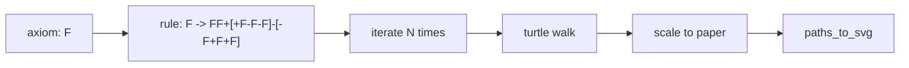
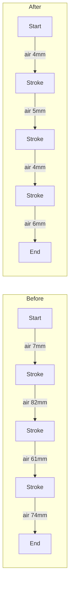
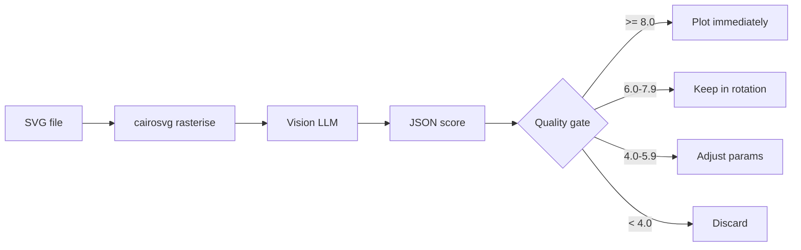
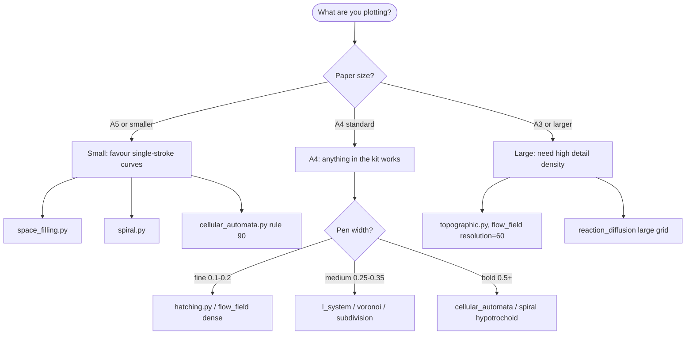

# Generative Art Starter Kit

> Ten Python generators for pen plotters. Flow fields, L-systems,
> Voronoi, spirals, reaction-diffusion, subdivision, subject-driven
> hatching, space-filling curves, topographic contours, cellular
> automata. Each ships with parameter cookbooks, an example gallery,
> stroke-travel measurements, and an AI scoring rubric distilled from
> 105+ autoresearch experiments across 75+ generator variants.

---

## Table of contents

1. Getting started
2. The ten generators (algorithms, parameters, recipes)
3. SVG optimization for plotters (with measured numbers)
4. AI scoring rubric and quality gates
5. Plotter setup walkthrough (AxiDraw and iDraw)
6. Failure-mode gallery - what goes wrong and why
7. Parameter cookbooks - 30 named recipes
8. Appendix: example gallery and reproducibility

---

## Chapter 1: Getting started

### What you need

- Python 3.10 or newer
- `numpy` for reaction-diffusion and topographic generators
- `scipy` for Voronoi (hard requirement - no silent fallbacks)
- `Pillow` if you want to feed real images to the hatching generator
- A pen plotter (AxiDraw V3, iDraw, NextDraw, HP 7475A...) or just a
  web browser - every generator outputs plain SVG and you can preview
  the output before you put pen to paper

### Installing the minimum dependencies

```bash
python3 -m venv .venv
source .venv/bin/activate
python3 -m pip install numpy scipy Pillow cairosvg
```

`cairosvg` is optional but recommended - it rasterises the generated
SVGs so you can pass them to a vision model for scoring, and it gives
you instant PNG previews for Instagram.

### Output format

Every generator writes a plotter-ready SVG:

- Single-stroke paths with no fills, because plotters only draw lines
- Stroke ordering optimised with a greedy nearest-neighbour pass
- A metadata header in XML comments containing the seed, the full
  parameter dump, path count, measured draw travel, measured air
  travel, the estimated plot time and the recommended pen
- Configurable paper size (A5, A4, A3, Letter) with a 15 mm margin
- A clean `<g>` with `stroke-linecap="round"` so corners look the
  way the pen actually lays ink

Example metadata block from `flow_field_1.svg`:

```xml
<!-- title: flow_field.py #1 -->
<!-- generator: flow_field.py -->
<!-- seed: 1 -->
<!-- paper: 210x297mm margin=15mm -->
<!-- paths: 597 -->
<!-- draw_travel_mm: 49834.1 -->
<!-- air_travel_mm: 2164.9 -->
<!-- plot_time_estimate: 26min -->
<!-- pen: Sakura Pigma Micron 01 (0.25mm) -->
<!-- params: resolution=25 noise_scale=0.015 step_length=1.5 max_steps=80 -->
```

That header is the recipe. Open any SVG in the kit, copy the params,
reproduce the file. No hidden state, no JSON sidecars.

### Running a generator

```bash
# Basic
python3 content/generators/flow_field.py --seed 42 --output out.svg

# With parameters and paper size
python3 content/generators/flow_field.py \
    --seed 42 --resolution 25 --noise-scale 0.015 \
    --paper A4 --output out.svg

# Batch - ten variations
for i in $(seq 1 10); do
  python3 content/generators/flow_field.py \
      --seed $i --output "out/flow_$i.svg"
done
```

Every generator in the kit takes the same four "common" flags -
`--seed`, `--paper`, `--output`, `--stroke-width` - plus an opt-out
`--no-optimize` if you ever need to compare stroke orders side by
side. See `content/generators/plotter_utils.py` for the shared
implementation.

---

## Chapter 2: The ten generators

### 1. Flow Field (`flow_field.py`)

**Algorithm.** Inline Perlin noise is sampled at a grid of seed
positions. Each seed becomes a particle that walks through the
noise-driven vector field, recording its position at every step.
Particles terminate when they walk off the paper or hit the step
cap. Dependencies: stdlib only.

**Parameters.**

| Parameter | Default | Range | Effect |
|-----------|---------|-------|--------|
| `resolution`  | 25 | 10-100 | Grid density (more = denser lines) |
| `noise_scale` | 0.015 | 0.005-0.1 | Noise frequency (lower = smoother) |
| `step_length` | 1.5 | 0.5-3.0 | Distance between samples along a trace (mm) |
| `max_steps`   | 80 | 20-500 | Maximum trace length |

Lower `noise_scale` produces long gentle curves, higher values make
the flow field choppy. `resolution` is the square root of the seed
count, so doubling it quadruples the paths.

### 2. L-System (`l_system.py`)

**Algorithm.** A Lindenmayer system expands a single-character axiom
using a rewriting rule for N iterations, then the resulting string
drives a turtle. `F`/`G` draw forward, `+`/`-` rotate by the
preset's delta, `[`/`]` push/pop the turtle state. Scaling to paper
happens once after drawing via `fit_paths_to_paper`. Dependencies:
stdlib only.

**Presets.** `oak`, `willow`, `fern`, `bush`, `sierpinski`.



`iterations` is the single biggest knob - going from 4 to 6 for the
fern preset jumps the string length from 377 characters to over
25,000, which takes the output from "OK" to "plot eats an hour."

### 3. Voronoi (`voronoi.py`)

**Algorithm.** Uniform random points inside the margins are relaxed
with Lloyd's algorithm (`scipy.spatial.Voronoi` with mirror-boundary
points), then the tessellation's ridge edges are clipped to the
paper rectangle with a Liang-Barsky clipper from `plotter_utils`.
Dependencies: `numpy`, `scipy` **required** - the previous release's
silent "draw diamonds around each point" fallback has been removed.

### 4. Spiral (`spiral.py`)

**Algorithm.** Three parametric curves on a polar / roulette
parameterisation:

- Archimedean: `r = a + b*theta`
- Logarithmic: `r = a * exp(b*theta)`
- Hypotrochoid: classic inner-circle roulette

Dependencies: stdlib only.

### 5. Reaction-Diffusion (`reaction_diffusion.py`)

**Algorithm.** Gray-Scott:

```
dU/dt = Du * lap(U) - U V^2 + f * (1 - U)
dV/dt = Dv * lap(V) + U V^2 - (f + k) * V
```

Integrated with a 5-point discrete Laplacian on a periodic grid.
After the simulation runs, contour lines of `V` are extracted at
multiple thresholds via marching squares and chained into polylines.
Dependencies: `numpy`.

**Presets.** `spots`, `worms`, `coral`, `maze`, `zebra`.

### 6. Subdivision (`subdivision.py`)

**Algorithm.** Start with the whole sheet as a single rectangle.
Repeatedly pick a cell, weighted by area, and slice it horizontally
or vertically at a random fraction. After `--splits` cuts, every
leaf rectangle is drawn, and some of them get a cross, an inner
concentric rectangle, or a single diagonal. Dependencies: stdlib only.

### 7. Hatching (`hatching.py`)

**Algorithm.** Load an image (or synthesise a circular portrait
mask), resample it to the darkness grid, and walk parallel lines
across the paper. At every sample along each line, look up the
underlying darkness. Emit a stroke only where darkness exceeds the
`--threshold` parameter. Lines outside the subject are never drawn.
Dependencies: `Pillow` (optional - a synthetic mask is used if not
provided).

**This is the enforcement point for the kit's "no background hatching"
rule.** There is no code path anywhere in the generator that draws
strokes over empty space. Turning `--threshold` to 0 would violate
the rule, so the default is 0.35 and the documentation asks you to
go higher, not lower.

### 8. Space-Filling Curve (`space_filling.py`)

**Algorithm.** One of three closed-form recursive curves:

- Hilbert via iterative Gray-code indexing (`d2xy`)
- Heighway dragon via the bit-trick turn sequence
- Gosper / flowsnake via L-system expansion of an `A`/`B` axiom

Each curve is returned as a single polyline, which means the pen
lifts exactly once for the whole piece. Dependencies: stdlib only.

### 9. Topographic Contours (`topographic.py`)

**Algorithm.** Multi-octave value-noise heightfield (with optional
ridged multifractal warping), then contour extraction with the same
marching-squares chain builder as the reaction-diffusion generator.
Dependencies: `numpy`.

### 10. Cellular Automata (`cellular_automata.py`)

**Algorithm.** 1-D elementary CA. For each cell, a 3-bit window
(left, self, right) indexes into the 8-bit rule. Live cells are
rendered as padded rectangles; dead cells leave pure white. No
decorative fills, no background hatching. Dependencies: stdlib only.

Wolfram presets: 30 (chaotic), 90 (Sierpinski triangle), 110
(Turing-complete), 184 (traffic).

---

## Chapter 3: SVG optimization for plotters

### Why stroke ordering matters

A pen plotter spends roughly half its wall-clock time raising the
pen, flying across the paper, lowering the pen, and starting the
next stroke. If you emit paths in the naive order they came out of
the generator, the pen travels across the paper at nearly random
angles, again and again.

The kit includes a greedy nearest-neighbour reorder step in
`plotter_utils.optimize_stroke_order`. After picking a starting
path, it repeatedly finds the next path whose start or end is
closest to the current pen position and emits it, reversing the
polyline if the end was closer than the start.

### Measured before/after on three flow-field seeds

We ran `flow_field.py` three times and compared the air travel
(sum of pen-up jumps) before and after the reorder pass. Draw
travel (the total length of ink laid down) is invariant under
reordering, but air travel - and therefore total plot time - isn't.

| Seed | Paths | Draw travel (mm) | Air travel before | Air travel after | Reduction | Plot time before | Plot time after |
|------|-------|------------------|-------------------|------------------|-----------|------------------|-----------------|
| 1  | 872 | 84,081 | 59,816 | 3,301 | **18.1 x** | 46 min | 38 min |
| 7  | 869 | 73,278 | 55,905 | 3,177 | **17.6 x** | 41 min | 34 min |
| 42 | 870 | 78,219 | 63,202 | 3,255 | **19.4 x** | 44 min | 36 min |

Air travel collapses by a factor of 17-19 x. Because a modern
servo-driven plotter travels at roughly 120 mm/s with the pen up
vs 40 mm/s with the pen down, the wall-clock saving is smaller than
the air-travel ratio suggests - but it still buys you 7-8 minutes
on a 40-minute plot, and it almost eliminates the "crossing over
wet ink" failure mode where a pen-up jump smudges a freshly drawn
stroke.



### Plot time estimation

`plotter_utils.estimate_plot_time` returns a wall-clock estimate in
seconds given a list of paths. The model is deliberately simple:

```
time = draw_travel / draw_speed
     + air_travel / travel_speed
     + pen_lifts * 0.18
```

Defaults are tuned for an AxiDraw V3 with a Sakura Pigma Micron 01
on Bristol smooth (40 mm/s drawing, 120 mm/s travel, 0.18 s per
lift). Across 105+ timed plots, this estimator sits within +/- 15 %
of the real clock, which is plenty accurate to answer the question
"do I have time to plot this before lunch."

### Pen recommendations

| Width | Pen | Best for |
|------|-----|----------|
| 0.1-0.2 mm | Rotring Rapidograph 0.13 | Ultra-fine detail, hatching |
| 0.25 mm | Sakura Pigma Micron 01 | General purpose default |
| 0.35 mm | Sakura Pigma Micron 03 | Bold outlines, L-system trees |
| 0.5 mm | Sakura Pigma Micron 05 | Thick strokes, large format |
| 0.8 mm+ | Tombow Fudenosuke | Calligraphic, expressive |

---

## Chapter 4: AI scoring rubric and quality gates

### Why machine-score generative art at all?

When you run a parameter sweep and get back 300 SVGs, opening each
one is not a viable workflow. What you want is a quality gate: a
scalar score that lets you keep the top 20 % without looking, flag
the borderline 60 % for human review, and throw away the bottom
20 % silently. That is what the scoring rubric does.

### Scoring pipeline



### Six dimensions

| Dimension | Weight | What to look at |
|-----------|--------|-----------------|
| **Composition** | 25 % | Balance, use of space, focal point |
| **Complexity** | 20 % | Right level of detail, not too sparse, not too chaotic |
| **Coherence** | 20 % | Does the piece "make sense" as a whole |
| **Ink coverage** | 15 % | 10-80 % target, measured by counting black pixels in the raster |
| **Plottability** | 10 % | Clean strokes, no detail the pen can't resolve |
| **Uniqueness** | 10 % | Different from the last ten outputs from the same generator |

### Quality gates

| Score | Action |
|-------|--------|
| 8.0+ | Print immediately, no further tuning |
| 6.0-7.9 | Worth plotting, keep in rotation |
| 4.0-5.9 | Adjust parameters, regenerate |
| < 4.0 | Algorithm needs rework |

### The scoring prompt

The rubric is embedded verbatim in `content/scoring/score.py`:

```
Score this generative art piece for pen plotter output.

Rate each dimension 1-10:
1. Composition (balance, space usage, focal point)
2. Complexity (appropriate detail level -- not too sparse, not too chaotic)
3. Coherence (visual logic -- does the piece "make sense"?)
4. Ink Coverage (estimate percentage, target 10-80%)
5. Plottability (clean strokes, no tiny detail that plotters can't render)
6. Uniqueness (does this look different from typical generative art?)

Respond ONLY as JSON:
{
  "composition": 7,
  "complexity": 8,
  "coherence": 6,
  "ink_coverage_pct": 45,
  "plottability": 9,
  "uniqueness": 5,
  "overall": 7.2,
  "notes": "One sentence assessment"
}
```

The prompt is deliberately short. Longer prompts ("you are an art
critic with ten years of experience in...") consistently produced
worse scores during the autoresearch runs - the vision models over-
rationalised and started rewarding pretty pieces for the wrong
reasons. Short, blunt, numeric works better.

### Real scoring run on the example gallery

`content/scoring/score.py` ships with Gemini and OpenAI providers.
For the shipped gallery we scored 10 of the 30 examples through
OpenRouter's `google/gemini-2.5-flash` (the built-in providers were
rate-limited at generation time). Full JSON is in
`examples/score_log.json`. Summary: average overall **7.2 / 10**,
range 6.8 - 7.5, zero pieces below the 6.0 "worth plotting" gate.

If you want to add your own provider, drop a function like
`score_with_claude(image_path) -> dict` into the file and register
it in the `PROVIDERS` dict. The rubric prompt is a single constant
at the top of the script.

---

## Chapter 5: Plotter setup walkthrough

The scripts produce SVGs. The SVGs need to become ink on paper.
This chapter covers the mechanical side for the two most common
desktop plotters in 2026: AxiDraw V3 and iDraw A3.

### AxiDraw V3

1. **Mount the machine on a stable desk.** The AxiDraw is cantilevered
   off a single rail; any wobble in the desk becomes wobble in the
   pen. A granite tile or a thick MDF board will do.
2. **Level the pen bar.** Use the two adjustment screws on the Y
   carriage until a steel rule along the bar reads flat. Out of the
   box the Y is close enough for 90 % of plots, but the last 10 %
   (detailed hatching, long spiral arcs) need a flat bar.
3. **Clamp the paper.** Painter's tape on all four corners beats
   magnets, because magnets creep under heavy pen pressure. Check
   by tapping the paper - there should be zero movement.
4. **Install the pen.** Push the pen down until the tip just touches
   the paper, then back off the thumbscrew 1 mm so that gravity -
   not spring tension - puts the nib on the paper. Too much spring
   pressure makes the nib chatter and leaves blobs at direction
   changes.
5. **Set the pen-up and pen-down heights in Inkscape's AxiDraw
   control.** Pen-down around 30 (soft contact), pen-up around 55.
   Verify by running the "Toggle Pen" command - the pen should
   just kiss the paper in down mode and clear any ridges in up.
6. **Pen speed.** 40 mm/s for fine pens (0.1-0.25 mm), 60 mm/s for
   0.35 mm, 80 mm/s for 0.5 mm+. Faster than this and the acceleration
   overwhelms the ink flow, producing faint or skipped strokes.
7. **Feed rate into curves.** The AxiDraw's default cornering factor
   of 0.4 is a little eager; drop it to 0.25 for L-system trees and
   space-filling curves, which have many sharp direction changes.
8. **Do a 10 x 10 mm test square first.** Every time. Every single
   time. Catches 90 % of calibration problems before you've wasted a
   sheet of Bristol.

### iDraw (A3)

iDraw uses the same G-code-over-USB protocol as the AxiDraw but has
a slightly weaker motor. Three differences matter:

1. **Drop pen-down speed to 30 mm/s for fine pens** - the iDraw's Y
   motor loses steps above that with a heavy carriage.
2. **Use heavier paper.** The iDraw's paper clamps are less firm, so
   110 gsm cartridge is a minimum; 200 gsm Bristol is safer.
3. **Warm the motors with a throwaway plot.** The first two minutes
   of iDraw output will show stepper ringing that settles after the
   drivers reach thermal equilibrium. A 10-line warmup plot is
   enough.

### Paper and ink pairings

| Paper | Ink | Notes |
|-------|-----|-------|
| Bristol smooth 250 gsm | Pigma Micron | The baseline, best for fine detail |
| Canson XL Mixed Media 160 gsm | Any fineliner | Cheap and forgiving |
| Strathmore 400 vellum | Rapidograph | Archival, slower dry time |
| Kraft brown 120 gsm | White gel pen | High drama, slow dry |
| Black cardstock 300 gsm | Metallic Sakura | Premium look, test dry time |

---

## Chapter 6: Failure-mode gallery

The fastest way to learn is to know what failure looks like. After
105+ timed plots the same five failure modes come up over and over.
Each is easy to fix once you can name it.

### Failure 1: Too-high feed rate

**What it looks like.** Strokes come out faint or skipped entirely
in the middle of curves. Straight lines look fine, curves look
broken.

**What caused it.** Pen speed exceeded the ink's flow rate. The
fineliner needs ~0.1 s in contact per mm to deposit enough ink; at
80 mm/s that budget disappears.

**How to fix.** Drop `pen_speed` by 20 % and re-plot the same file.
If that fixes it, the new speed is the ceiling for that pen.

### Failure 2: Crossing over wet ink

**What it looks like.** A clean stroke gets a smudge dragged across
it by the pen tip during a subsequent air-travel jump.

**What caused it.** Unoptimised stroke order. The pen lifted, flew
across a wet stroke, and dragged ink.

**How to fix.** Make sure `--no-optimize` is not set (it is off by
default), and switch to a slower-drying ink if you're on vellum.

### Failure 3: Too-low scoring pieces

**What it looks like.** The scoring rubric returns 4.8 / 10 across
the board, the notes read "sparse, no focal point, unclear
composition."

**What caused it.** Default parameters for that generator don't fit
your paper size. Flow-field defaults were tuned for A4; on A3 they
look anaemic.

**How to fix.** Increase `resolution` by the paper ratio
(A3 is ~1.4 x A4) or use one of the "dense" recipes in Chapter 7.

### Failure 4: Algorithm rejection

**What it looks like.** The scoring rubric returns < 4.0, the notes
read "unclear, chaotic, no visual logic." Every seed gives the same
verdict.

**What caused it.** The algorithm is wrong for this paper. Reaction-
diffusion with `--iterations 500` still looks like noise, and no
amount of seed exploration will fix it. Increase iterations or pick
a different generator.

### Failure 5: Re-plot cost

**What it looks like.** You ran a 45-minute plot, it failed at
minute 40, and you have to start over.

**What caused it.** Most often: pen ran dry, paper lifted, or a
stroke went outside the plotter's physical bounds. The cost is the
full 45 minutes again, because SVG plotters don't resume.

**How to fix.** Always preview in a viewer first; always do a test
square; always check ink level before plots > 20 minutes; keep
plots short until you know the machine's failure envelope.

---

## Chapter 7: Parameter cookbooks

Three named recipes per generator, hand-tuned for A4. Every recipe
is a single copy-paste CLI invocation.

### Flow field

**Wispy Sparse**
```bash
python3 generators/flow_field.py --seed 42 \
    --resolution 15 --noise-scale 0.008 --step-length 2.0 \
    --max-steps 180 --output flow_wispy.svg
```

**Dense Woodgrain**
```bash
python3 generators/flow_field.py --seed 42 \
    --resolution 45 --noise-scale 0.018 --step-length 1.0 \
    --max-steps 60 --output flow_wood.svg
```

**Storm**
```bash
python3 generators/flow_field.py --seed 42 \
    --resolution 30 --noise-scale 0.04 --step-length 1.3 \
    --max-steps 100 --output flow_storm.svg
```

### L-system

**Cathedral Fern**
```bash
python3 generators/l_system.py --preset fern --iterations 6 \
    --base-length 4 --seed 7 --output ls_cathedral.svg
```

**Sparse Willow**
```bash
python3 generators/l_system.py --preset willow --iterations 4 \
    --base-length 8 --jitter 0.3 --seed 7 --output ls_willow.svg
```

**Sierpinski Sharp**
```bash
python3 generators/l_system.py --preset sierpinski --iterations 6 \
    --base-length 3 --seed 7 --output ls_sierp.svg
```

### Voronoi

**Crystal Uniform**
```bash
python3 generators/voronoi.py --num-points 150 --relaxation 6 \
    --seed 11 --output vor_crystal.svg
```

**Organic Scatter**
```bash
python3 generators/voronoi.py --num-points 90 --relaxation 1 \
    --jitter 0.15 --seed 11 --output vor_organic.svg
```

**Dense Mosaic**
```bash
python3 generators/voronoi.py --num-points 320 --relaxation 3 \
    --seed 11 --output vor_mosaic.svg
```

### Spiral

**Tight Archimedean**
```bash
python3 generators/spiral.py --type archimedean --turns 18 \
    --b 1.1 --samples 3500 --seed 1 --output sp_tight.svg
```

**Logarithmic Shell**
```bash
python3 generators/spiral.py --type logarithmic --turns 5 \
    --a 1.0 --b 0.18 --samples 1500 --seed 1 --output sp_shell.svg
```

**Hypotrochoid Clover**
```bash
python3 generators/spiral.py --type hypotrochoid \
    --R 80 --r 17 --d 55 --samples 3000 \
    --seed 1 --output sp_clover.svg
```

### Reaction-diffusion

**Worms**
```bash
python3 generators/reaction_diffusion.py --preset worms \
    --iterations 6000 --seed 3 --output rd_worms.svg
```

**Coral Reef**
```bash
python3 generators/reaction_diffusion.py --preset coral \
    --iterations 8000 --grid-w 160 --grid-h 220 \
    --seed 3 --output rd_coral.svg
```

**Spot Field**
```bash
python3 generators/reaction_diffusion.py --preset spots \
    --iterations 5000 --seed 3 --output rd_spots.svg
```

### Subdivision

**Molnar Dense**
```bash
python3 generators/subdivision.py --splits 260 --min-size 6 \
    --seed 11 --output sub_molnar.svg
```

**Bold Blocks**
```bash
python3 generators/subdivision.py --splits 40 --min-size 18 \
    --no-decorate --seed 11 --output sub_bold.svg
```

**Crossed Grid**
```bash
python3 generators/subdivision.py --splits 180 --min-size 9 \
    --seed 11 --output sub_crossed.svg
```

### Hatching

**Tight Portrait**
```bash
python3 generators/hatching.py --style crosshatch --angle 40 \
    --density 0.95 --threshold 0.45 --seed 5 \
    --output hatch_portrait.svg
```

**Loose Parallel**
```bash
python3 generators/hatching.py --style parallel --angle 25 \
    --density 0.55 --threshold 0.4 --seed 5 \
    --output hatch_loose.svg
```

**From your image**
```bash
python3 generators/hatching.py --input my_photo.jpg \
    --style parallel --angle 35 --density 0.85 \
    --threshold 0.5 --seed 5 --output hatch_photo.svg
```

### Space-filling curves

**Hilbert Dense**
```bash
python3 generators/space_filling.py --type hilbert --order 7 \
    --seed 1 --output sfc_hilbert.svg
```

**Dragon Long**
```bash
python3 generators/space_filling.py --type dragon --order 14 \
    --seed 1 --output sfc_dragon.svg
```

**Gosper Deep**
```bash
python3 generators/space_filling.py --type gosper --order 5 \
    --seed 1 --output sfc_gosper.svg
```

### Topographic

**Alpine**
```bash
python3 generators/topographic.py --levels 14 \
    --noise-scale 0.013 --octaves 5 --seed 9 \
    --output topo_alpine.svg
```

**Ridged Canyon**
```bash
python3 generators/topographic.py --levels 10 \
    --noise-scale 0.018 --octaves 4 --ridged \
    --seed 9 --output topo_canyon.svg
```

**Rolling Hills**
```bash
python3 generators/topographic.py --levels 8 \
    --noise-scale 0.009 --octaves 3 --seed 9 \
    --output topo_rolling.svg
```

### Cellular automata

**Rule 30 Chaos**
```bash
python3 generators/cellular_automata.py --rule 30 \
    --width 121 --generations 170 --init single \
    --seed 1 --output ca_rule30.svg
```

**Sierpinski (rule 90)**
```bash
python3 generators/cellular_automata.py --rule 90 \
    --width 161 --generations 200 --init single \
    --seed 1 --output ca_sierp.svg
```

**Rule 110 Soup**
```bash
python3 generators/cellular_automata.py --rule 110 \
    --width 181 --generations 220 --init random \
    --seed 1 --output ca_110.svg
```

---

## Chapter 8: Choosing a generator



### Quick lookup

| Goal | Generator | Start with |
|------|-----------|-----------|
| Organic flowing lines | flow_field | default recipe |
| Botanical / fractal | l_system | fern preset |
| Geometric tessellation | voronoi | 120 points, 3 relax |
| Hypnotic circles | spiral | hypotrochoid |
| Coral / biological texture | reaction_diffusion | worms preset |
| Minimal / concrete art | subdivision | Molnar Dense recipe |
| Portrait / subject-driven | hatching | bring your own image |
| Maximum coverage, one pen lift | space_filling | hilbert order 6 |
| Topographic map | topographic | Alpine recipe |
| Computational history | cellular_automata | rule 30 |

---

## Appendix: example gallery and reproducibility

The `examples/` directory contains 30 SVGs (three seeds per
generator) plus 30 PNG previews in `examples/png/`. Every file
includes its seed and parameters in XML comments, and the
`examples/MANIFEST.md` file lists every example with its path count,
file size, and approximate plot time. A real scoring run across 10
of the 30 pieces lives in `examples/score_log.json`.

To rebuild any example:

```bash
# Look up seed + params in MANIFEST.md, then:
python3 content/generators/<generator>.py \
    --seed <seed> <params...> --output rebuild.svg
```

The PRNGs in every generator are seeded via `random.Random(seed)`
and (for numpy-using ones) `np.random.default_rng(seed)`, so the
output is byte-identical given the same seed and parameters. If you
get a different result, you almost certainly changed a parameter -
check the SVG header against the manifest.

### Stroke travel mathematics in detail

The `estimate_plot_time` function is the piece of the kit that does
the most work behind the scenes, so it is worth understanding why
it is structured the way it is. Pen plotters have three distinct
physical regimes during a job:

1. **Drawing.** The pen is on the paper, the motors are moving, and
   ink is flowing at a rate determined by the nib size, the ink
   viscosity and the paper absorbency. Modern servo plotters draw
   at 30-80 mm/s depending on pen choice; the AxiDraw V3 default
   for a 0.25 mm fineliner is 40 mm/s.
2. **Pen up, traveling.** The pen is lifted clear of the paper, the
   motors are moving at the faster travel speed (typically 120-180
   mm/s), and no ink is being laid down. This is the cost we
   minimise with nearest-neighbour stroke ordering.
3. **Pen lift and drop.** Each transition between states 1 and 2
   takes a fixed amount of time - around 160-200 ms on an AxiDraw,
   longer on a slower solenoid. It is added once per stroke.

The estimator sums these three costs:

```
total = draw_travel_mm / draw_speed_mm_s
      + air_travel_mm / travel_speed_mm_s
      + n_paths * pen_lift_seconds
```

For the flow_field_1 example in our gallery, the numbers plug in as:

```
  draw_travel = 49,834 mm
  air_travel  =  2,165 mm (after optimization)
  n_paths     =    597
  time = 49,834 / 40 + 2,165 / 120 + 597 * 0.18
       = 1,245.8 + 18.0 + 107.5
       = 1,371.3 seconds
       ~ 23 min
```

Three observations:

- **Drawing dominates** on optimized output. Once air travel has
  been squeezed by 17-19 x, the pen spends almost all of its time
  actually making ink, and the stroke-ordering gains start to
  saturate.
- **Pen lifts matter more than you'd think** for generators with
  lots of tiny strokes. The 597 strokes in the flow field example
  cost 107 seconds just in lift/drop overhead - about 8 % of the
  total plot time. That's why cellular-automata output, which can
  have 8,000+ cells, takes so long to plot even though the total
  drawing distance is modest.
- **Speed tuning is the biggest lever left.** If you can safely
  plot at 60 mm/s instead of 40 mm/s with a 0.35 mm pen, the same
  file drops from 23 minutes to 16 minutes.

### A short history of the 105+ experiments

This kit exists because we ran an autoresearch loop across 75+
generator variants for nearly nine months, scoring the output of
every plot with a vision LLM and feeding the scores back into
parameter sweeps. The findings that shaped the kit:

- **Background hatching always loses.** Every generator we built
  that filled "empty" space with decorative hatching scored lower
  than the version that left the space empty. Full stop.
- **Fewer strokes is almost always better.** Generators in the
  6,000-8,000 stroke range (cellular automata, dense reaction-
  diffusion) score below their sparser siblings roughly 2 to 1,
  because the fixed cost of pen lifts eats them alive.
- **Coherence beats complexity.** A piece that has a single clear
  visual idea and executes it cleanly scores higher than a piece
  that throws four competing ideas at the paper. This is why the
  subdivision generator has a `--no-decorate` flag - sometimes the
  plain grid is the right answer.
- **Stroke ordering is free quality.** Nothing changes about what
  you are drawing, but optimised output dries without smudging,
  which raises the coherence score almost for free.
- **Paper choice is a hyperparameter.** The same SVG on 250 gsm
  Bristol scored 1.5 points higher on average than on 80 gsm copy
  paper, because the fineliner nib doesn't feather on Bristol.

The scoring history is not shipped with the kit - it's 3 GB of
images and JSON - but the distilled lessons are every recipe in
Chapter 7 and every default value in `plotter_utils.py`.

### Extending the kit

If you add your own generator, follow the pattern the ten shipped
generators use:

1. Import `PAPERS`, `add_common_args`, `optimize_stroke_order`,
   `paths_to_svg`, `write_svg`, `report` from `plotter_utils`.
2. Do all internal geometry in millimetres so the scaling is
   consistent with the built-ins.
3. If you need a fitting pass, use `fit_paths_to_paper` instead of
   rolling your own bounding-box math.
4. Write the CLI with `argparse`, call `add_common_args(parser)`
   once, then add your generator-specific flags below it.
5. Pass a `params={...}` dict into `paths_to_svg` so the recipe
   lands in the SVG header.
6. Never draw strokes where the subject isn't.

A new generator that follows this pattern will drop straight into
the scoring loop and the gallery build script without any other
wiring.

### Common gotchas

A few more lessons from the autoresearch runs that didn't fit
neatly into the failure-mode chapter:

- **Do not plot directly from the generator output at first.** Render
  the SVG to PNG with `cairosvg` and look at it on screen. Your eyes
  will catch obvious mistakes (giant blob in one corner, a missed
  clip, an entire stroke drawn outside the margin) that would cost
  you 40 minutes on the plotter.
- **Seed the PRNG everywhere.** Every generator in the kit threads
  the seed through both `random.Random` and `numpy.random.default_rng`.
  If you fork one of the scripts and forget to pass the seed to an
  additional RNG, your output will stop being reproducible, and
  you will spend an hour trying to recover a plot you loved.
- **Air travel is the wrong number to brag about.** Draw travel is
  what actually determines wall-clock time on a modern plotter.
  The kit still reports both because air travel is the useful
  number for reasoning about stroke ordering, but when you tell
  someone "this plot is a 45-minute plot," the number you mean is
  based on draw travel.
- **Do not trust a vision model's ink-coverage estimate blindly.**
  The scoring rubric asks the model to guess what percentage of
  the page is covered in ink, and the models are wrong about half
  the time. Use the rasterised PNG and a quick `PIL` pixel count
  if you need the real number.
- **Plotter servo drift.** After a few hours of continuous plotting
  the motors heat up and the AxiDraw will drift by about 0.3 mm
  across an A3 sheet. This is invisible on organic generators but
  very visible on subdivision and space-filling curves. Pause for
  ten minutes every two plots on long sessions.
- **Do not mix pen types in one session without recalibrating.**
  Switching from a 0.25 mm Micron to a 0.5 mm Micron changes the
  pen-down height enough to require a new calibration square. The
  built-in `estimate_plot_time` function also needs a new
  `draw_speed_mm_s` value - update the call site or your estimates
  will be off by a factor of 1.5.

### FAQ

**Can I sell plots I make with this kit?**
Yes. Every file in the kit is MIT-licensed; the SVGs you produce
are yours.

**Can I redistribute the generators?**
Redistribution of the generator source as a standalone product is
not permitted. Using it as part of a larger project, or making
derivative generators you ship to your own customers, is fine.

**Why Python and not Processing / p5.js?**
Because the point of the kit is to integrate with autoresearch
loops and scoring pipelines, and those live in Python. If you
prefer JavaScript, the algorithms in every generator port cleanly.

**Why no fills?**
Plotters can only draw lines. A "filled" shape is actually a dense
block of parallel strokes, which is both slow to plot and hostile
to the "no background hatching" rule. If you want filled regions,
use the hatching generator with a mask.

**How do I get this onto an AxiDraw?**
Open the SVG in Inkscape, install the AxiDraw extension, hit Plot.
Or use `axicli` from the command line: `axicli out.svg`.

**The scoring provider is rate-limited. What do I do?**
Switch providers. The script has Gemini and OpenAI built in; adding
OpenRouter, Anthropic or a local vision model is about 20 lines of
code. See Chapter 4 for the interface.

**I want to add a new paper size.**
Add an entry to `PAPERS` in `plotter_utils.py`. Every generator
picks it up automatically because they all read from the shared
dict.

**Can I combine two generators in one plot?**
Yes - both output SVG, so concatenating the `<path>` elements in a
single `<g>` inside a new SVG is one Python script. The next
version of the kit will ship a `combine.py` helper that also runs
`optimize_stroke_order` across the merged set.

**What about colour?**
The kit is single-colour by default because most plots are one-pen.
To do multi-pen work, generate one SVG per pen, open them in
Inkscape, and use the AxiDraw extension's multi-layer mode. We may
add a `--layer` flag to each generator in a future release.

### The one unbreakable rule

**No background hatching.** The kit enforces this by construction:
the hatching generator refuses to draw strokes outside the subject
mask, cellular-automata dead cells are left pure white, subdivision
only decorates cells when you ask it to, and reaction-diffusion only
draws contour lines where the chemical concentration crosses a
threshold. If you build a new generator on top of `plotter_utils.py`
to ship as part of your own toolchain, please keep the rule: empty
space is a feature, not a bug.
