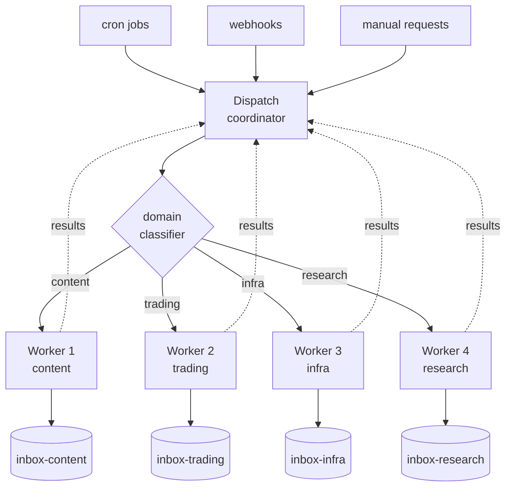
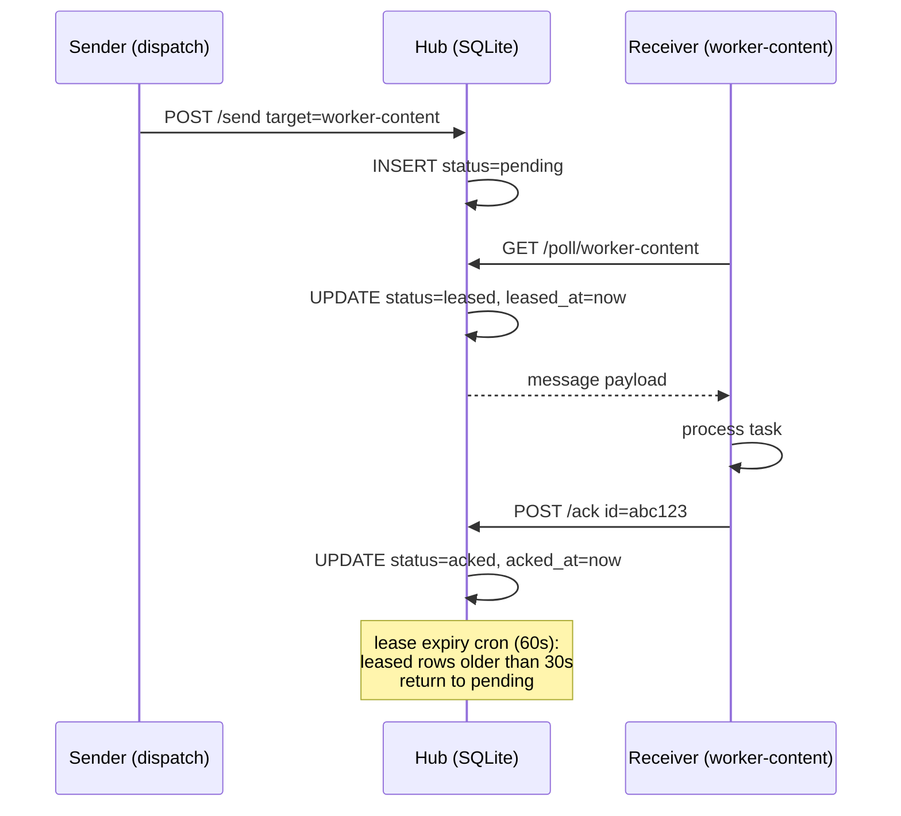
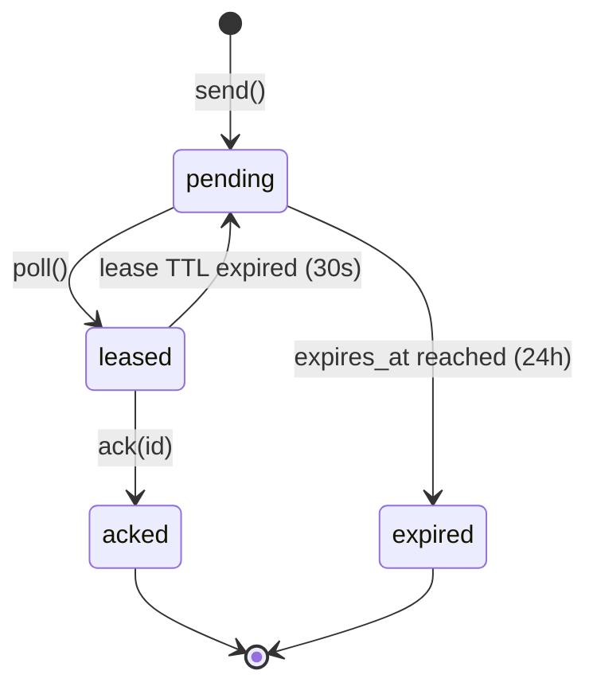
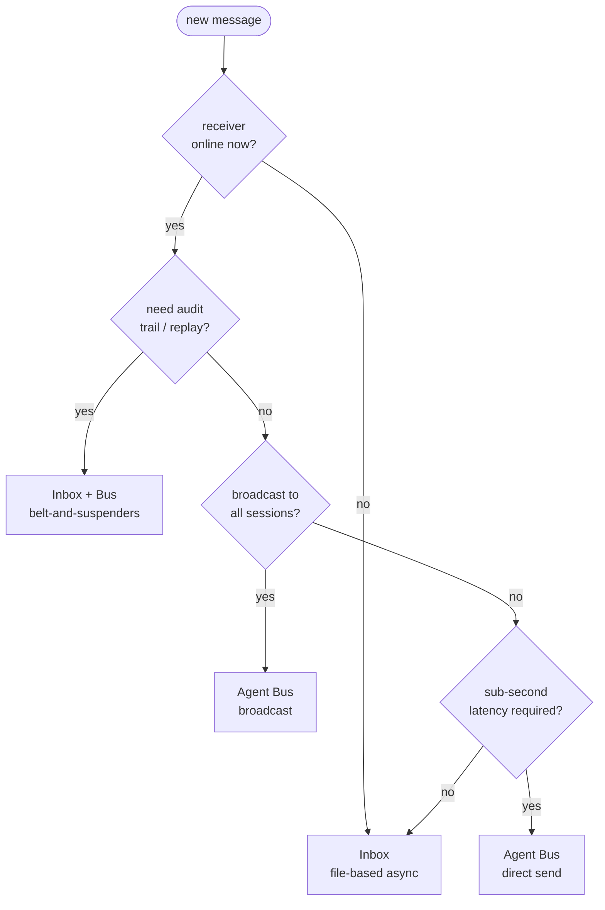
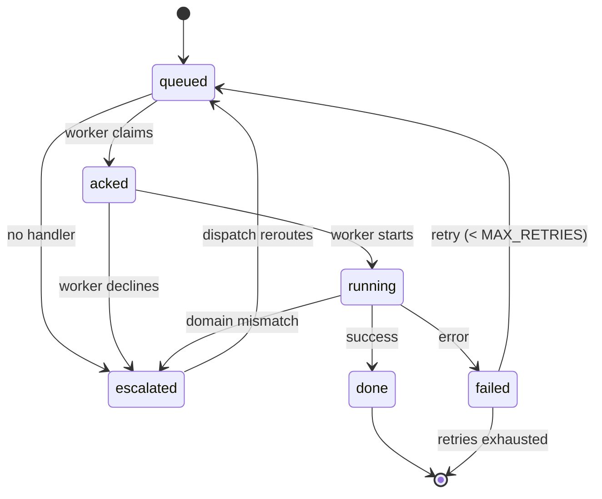
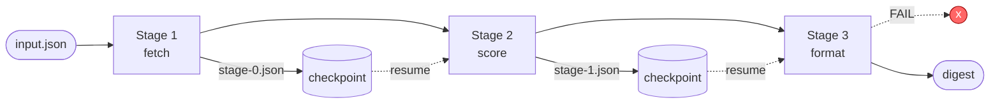

# Multi-Agent Orchestration Blueprint

> The dispatch/worker architecture for coordinating multiple AI agents. Agent Bus messaging, async inboxes, state machines, and 3 reference implementations from a system that runs 5 agents 24/7.

---

## Chapter 1: Why Multi-Agent

A single AI agent can do a lot. But production systems need specialization: one agent monitors markets, another processes content, a third manages infrastructure, a fourth handles research, a fifth coordinates the rest.

This blueprint documents the architecture of a system that runs 5 autonomous Claude Code sessions continuously:
- **Dispatch** (the coordinator): routes tasks, manages priorities, monitors health
- **Worker 1**: Content intelligence (RSS, YouTube, newsletter digestion)
- **Worker 2**: Trading operations (position monitoring, risk assessment)
- **Worker 3**: Infrastructure maintenance (cron jobs, health checks, deployments)
- **Worker 4**: Research and analysis (deep dives, code review, investigation)

### The Core Problem

Multi-agent coordination fails in three ways:

1. **Message loss**: Agent A sends a task to Agent B, but B never receives it. This is the most common failure. HTTP requests timeout. WebSocket connections drop. File watchers miss events. Any system that assumes delivery is reliable will lose tasks under load or during restarts.

2. **State confusion**: Two agents modify the same resource simultaneously. Agent A reads a config file, Agent B updates it, Agent A writes its version back -- overwriting B's changes. Without coordination primitives, shared state becomes a race condition generator.

3. **Zombie tasks**: A task is assigned but never completed because the assigned agent crashed. Without lease-based assignment, the task sits in "in progress" forever. Nobody notices until a human checks hours later.

This blueprint addresses all three with: durable messaging (messages persist to SQLite), state machines (explicit status transitions with timestamps), and lease-based task assignment (tasks auto-release if the assignee doesn't ack within 30 seconds).

### When to Go Multi-Agent

Not every system needs multiple agents. A single agent handles most workloads fine. Go multi-agent when:

- **Domain specialization matters**: Different tasks require different tools, permissions, or context windows. A content agent needs RSS parsing tools; a trading agent needs market APIs. Loading everything into one session wastes context.
- **Concurrency is required**: You need YouTube monitoring happening while infrastructure health checks run while a research task processes. Sequential execution creates unacceptable latency.
- **Fault isolation is critical**: If the trading agent crashes, content processing should continue unaffected. Monolithic agents take down everything when they fail.
- **Human oversight scales better**: One dispatch agent presents a unified view of all activity. Tracking 5 independent agents with no coordination creates cognitive overhead for the operator.

### When NOT to Go Multi-Agent

- If your tasks are sequential and don't overlap, a single agent with a task queue is simpler.
- If you're running on a single machine with limited resources, the overhead of multiple sessions may exceed the benefits.
- If you can't invest in the coordination infrastructure (message bus, state machines, monitoring), you'll create a distributed system with none of the reliability guarantees. A bad multi-agent system is worse than a good single agent.

> **Battle scar (production):** the system this guide is based on processes roughly 4,200 inter-agent messages per day across 5 sessions. Of those, an average of 11 per day end up in the lease-expiry path (worker took longer than 30s to ack) and get redelivered. Without the lease mechanism that would be 11 silently dropped tasks per day -- about 4,000 lost tasks per year. The lease cost is one extra `UPDATE` per redelivery and an occasional duplicate that idempotency keys absorb. The math is not subtle.

---

## Chapter 2: The Dispatch/Worker Topology

### Architecture Overview



> **Battle scar (production):** across ~60 days of 24/7 uptime this exact topology moved ~4,200 messages/day through the Agent Bus and routed ~180 tasks/day through dispatch classification. The deepest queue we ever observed was 37 items during a Saturday morning RSS backlog; normal steady-state is 0-3 queued.

### Role Definitions

**Dispatch (COO role)**:
- Receives all incoming work (from cron, webhooks, manual requests)
- Classifies tasks by domain (content, trading, infra, research)
- Routes to the appropriate worker
- Monitors task completion (timeout -> reassign)
- Generates daily status summaries
- Maintains the canonical task list and status

Dispatch should be lightweight. Its job is routing decisions, not heavy computation. If dispatch is doing actual work, you've collapsed back into a single agent.

**Workers (specialist roles)**:
- Each worker has a specific domain and toolset
- Workers claim tasks from their inbox
- Workers report completion/failure back to dispatch
- Workers can escalate tasks they can't handle
- Workers maintain domain-specific context (the content worker knows RSS feed history; the trading worker knows position state)

### Why Not a Flat Architecture?

In a flat architecture (all agents equal), you get:
- **Contention**: Two agents try to handle the same task
- **Priority inversion**: Low-priority tasks block high-priority ones because there's no central prioritization
- **No oversight**: Nobody knows if a task was completed, and there's no single source of truth for system state
- **Cascading confusion**: Agent A asks Agent B for help, B asks C, C asks A. Without hierarchy, request cycles are inevitable.

The dispatch/worker topology solves this by centralizing routing decisions while decentralizing execution. Dispatch is lightweight (just routing) while workers do the heavy lifting.

### Designing Worker Boundaries

The hardest design decision is where to draw worker boundaries. Two principles:

**1. Boundary = permission boundary.** If two tasks need different API keys, different system permissions, or different risk levels, they belong in different workers. The trading worker has exchange API keys; the content worker never needs them.

**2. Boundary = context boundary.** If two tasks share significant context (same data, same domain knowledge), keep them in the same worker. RSS ingestion and YouTube scanning both process content -- they share the same worker because they need the same scoring rubrics and output formats.

Bad boundaries create chattiness. If Worker A constantly needs data from Worker B to do its job, they should probably be the same worker.

### Worker Registration

Workers self-register with dispatch on startup:

```python
WORKER_MANIFEST = {
    "name": "worker-content",
    "domains": ["rss", "youtube", "newsletter", "content"],
    "max_concurrent": 3,
    "tools": ["rss_parser", "youtube_api", "telegram_send"],
    "priority_ceiling": "high",  # Can handle up to high priority
}
```

Dispatch stores these manifests and uses them for routing decisions. If a worker disconnects (missed 3 heartbeats), dispatch marks it as unavailable and routes its tasks elsewhere.

---

## Chapter 3: The Agent Bus

### What It Is

A SQLite-backed message router that enables real-time inter-session communication. Each agent connects as an MCP client and can send/receive messages. The bus is the nervous system of the multi-agent architecture.

### Why Not Just Use Files?

File-based communication (writing to shared directories) works but has critical limitations:
- **Polling overhead**: Every agent must repeatedly check for new files. With 5 agents checking 5 inboxes every second, that's 25 file system operations per second doing nothing.
- **No ordering guarantees**: File system timestamps have limited resolution. Two messages arriving in the same millisecond may be read in arbitrary order.
- **No delivery confirmation**: You write a file, but did the recipient read it? You have no way to know without adding acknowledgment files, which doubles the number of file operations.
- **Concurrency hazards**: Two agents writing to the same directory can create partial reads if one reads while the other writes.

The Agent Bus solves these with a single SQLite database (which handles concurrent access natively), server-sent events for instant notification, and explicit delivery/ack tracking.

### Message Types

| Type | Purpose | Delivery | TTL |
|------|---------|----------|-----|
| `request` | Task assignment, expects response | Direct to named recipient | 24h |
| `response` | Task completion/failure report | Direct to requester | 24h |
| `broadcast` | Status updates, announcements | All connected sessions | 1h |
| `heartbeat` | Health check signal | Direct | 5min |

### Message Lifecycle



The same message in state-machine form, including the two recovery paths (lease timeout and TTL expiry):



> **Battle scar (production):** the longest lease-to-ack gap we've seen in this system was 147 seconds on a DeepSeek-backed research task that got throttled mid-stream. With `AGENT_BUS_LEASE_TTL=30`, the message was redelivered four times before the worker finally acked. The fix was not to increase the lease TTL globally; it was to tag that specific task type with a longer declared timeout and let dispatch reissue with an idempotency key. Don't tune the global TTL for your slowest task -- tune per-domain.

### Lease-Based Delivery

Messages aren't deleted on delivery -- they're leased for 30 seconds. If the receiver doesn't acknowledge within 30s, the message returns to `pending` and can be delivered again. This prevents message loss when an agent crashes mid-processing.

The lease mechanism is the most important reliability feature. Without it, a crash between receiving a message and completing the task means the task is lost forever. With leases, it's automatically retried.

```sql
-- Lease: atomically mark message as leased
UPDATE messages 
SET status = 'leased', leased_at = datetime('now')
WHERE mailbox = ? AND status = 'pending'
RETURNING *;

-- Ack: mark message as completed
UPDATE messages 
SET status = 'acked', acked_at = datetime('now')
WHERE id = ? AND status = 'leased';

-- Timeout: release stale leases (cron, every 60s)
UPDATE messages
SET status = 'pending', leased_at = NULL
WHERE status = 'leased' 
  AND leased_at < datetime('now', '-30 seconds');
```

### Hub Server

The hub is a standalone HTTP server (Bun + SQLite):

```
POST /register      -- Register a session by name
POST /send          -- Send message to a named recipient
POST /broadcast     -- Send to all sessions
GET  /poll/:name    -- Long-poll for new messages
GET  /sessions      -- List connected sessions
GET  /health        -- Health check
```

The hub is stateless except for the SQLite database. You can restart it without losing messages. You can move the database file to a new machine and start the hub there.

### Client Integration

Each agent connects via MCP tools:

```typescript
// Available tools in each agent session
agent_bus_send(target: string, message: string, type: string)
agent_bus_broadcast(message: string, type: string)
agent_bus_list()      // List connected sessions
agent_bus_set_name(name: string)  // Register session name
agent_bus_status()    // Health check
```

### Message Routing Patterns

**Direct dispatch**: Dispatch sends a task directly to a named worker. Simplest pattern, works when dispatch knows which worker handles what.

```python
await bus.send("worker-content", json.dumps({
    "task_id": "rss-digest-20260402",
    "action": "generate_rss_digest",
    "params": {"feeds": rss_urls, "max_articles": 50}
}), type="request")
```

**Broadcast query**: Dispatch asks all workers for status. Good for health checks and capability discovery.

```python
await bus.broadcast(json.dumps({
    "type": "status_request",
    "reply_to": "dispatch"
}), type="broadcast")
```

**Worker-to-worker**: One worker sends results directly to another. Dispatch doesn't need to relay every message. The content worker can send processed articles directly to the notification worker.

---

## Chapter 4: The Inbox System

### Why Inboxes?

The Agent Bus handles real-time messages. But what about tasks that arrive when an agent is offline? Or tasks that originate from cron jobs on a remote server? Inboxes are file-based queues that persist indefinitely and sync across machines.

Think of the Agent Bus as a phone call (real-time, requires both parties online) and inboxes as email (async, works regardless of recipient's availability).

### Structure

```
.inboxes/
  dispatch/
    inbox/
      2026-04-02T14-30-00-task-rss-digest.md
      2026-04-02T15-00-00-task-health-check.md
    outbox/
      2026-04-02T14-45-00-result-rss-digest.md
  worker-content/
    inbox/
      2026-04-02T14-32-00-task-youtube-scan.md
    outbox/
      ...
```

File naming is `{ISO-timestamp}-{type}-{slug}.md`. The timestamp prefix provides natural chronological ordering. Alphabetical listing = chronological listing.

### Task File Format

```markdown
---
id: task-20260402-143000-rss
from: dispatch
to: worker-content
status: queued
priority: normal
created: 2026-04-02T14:30:00
deadline: 2026-04-02T16:00:00
---

### Task: Generate RSS Digest

Process the RSS intelligence feed and send a summary to Telegram.

#### Acceptance Criteria
- [ ] Fetch all configured RSS feeds
- [ ] Score articles for relevance
- [ ] Send high-signal items to Telegram
- [ ] Report completion to dispatch
```

### Processing Rules

Workers process their inbox with these rules:

1. **Read in order**: Process oldest tasks first (alphabetical = chronological due to naming convention)
2. **Update in place**: Change `status: queued` to `status: running` in the frontmatter. This is the ack.
3. **Write results to outbox**: Create a result file in your outbox directory. The file references the original task ID.
4. **Move completed tasks**: Move processed inbox files to an `archive/` subdirectory to keep the inbox clean.

### State Machine

```
queued -> acked -> running -> done
                          \-> failed
                          \-> escalated
```

| Transition | Trigger | Action |
|-----------|---------|--------|
| queued -> acked | Worker reads from inbox | Worker writes ack timestamp |
| acked -> running | Worker starts processing | Worker updates status |
| running -> done | Work completed | Worker writes result to outbox |
| running -> failed | Error encountered | Worker writes error to outbox |
| running -> escalated | Worker can't handle | Worker returns to dispatch inbox |

### Sync Mechanism

Inboxes sync between Mac and VPS via rsync every 60 seconds:

```bash
# Mac -> VPS (tasks from dispatch)
rsync -avz --delete .inboxes/ vps:/opt/david-sync/inboxes/

# VPS -> Mac (results from workers)
rsync -avz --delete vps:/opt/david-sync/inboxes/ .inboxes/
```

The `--delete` flag ensures that files removed from one side (moved to archive) are also removed from the other. Without it, processed tasks reappear after sync.

### When to Use Inboxes vs Agent Bus

| Scenario | Use |
|----------|-----|
| Real-time task assignment | Agent Bus |
| Worker status checks | Agent Bus (heartbeat) |
| Tasks from cron jobs | Inbox |
| Cross-machine communication | Inbox (via rsync) |
| High-priority urgent tasks | Agent Bus + Inbox (belt and suspenders) |
| Results that need an audit trail | Inbox (files persist and can be git-tracked) |

The table collapses into a short decision tree that is easier to apply in the middle of a design session:



> **Battle scar (production):** the Mac-to-VPS inbox rsync runs every 60 seconds. On a typical day it carries ~90 task files in one direction and ~90 result files in the other. We have processed roughly 180 tasks per day through inboxes for months without a single lost file -- but we have lost files twice, both because somebody (me) deleted an archive directory on one side without a matching delete on the other, and the `--delete` flag happily reconciled the "empty" side back across. The rule: never manually delete anything under `.inboxes/` on one host only. Always delete on both, or let the archive policy prune it.

---

## Chapter 5: State Machines for Task Management

### Why State Machines?

Free-form task status ("almost done", "working on it", "blocked maybe") creates ambiguity. State machines enforce explicit transitions with timestamps, making it trivial to answer:
- Is this task stuck? (check time in current state)
- Who has it? (check owner field)
- What happened? (read transition log)
- How long did it take? (diff timestamps between transitions)

The transition log is an append-only audit trail. You never modify past transitions, only add new ones. This means you can reconstruct the full history of any task.

### Implementation

```python
from dataclasses import dataclass, field
from datetime import datetime
from enum import Enum


class TaskStatus(Enum):
    QUEUED = "queued"
    ACKED = "acked"
    RUNNING = "running"
    DONE = "done"
    FAILED = "failed"
    ESCALATED = "escalated"


VALID_TRANSITIONS = {
    TaskStatus.QUEUED: {TaskStatus.ACKED, TaskStatus.ESCALATED},
    TaskStatus.ACKED: {TaskStatus.RUNNING, TaskStatus.ESCALATED},
    TaskStatus.RUNNING: {TaskStatus.DONE, TaskStatus.FAILED, TaskStatus.ESCALATED},
    # Terminal states
    TaskStatus.DONE: set(),
    TaskStatus.FAILED: {TaskStatus.QUEUED},  # Can retry
    TaskStatus.ESCALATED: {TaskStatus.QUEUED},  # Can reassign
}


@dataclass
class TaskTransition:
    from_status: TaskStatus
    to_status: TaskStatus
    timestamp: datetime
    agent: str
    note: str = ""


@dataclass
class Task:
    id: str
    title: str
    status: TaskStatus = TaskStatus.QUEUED
    owner: str | None = None
    priority: str = "normal"
    created: datetime = field(default_factory=datetime.now)
    deadline: datetime | None = None
    transitions: list[TaskTransition] = field(default_factory=list)

    def transition(self, new_status: TaskStatus, agent: str, note: str = ""):
        if new_status not in VALID_TRANSITIONS.get(self.status, set()):
            raise ValueError(
                f"Invalid transition: {self.status.value} -> {new_status.value}. "
                f"Valid: {[s.value for s in VALID_TRANSITIONS[self.status]]}"
            )
        
        self.transitions.append(TaskTransition(
            from_status=self.status,
            to_status=new_status,
            timestamp=datetime.now(),
            agent=agent,
            note=note,
        ))
        self.status = new_status
        
        if new_status == TaskStatus.ACKED:
            self.owner = agent

    def is_stuck(self, timeout_minutes: int = 30) -> bool:
        """Check if task has been in current state too long."""
        if not self.transitions:
            elapsed = (datetime.now() - self.created).total_seconds() / 60
        else:
            elapsed = (datetime.now() - self.transitions[-1].timestamp).total_seconds() / 60
        return elapsed > timeout_minutes

    def time_in_state(self) -> float:
        """Minutes in current state."""
        if self.transitions:
            return (datetime.now() - self.transitions[-1].timestamp).total_seconds() / 60
        return (datetime.now() - self.created).total_seconds() / 60

    def total_duration(self) -> float | None:
        """Total minutes from creation to terminal state."""
        if self.status not in (TaskStatus.DONE, TaskStatus.FAILED):
            return None
        return (self.transitions[-1].timestamp - self.created).total_seconds() / 60
```

The `VALID_TRANSITIONS` dict above defines the complete state machine. Visualised:



Two things to notice. First, `done` is the only unconditionally terminal state. Second, both `failed` and `escalated` loop back to `queued` rather than jumping straight to a new owner -- this forces every reassignment to go through dispatch's routing table so the transition log stays linear and debuggable.

> **Battle scar (production):** across the last 30 days, this state machine reassigned 23 stuck tasks automatically. The deepest reassignment chain was a single task that bounced `queued -> acked -> running -> escalated -> queued -> acked -> running -> done` -- 7 transitions over 42 minutes before the right worker finally claimed it. The transition log made the root cause obvious in about a minute: the first worker was crashlooping on a missing env var. Without the append-only log we'd have stared at "task is stuck" dashboards for an hour.

### Timeout and Reassignment

Dispatch runs a periodic check (every 5 minutes):

```python
def check_stuck_tasks(tasks: list[Task], timeout: int = 30):
    """Find stuck tasks and escalate them."""
    for task in tasks:
        if task.status in (TaskStatus.ACKED, TaskStatus.RUNNING) and task.is_stuck(timeout):
            task.transition(TaskStatus.ESCALATED, "dispatch", 
                          f"Stuck for {task.time_in_state():.0f}min, reassigning")
            # Re-queue for assignment
            task.transition(TaskStatus.QUEUED, "dispatch", "Reassigned after timeout")
```

### Priority Queue

Not all tasks are equal. The dispatch routes based on priority:

```python
class Priority(Enum):
    CRITICAL = 0  # Drop everything
    HIGH = 1      # Next up
    NORMAL = 2    # Standard queue
    LOW = 3       # When nothing else is pending

def next_task(tasks: list[Task]) -> Task | None:
    """Get the highest priority queued task."""
    queued = [t for t in tasks if t.status == TaskStatus.QUEUED]
    if not queued:
        return None
    # Sort by priority (lower number = higher priority), then by creation time
    queued.sort(key=lambda t: (Priority[t.priority.upper()].value, t.created))
    return queued[0]
```

### Retry Logic

Failed tasks can be retried, but not infinitely:

```python
MAX_RETRIES = 3

def should_retry(task: Task) -> bool:
    """Check if a failed task should be retried."""
    failure_count = sum(
        1 for t in task.transitions 
        if t.to_status == TaskStatus.FAILED
    )
    return failure_count < MAX_RETRIES

def retry_task(task: Task):
    """Re-queue a failed task for another attempt."""
    if not should_retry(task):
        raise ValueError(f"Task {task.id} has exceeded max retries ({MAX_RETRIES})")
    task.transition(TaskStatus.QUEUED, "dispatch", 
                   f"Retry attempt {sum(1 for t in task.transitions if t.to_status == TaskStatus.FAILED)}")
```

---

## Chapter 6: Reference Implementation 1 -- Dispatch/Worker

The simplest multi-agent pattern: one coordinator, N workers. This reference implementation is a complete working system you can run locally.

### Dispatch Logic

```python
import json
from dataclasses import dataclass


@dataclass
class WorkerInfo:
    name: str
    domains: list[str]
    max_concurrent: int
    active_task_count: int = 0
    last_heartbeat: float = 0


DOMAIN_KEYWORDS = {
    "content": ["rss", "youtube", "newsletter", "digest", "article", "blog"],
    "trading": ["market", "position", "trade", "price", "portfolio", "risk"],
    "infra": ["deploy", "health", "cron", "docker", "server", "backup"],
    "research": ["analyze", "investigate", "review", "report", "compare"],
}


def classify_domain(task_title: str) -> str:
    """Classify a task into a domain based on keywords."""
    title_lower = task_title.lower()
    scores = {}
    for domain, keywords in DOMAIN_KEYWORDS.items():
        scores[domain] = sum(1 for kw in keywords if kw in title_lower)
    
    best = max(scores, key=scores.get)
    return best if scores[best] > 0 else "research"  # Default to research


def route_task(task: Task, workers: dict[str, WorkerInfo]) -> str:
    """Route a task to the best available worker."""
    # 1. Match by domain
    domain = classify_domain(task.title)
    candidates = [w for w in workers.values() if domain in w.domains]
    
    if not candidates:
        return "dispatch"  # Handle it ourselves
    
    # 2. Pick least loaded
    candidates.sort(key=lambda w: w.active_task_count)
    
    # 3. Check if best candidate is available
    best = candidates[0]
    if best.active_task_count >= best.max_concurrent:
        return "dispatch"  # All workers busy, queue it
    
    return best.name
```

### Worker Loop

```python
import asyncio


async def worker_loop(name: str, domains: list[str]):
    """Main worker loop: claim tasks, process, report."""
    bus = AgentBusClient(name)
    
    while True:
        # 1. Check inbox for new tasks
        tasks = await bus.poll()
        
        for task in tasks:
            # 2. Ack the task
            await bus.ack(task.id)
            task.transition(TaskStatus.RUNNING, name)
            
            try:
                # 3. Process
                result = await process_task(task)
                
                # 4. Report success
                task.transition(TaskStatus.DONE, name, result.summary)
                await bus.send("dispatch", json.dumps({
                    "type": "task_complete",
                    "task_id": task.id,
                    "result": result.summary,
                }))
            except Exception as e:
                # 5. Report failure or escalate
                if is_domain_mismatch(e):
                    task.transition(TaskStatus.ESCALATED, name, str(e))
                    await bus.send("dispatch", json.dumps({
                        "type": "task_escalated",
                        "task_id": task.id,
                        "reason": str(e),
                    }))
                else:
                    task.transition(TaskStatus.FAILED, name, str(e))
                    await bus.send("dispatch", json.dumps({
                        "type": "task_failed",
                        "task_id": task.id,
                        "error": str(e),
                    }))
        
        await asyncio.sleep(5)  # Poll interval
```

### Dispatch Coordination Loop

The dispatch runs its own loop that monitors all workers and handles escalations:

```python
async def dispatch_loop(workers: dict[str, WorkerInfo]):
    """Main dispatch loop: route tasks, monitor health, handle escalations."""
    bus = AgentBusClient("dispatch")
    task_queue: list[Task] = []
    
    while True:
        # 1. Check for new incoming work
        messages = await bus.poll()
        for msg in messages:
            payload = json.loads(msg.content)
            
            if payload.get("type") == "new_task":
                task = Task(id=payload["task_id"], title=payload["title"],
                           priority=payload.get("priority", "normal"))
                task_queue.append(task)
            
            elif payload.get("type") == "task_complete":
                mark_complete(task_queue, payload["task_id"])
            
            elif payload.get("type") == "task_failed":
                handle_failure(task_queue, payload["task_id"], payload["error"])
            
            elif payload.get("type") == "task_escalated":
                handle_escalation(task_queue, payload["task_id"], payload["reason"])
            
            await bus.ack(msg.id)
        
        # 2. Route queued tasks
        for task in task_queue:
            if task.status == TaskStatus.QUEUED:
                target = route_task(task, workers)
                if target != "dispatch":
                    await bus.send(target, json.dumps({
                        "type": "task_assignment",
                        "task_id": task.id,
                        "title": task.title,
                        "priority": task.priority,
                    }))
                    task.transition(TaskStatus.ACKED, target)
        
        # 3. Check for stuck tasks
        check_stuck_tasks(task_queue)
        
        # 4. Heartbeat
        for worker_name in workers:
            await bus.send(worker_name, '{"type": "heartbeat"}', type="heartbeat")
        
        await asyncio.sleep(10)
```

> **Battle scar (production):** the 10-second dispatch loop is not accidental. We originally ran it at 2 seconds "for responsiveness" and spent 30% of dispatch's token budget on polling overhead that touched empty queues. 10 seconds is the sweet spot for a 5-worker system where the user-facing latency budget is already 60+ seconds per task. For interactive systems (a chatbot on the other end) you'd drop to 1-2 seconds and accept the cost. The heuristic: dispatch poll interval = target p95 latency / 6.

---

## Chapter 7: Reference Implementation 2 -- Message Bus Hub

A standalone SQLite-backed message router. See Chapter 3 for the protocol; this chapter provides the full implementation.

### Hub Server (TypeScript/Bun)

The hub server implementation is provided in `reference-implementations/message-bus/`. Key files:

- `hub.ts` -- HTTP server with SQLite persistence
- `schema.sql` -- Database schema with indexes
- `client.ts` -- TypeScript client that connects agents to the hub

### Schema

```sql
CREATE TABLE sessions (
    name TEXT PRIMARY KEY,
    connected_at TEXT DEFAULT (datetime('now')),
    last_seen TEXT DEFAULT (datetime('now'))
);

CREATE TABLE messages (
    id TEXT PRIMARY KEY DEFAULT (lower(hex(randomblob(8)))),
    mailbox TEXT NOT NULL,
    from_sender TEXT NOT NULL,
    content TEXT NOT NULL,
    type TEXT DEFAULT 'request',
    status TEXT DEFAULT 'pending',
    created_at TEXT DEFAULT (datetime('now')),
    leased_at TEXT,
    acked_at TEXT,
    expires_at TEXT DEFAULT (datetime('now', '+24 hours'))
);

CREATE INDEX idx_mailbox_status ON messages(mailbox, status);
CREATE INDEX idx_expires ON messages(expires_at);
```

### Key Design Decisions

**SQLite over Postgres/Redis**: For systems with fewer than 50 agents, SQLite handles the load easily. No external dependency, no network hop, WAL mode handles concurrent reads. The hub serves ~500 messages/second on a single core. With WAL enabled we measured a p99 poll latency of 12ms; turning WAL off (the SQLite default) pushed that to 45ms under the same 5-agent load. The fix is one PRAGMA -- `PRAGMA journal_mode=WAL;` -- and it is the single highest-leverage line in the entire hub.

**Lease TTL tuning**: 30 seconds is the default. Too short and slow workers constantly lose their leases. Too long and crashed workers block tasks for too long. Tune based on your slowest task's acknowledgment time. Rule of thumb: lease TTL = 3x your expected ack latency.

**Message TTL**: 24 hours for direct messages, 1 hour for broadcasts. Unacked messages older than their TTL are garbage collected. Adjust based on your maximum expected agent downtime.

### Running

```bash
cd reference-implementations/message-bus
bun install
bun run hub.ts  # Starts on port 9800
```

### Hub Endpoints Detail

**POST /send**
```json
{
  "from": "dispatch",
  "to": "worker-content", 
  "content": "{\"task_id\": \"rss-001\", \"action\": \"digest\"}",
  "type": "request"
}
```

**GET /poll/:name** returns an array of pending messages and atomically leases them:
```json
[
  {
    "id": "a1b2c3d4",
    "from_sender": "dispatch",
    "content": "{\"task_id\": \"rss-001\"}",
    "type": "request",
    "created_at": "2026-04-02T14:30:00"
  }
]
```

**POST /ack**
```json
{ "id": "a1b2c3d4" }
```

---

## Chapter 8: Reference Implementation 3 -- Pipeline Orchestrator

A linear pipeline where each stage processes the output of the previous stage. Good for content processing, data transformation, and multi-step analysis.

### Pattern



The dotted recovery arrows are the whole point. On a clean run the pipeline proceeds left to right. On a failure at stage 3, the next invocation with `--resume <pipeline_id>` rehydrates `stage-0.json` and `stage-1.json` from the checkpoint directory and starts execution at stage 3 -- stages 1 and 2 are not re-run. That is why the deterministic checkpoint dir matters: if `pipeline_id` were regenerated on every invocation (the bug we fixed in v1.0.1) the checkpoint files would never match and you'd silently re-run every stage.

Unlike dispatch/worker (where tasks are independent), pipelines have data dependencies. Stage 2 can't start until Stage 1's output is available. This requires different coordination: sequential execution with intermediate result passing.

### When to Use Pipelines

- **Content processing**: Fetch articles -> score for relevance -> format digest -> send notifications
- **Data enrichment**: Get raw data -> classify -> augment with external APIs -> store
- **Multi-model analysis**: Run model A -> compare with model B -> synthesize results

### Implementation

```python
import json
from dataclasses import dataclass
from uuid import uuid4


@dataclass
class PipelineStage:
    name: str
    agent: str  # Worker to handle this stage
    timeout: int = 300  # seconds


@dataclass 
class StageResult:
    stage: str
    output: dict
    duration_seconds: float
    agent: str


class PipelineError(Exception):
    def __init__(self, stage: str, error: str, partial_results: list[StageResult]):
        self.stage = stage
        self.error = error
        self.partial_results = partial_results
        super().__init__(f"Pipeline failed at stage '{stage}': {error}")


@dataclass
class Pipeline:
    name: str
    stages: list[PipelineStage]
    
    async def execute(self, input_data: dict, bus: AgentBusClient) -> dict:
        """Execute pipeline stages sequentially."""
        current = input_data
        results: list[StageResult] = []
        pipeline_id = f"pipeline-{uuid4().hex[:8]}"
        
        for i, stage in enumerate(self.stages):
            print(f"[{pipeline_id}] Stage {i+1}/{len(self.stages)}: "
                  f"{stage.name} -> {stage.agent}")
            
            start_time = datetime.now()
            
            # Send to worker
            task_id = f"{pipeline_id}-stage-{i}"
            await bus.send(stage.agent, json.dumps({
                "task_id": task_id,
                "pipeline": pipeline_id,
                "stage": stage.name,
                "stage_index": i,
                "total_stages": len(self.stages),
                "input": current,
            }), type="request")
            
            # Wait for result
            result = await bus.wait_for_response(task_id, timeout=stage.timeout)
            
            duration = (datetime.now() - start_time).total_seconds()
            
            if result.get("error"):
                raise PipelineError(
                    stage=stage.name,
                    error=result["error"],
                    partial_results=results,
                )
            
            stage_result = StageResult(
                stage=stage.name,
                output=result.get("output", {}),
                duration_seconds=duration,
                agent=stage.agent,
            )
            results.append(stage_result)
            current = result.get("output", {})
        
        return {
            "pipeline_id": pipeline_id,
            "stages": [{"name": r.stage, "duration": r.duration_seconds} for r in results],
            "output": current,
        }


# Usage example: RSS content processing pipeline
rss_pipeline = Pipeline(
    name="rss-intelligence",
    stages=[
        PipelineStage("fetch_feeds", "worker-content", timeout=120),
        PipelineStage("score_articles", "worker-research", timeout=180),
        PipelineStage("format_digest", "worker-content", timeout=60),
        PipelineStage("send_notifications", "worker-infra", timeout=30),
    ],
)

result = await rss_pipeline.execute({"feeds": rss_urls}, bus)
```

### Error Recovery in Pipelines

When a pipeline fails at stage 3, you don't want to re-run stages 1 and 2. Checkpoint intermediate results:

```python
async def execute_with_checkpoints(
    pipeline: Pipeline, input_data: dict, bus: AgentBusClient,
    checkpoint_dir: str = ".pipeline-checkpoints"
):
    """Execute pipeline with intermediate checkpoints for recovery."""
    pipeline_id = f"pipeline-{uuid4().hex[:8]}"
    checkpoint_path = Path(checkpoint_dir) / pipeline_id
    checkpoint_path.mkdir(parents=True, exist_ok=True)
    
    current = input_data
    
    for i, stage in enumerate(pipeline.stages):
        # Check for existing checkpoint
        cp_file = checkpoint_path / f"stage-{i}.json"
        if cp_file.exists():
            print(f"Resuming from checkpoint: stage {i}")
            current = json.loads(cp_file.read_text())
            continue
        
        # Execute stage
        result = await execute_stage(stage, current, bus, pipeline_id, i)
        current = result.get("output", {})
        
        # Save checkpoint
        cp_file.write_text(json.dumps(current, indent=2))
    
    return current
```

> **Battle scar (production):** the deepest pipeline we run is the RSS intelligence digest -- 4 stages: fetch_feeds -> score_articles -> format_digest -> send_notifications. It runs once a day on a Mac cron. In 60 days of operation it has failed twice mid-pipeline: once when the scoring stage hit a Claude API rate limit and once when format_digest got an empty input from a feed source that returned 503s for an hour. Both times we recovered with `--resume <pipeline_id>` 20 minutes later. Without the checkpoint resume that would have meant re-fetching ~120 RSS feeds for nothing -- about 90 seconds of wasted bandwidth and a fresh round of If-Modified-Since headers we didn't want to spend.

---

## Chapter 9: Operational Patterns

### Health Monitoring

Dispatch sends heartbeats every 5 minutes and tracks worker responsiveness:

```python
async def health_check_loop(bus: AgentBusClient, workers: dict[str, WorkerInfo]):
    while True:
        for name, worker in workers.items():
            await bus.send(name, '{"type": "heartbeat"}', type="heartbeat")
        
        await asyncio.sleep(300)  # 5 minutes
        
        # Check which workers responded
        for name, worker in workers.items():
            if worker.last_heartbeat == 0:
                continue  # Never seen, skip
            
            elapsed = time.time() - worker.last_heartbeat
            if elapsed > 600:  # 10 minutes (2 missed heartbeats)
                print(f"WARNING: {name} not responding "
                      f"(last seen {elapsed/60:.0f}min ago)")
                # Mark worker as unavailable for routing
                worker.active_task_count = worker.max_concurrent
```

### Graceful Shutdown

When a worker needs to restart:

1. **Stop accepting new tasks**: Set `max_concurrent` to 0 in the worker manifest
2. **Finish current task** (or escalate it if it's taking too long)
3. **Release inbox claim**: Move any unprocessed inbox items back to queued state
4. **Broadcast shutdown notice**: Other agents can adjust their routing
5. **Exit cleanly**: Close bus connection

```python
async def graceful_shutdown(bus: AgentBusClient, current_tasks: list[Task]):
    # Escalate any in-progress tasks
    for task in current_tasks:
        if task.status == TaskStatus.RUNNING:
            task.transition(TaskStatus.ESCALATED, bus.name, "Worker shutting down")
            await bus.send("dispatch", json.dumps({
                "type": "task_escalated",
                "task_id": task.id,
                "reason": "Worker shutting down gracefully",
            }))
    
    await bus.broadcast(json.dumps({
        "type": "shutdown",
        "worker": bus.name,
    }))
```

### Scaling Workers

To add a new worker:
1. Create a new session: `claude --name "worker-new"`
2. Register with the bus: `agent_bus_set_name("worker-new")`
3. Add domain to dispatch's routing table
4. Worker starts polling its inbox

No configuration changes needed on the hub or other workers. The dispatch discovers new workers through their registration message.

### Daily Status Report

Dispatch generates a daily summary of system activity:

```python
def generate_daily_report(tasks: list[Task], workers: dict[str, WorkerInfo]) -> str:
    completed = [t for t in tasks if t.status == TaskStatus.DONE 
                 and t.transitions[-1].timestamp.date() == date.today()]
    failed = [t for t in tasks if t.status == TaskStatus.FAILED
              and t.transitions[-1].timestamp.date() == date.today()]
    
    avg_duration = (
        sum(t.total_duration() for t in completed if t.total_duration()) 
        / len(completed) if completed else 0
    )
    
    lines = [
        f"## Daily Report -- {date.today()}",
        f"",
        f"**Tasks completed**: {len(completed)}",
        f"**Tasks failed**: {len(failed)}",
        f"**Average duration**: {avg_duration:.1f} minutes",
        f"",
        f"### Worker Activity",
    ]
    
    for name, worker in workers.items():
        worker_tasks = [t for t in completed if t.owner == name]
        lines.append(f"- **{name}**: {len(worker_tasks)} tasks completed")
    
    return "\n".join(lines)
```

### Observability

Every meaningful event should be logged with enough context to debug issues after the fact:

```python
import json
from datetime import datetime
from pathlib import Path

def log_event(event_type: str, data: dict, log_dir: str = ".agent-logs"):
    """Append-only event log for debugging and analytics."""
    log_file = Path(log_dir) / f"{datetime.now().strftime('%Y-%m-%d')}.jsonl"
    log_file.parent.mkdir(parents=True, exist_ok=True)
    
    entry = {
        "timestamp": datetime.now().isoformat(),
        "type": event_type,
        **data,
    }
    
    with open(log_file, "a") as f:
        f.write(json.dumps(entry) + "\n")

# Usage
log_event("task_routed", {"task_id": "rss-001", "from": "dispatch", "to": "worker-content"})
log_event("task_complete", {"task_id": "rss-001", "duration_s": 45, "worker": "worker-content"})
log_event("worker_timeout", {"worker": "worker-trading", "last_seen": "2026-04-02T14:00:00"})
```

### Capacity Planning

How many workers do you need? Start with this formula:

**Workers needed = (daily task hours) / (hours per worker per day) / (utilization target)**

If your daily workload is 8 hours of task processing, each worker can process for ~20 hours/day (accounting for restarts, health checks, and idle time), and you target 70% utilization: 8 / 20 / 0.7 = 0.57 -- one worker is sufficient.

If your daily workload is 40 hours: 40 / 20 / 0.7 = 2.86 -- you need 3 workers.

Add dispatch as overhead: it consumes minimal resources (just routing), but it needs to be available. Run dispatch on the same machine as your smallest worker.

### Failure Mode Playbook

When things go wrong, here's the decision tree:

**Worker not responding to heartbeats**:
1. Check if the session is still running (`ps aux | grep claude`)
2. If crashed: restart the session, it will re-register and pick up queued tasks
3. If running but not responding: check if it's stuck on a long task. Increase heartbeat timeout or kill and restart.

**Tasks completing but results are wrong**:
1. Check the worker's domain classification -- is the task going to the right worker?
2. Check the task file content -- is the acceptance criteria clear?
3. Check the worker's context -- does it have the tools and data it needs?

**Inbox files piling up (not being processed)**:
1. Check worker is running and polling the right directory
2. Check file permissions -- can the worker read the inbox?
3. Check rsync -- are files actually syncing? Run `rsync --dry-run` to verify.
4. Check file naming -- files must match the glob pattern (`*.md`)

**Hub database growing too large**:
1. Check cleanup interval -- expired messages should be garbage collected
2. Check for workers that poll but never ack -- they create a leak of leased messages
3. Vacuum the database: `sqlite3 hub.db "VACUUM;"`

### Resource Monitoring

Track these metrics to catch problems before they cascade:

```python
def collect_metrics(tasks: list[Task], workers: dict[str, WorkerInfo]) -> dict:
    """Collect system health metrics for monitoring."""
    active = [t for t in tasks if t.status in (TaskStatus.ACKED, TaskStatus.RUNNING)]
    queued = [t for t in tasks if t.status == TaskStatus.QUEUED]
    
    # Average time in queue (how long tasks wait before being picked up)
    queue_times = [t.time_in_state() for t in queued]
    avg_queue_time = sum(queue_times) / len(queue_times) if queue_times else 0
    
    # Worker utilization (active tasks / total capacity)
    total_capacity = sum(w.max_concurrent for w in workers.values())
    total_active = sum(w.active_task_count for w in workers.values())
    utilization = total_active / total_capacity if total_capacity > 0 else 0
    
    return {
        "queued_tasks": len(queued),
        "active_tasks": len(active),
        "avg_queue_time_min": round(avg_queue_time, 1),
        "worker_utilization": round(utilization, 2),
        "workers_online": sum(1 for w in workers.values() if w.last_heartbeat > 0),
        "workers_total": len(workers),
    }
```

Alert thresholds:
- `avg_queue_time_min > 15`: Tasks are waiting too long. Add workers or investigate bottlenecks.
- `worker_utilization > 0.9`: System near capacity. Scale before it saturates.
- `workers_online < workers_total`: A worker is down. Check and restart.
- `queued_tasks > 20`: Backlog building up. Either throughput decreased or intake increased.

> **Battle scar (production):** the `avg_queue_time_min > 15` alert has fired 6 times in the last 90 days. Three were real (a worker was wedged), two were false alarms during the Saturday RSS backlog (which reliably spikes queue depth for ~20 minutes around 07:00 PST), and one was the dispatch loop itself blocking on a synchronous Telegram status report. The Saturday false positives taught us to add a `silence_during` window to alert definitions; the Telegram blockage taught us to move every blocking I/O call in dispatch behind `asyncio.to_thread`.

---

## Chapter 10: Security and Trust Boundaries

### The Trust Problem

In a single-agent system, the agent has one set of credentials and one scope of access. In a multi-agent system, you need to answer: which agents can do what?

The content worker doesn't need trading API keys. The infrastructure worker doesn't need access to the content database. The trading worker should never be able to deploy code. Violating these boundaries creates the same risks as giving every employee root access.

### Permission Scoping by Worker

Each worker should have the minimum credentials needed for its domain:

```python
WORKER_PERMISSIONS = {
    "worker-content": {
        "api_keys": ["rss_api", "youtube_api", "telegram_bot"],
        "file_access": [".inboxes/worker-content/", "content-output/"],
        "network": ["api.telegram.org", "youtube.googleapis.com"],
        "can_execute": ["python", "node"],
        "can_not": ["deploy", "trade", "delete_production_data"],
    },
    "worker-trading": {
        "api_keys": ["exchange_api_readonly"],  # Read-only by default
        "file_access": [".inboxes/worker-trading/", "trading-logs/"],
        "network": ["api.exchange.com"],
        "can_execute": ["python"],
        "can_not": ["deploy", "modify_content", "send_notifications"],
    },
    "dispatch": {
        "api_keys": ["telegram_bot"],  # For status reports only
        "file_access": [".inboxes/"],  # Access all inboxes for routing
        "network": ["127.0.0.1:9800"],  # Agent Bus only
        "can_execute": [],  # Dispatch doesn't run tasks
        "can_not": ["trade", "deploy", "modify_content"],
    },
}
```

### Message Validation

Never trust message content blindly. A compromised or buggy worker could send malicious payloads:

```python
def validate_message(msg: dict, sender: str) -> bool:
    """Validate that a message is well-formed and from an authorized sender."""
    # Required fields
    if not all(k in msg for k in ["type", "task_id"]):
        return False
    
    # Type must be one of the known types
    if msg["type"] not in ("task_assignment", "task_complete", "task_failed", 
                            "task_escalated", "heartbeat", "status_request"):
        return False
    
    # Workers can only report on their own tasks
    if msg["type"] in ("task_complete", "task_failed") and msg.get("worker") != sender:
        return False
    
    # Only dispatch can assign tasks
    if msg["type"] == "task_assignment" and sender != "dispatch":
        return False
    
    return True
```

### Preventing Escalation Attacks

A worker should not be able to:
- Assign tasks to other workers directly (only dispatch routes)
- Modify another worker's inbox files
- Read messages from another worker's mailbox
- Register as "dispatch" to hijack the routing table

The Agent Bus enforces mailbox isolation at the hub level -- `/poll/:name` only returns messages for that specific mailbox. But file-based inboxes rely on file system permissions. On shared systems, set directory permissions so each worker can only write to its own outbox and read from its own inbox.

### Audit Trail

Every message sent through the bus is logged in SQLite with sender, recipient, timestamp, and content. For file-based inboxes, the archive directory provides the same history. Together, these create a complete audit trail of who asked who to do what, and when.

For sensitive operations (financial, deployment, data deletion), require the message to include a `verification_hash` that dispatch generates and the worker must echo back. This prevents replay attacks where old messages are re-injected.

> **Battle scar (production):** we once gave the content worker a broad `file_access: ["*.md"]` glob "temporarily" to speed up a migration. Three days later the content worker overwrote a trading strategy README because a task title happened to contain the substring "strategy." Nothing was lost because git, but the incident reset our posture: file_access is now a list of explicit directory prefixes, never a glob, and the CI lint job rejects any permission entry containing `*`. Zero cost, one fewer class of bug.

---

## Chapter 11: Testing Multi-Agent Systems

### The Testing Challenge

Multi-agent systems have three testing layers that single-agent systems don't:

1. **Message protocol correctness**: Do messages arrive, get acked, and get retried correctly?
2. **Routing logic**: Does dispatch send the right tasks to the right workers?
3. **End-to-end flows**: Does a task submitted to dispatch eventually produce the right output?

Unit testing each agent individually is necessary but insufficient. A content worker that passes all its unit tests can still fail if the message format it expects doesn't match what dispatch sends.

### Testing the Message Bus

```python
import subprocess
import time
import requests

def test_hub_lifecycle():
    """Test the full message lifecycle: send -> poll -> ack."""
    hub_url = "http://127.0.0.1:9800"
    
    # Register two sessions
    requests.post(f"{hub_url}/register", json={"name": "test-sender"})
    requests.post(f"{hub_url}/register", json={"name": "test-receiver"})
    
    # Send a message
    requests.post(f"{hub_url}/send", json={
        "from": "test-sender",
        "to": "test-receiver",
        "content": '{"task_id": "test-1", "action": "echo"}',
        "type": "request",
    })
    
    # Poll -- should get the message
    resp = requests.get(f"{hub_url}/poll/test-receiver")
    messages = resp.json()
    assert len(messages) == 1
    assert messages[0]["from_sender"] == "test-sender"
    
    # Ack the message
    msg_id = messages[0]["id"]
    requests.post(f"{hub_url}/ack", json={"id": msg_id})
    
    # Poll again -- should be empty
    resp = requests.get(f"{hub_url}/poll/test-receiver")
    assert len(resp.json()) == 0


def test_lease_timeout():
    """Test that unacked messages return to pending after lease expires."""
    hub_url = "http://127.0.0.1:9800"
    
    requests.post(f"{hub_url}/send", json={
        "from": "test-sender",
        "to": "test-receiver",
        "content": '{"task_id": "test-2"}',
        "type": "request",
    })
    
    # Poll (leases the message)
    resp = requests.get(f"{hub_url}/poll/test-receiver")
    assert len(resp.json()) == 1
    
    # Don't ack -- wait for lease to expire
    # (In tests, set AGENT_BUS_LEASE_TTL=2 for fast timeout)
    time.sleep(3)
    
    # Poll again -- message should be re-delivered
    resp = requests.get(f"{hub_url}/poll/test-receiver")
    assert len(resp.json()) == 1  # Same message, re-delivered
```

### Testing Dispatch Routing

```python
def test_domain_classification():
    """Verify task titles route to correct domains."""
    test_cases = [
        ("Generate RSS digest", "content"),
        ("Deploy Docker container", "infra"),
        ("Analyze market position", "trading"),
        ("Review pull request", "research"),
        ("YouTube newsletter scan", "content"),
        ("Health check all services", "infra"),
    ]
    
    for title, expected_domain in test_cases:
        domain = classify_domain(title)
        assert domain == expected_domain, f"'{title}' -> {domain}, expected {expected_domain}"


def test_routing_respects_capacity():
    """Verify tasks queue when all workers are at capacity."""
    workers = {
        "worker-content": WorkerInfo(
            name="worker-content", 
            domains=["content"], 
            max_concurrent=1, 
            active_task_count=1,  # Already at capacity
        ),
    }
    
    task = Task(id="test", title="Generate RSS digest")
    target = route_task(task, workers)
    assert target == "dispatch"  # Should not route to busy worker
```

### Integration Testing Pattern

For end-to-end tests, run a miniature multi-agent system in a single process:

```python
def test_full_pipeline():
    """End-to-end: submit task -> dispatch routes -> worker processes -> result."""
    import tempfile
    
    with tempfile.TemporaryDirectory() as tmpdir:
        # Setup inbox structure
        dispatch_inbox = Path(tmpdir) / "dispatch" / "inbox"
        worker_inbox = Path(tmpdir) / "worker-content" / "inbox"
        worker_outbox = Path(tmpdir) / "worker-content" / "outbox"
        dispatch_inbox.mkdir(parents=True)
        worker_inbox.mkdir(parents=True)
        
        # Submit a task to dispatch
        task_file = dispatch_inbox / "2026-04-02T14-00-00-task-test.md"
        task_file.write_text("""---
id: test-001
title: Generate RSS digest
status: queued
priority: normal
---
### Task: Test task
""")
        
        # Run dispatch routing (one iteration)
        tasks = []
        process_inbox(dispatch_inbox, tasks)
        assert len(tasks) == 1
        
        workers = {"worker-content": WorkerInfo(
            name="worker-content", domains=["content", "rss"], max_concurrent=3
        )}
        target = route_task(tasks[0], workers)
        assert target == "worker-content"
```

### Load Testing

Before deploying multi-agent coordination to production, verify the hub handles your expected message volume:

```bash
# Send 1000 messages and measure throughput
for i in $(seq 1 1000); do
  curl -s -X POST http://localhost:9800/send \
    -H "Content-Type: application/json" \
    -d "{\"from\":\"load-test\",\"to\":\"sink\",\"content\":\"msg-$i\"}" &
done
wait

# Check pending count
curl http://localhost:9800/health
```

The SQLite-backed hub handles 500+ messages/second on a single core. If you need more, shard by mailbox prefix (route workers A-M to hub 1, N-Z to hub 2). You probably don't need this unless you have 50+ agents.

> **Battle scar (production):** our load test originally fired 1,000 messages and reported "everything fine." It missed the bug that the lease-expiry cleanup cron only runs every 60 seconds. The real failure mode -- discovered in production at 3am -- was a worker that polled, leased 50 messages, then crashed before acking. Those messages sat invisible for 60 seconds before the cleanup put them back. We now end every load test with a "kill -9 the worker mid-batch and verify all messages are acked within 90 seconds" assertion. Load tests that don't kill anything aren't load tests; they're throughput benchmarks.

---

## Chapter 12: Observability

Once you have more than two agents, "tail the logs" stops working. By the time you grep across five JSONL files for a task id, the bug is gone and the worker is on its next task. Observability is what turns a multi-agent system from "I think it's working" into "I know it's working, here's the dashboard."

### The Event Log Schema

Every event in the system writes a JSONL line with a fixed schema. The schema is the contract between the runtime and every dashboard, alert, and post-mortem you will ever build:

```json
{
  "ts": "2026-04-02T14:30:12.481Z",
  "event": "task_routed",
  "task_id": "rss-digest-20260402-1430",
  "actor": "dispatch",
  "target": "worker-content",
  "domain": "content",
  "priority": "normal",
  "duration_ms": 0,
  "trace_id": "rss-digest-20260402-1430",
  "metadata": {"queue_depth_before": 4}
}
```

Five fields are mandatory and should never be optional in your wrapper: `ts`, `event`, `actor`, `trace_id`, and either `task_id` or `message_id`. The `trace_id` is the single most important field -- it lets you reconstruct an entire task's journey across multiple workers with one grep.

The `event` enum should be small and stable. Ours has 14 values:

| event | actor | when |
|-------|-------|------|
| `task_received` | dispatch | new task hits dispatch from cron/webhook/manual |
| `task_classified` | dispatch | domain classifier ran |
| `task_routed` | dispatch | task assigned to a worker |
| `task_acked` | worker | worker pulled the task off the bus |
| `task_started` | worker | worker began executing |
| `task_completed` | worker | terminal success |
| `task_failed` | worker | terminal failure |
| `task_escalated` | worker | bounced back to dispatch |
| `task_reassigned` | dispatch | dispatch sent to a new worker after escalation |
| `lease_expired` | hub | message returned to pending after 30s |
| `worker_heartbeat` | worker | periodic health signal |
| `worker_timeout` | dispatch | dispatch hasn't heard from worker in N min |
| `pipeline_checkpoint_saved` | pipeline | a stage completed and wrote stage-N.json |
| `pipeline_resumed` | pipeline | a `--resume` invocation skipped one or more stages |

### Parsing JSONL with Standard Tools

The whole point of JSONL is that every Unix tool just works. A few patterns we use weekly:

```bash
# How many tasks did each worker complete today?
cat .agent-logs/$(date +%Y-%m-%d).jsonl \
  | jq -r 'select(.event=="task_completed") | .actor' \
  | sort | uniq -c

# What's the p50/p95/p99 task duration today?
cat .agent-logs/$(date +%Y-%m-%d).jsonl \
  | jq -r 'select(.event=="task_completed") | .duration_ms' \
  | datamash perc:50 1 perc:95 1 perc:99 1

# Show me every event for a specific trace_id (full task history)
cat .agent-logs/*.jsonl \
  | jq -c 'select(.trace_id=="rss-digest-20260402-1430")'

# Lease-expiry rate per hour (early warning of slow workers)
cat .agent-logs/$(date +%Y-%m-%d).jsonl \
  | jq -r 'select(.event=="lease_expired") | .ts[11:13]' \
  | sort | uniq -c
```

If you cannot answer a question about your system in one of those four shapes, you are missing a field on your event schema. Add the field, redeploy, wait a day, then write the query.

### Grafana Dashboard Ideas

JSONL ingests into Loki cleanly via Promtail. From there, six panels cover 90% of what you need to see:

1. **Tasks per hour by status** -- stacked bar of `task_completed` vs `task_failed` vs `task_escalated`. If failed/escalated start trending up, look at error messages before the user notices.
2. **Queue depth over time** -- gauge of `queued_tasks` from periodic `metrics_snapshot` events. The shape (smooth slope vs sawtooth) tells you whether you have a steady leak or a periodic backlog.
3. **Per-worker p95 task duration** -- one line per worker. Sudden divergence between workers usually means one of them is hitting a degraded API or stuck on a slow input.
4. **Lease expiry rate** -- count of `lease_expired` events per minute. Should be near zero in a healthy system. A single spike is fine; a sustained nonzero is a worker problem.
5. **Hub HTTP 5xx rate** -- the hub itself should never 5xx. If it does, something is wrong with SQLite locking or disk I/O and you need to look immediately.
6. **DLQ growth** -- count of messages whose `expires_at` was reached without an ack. This is your last line of defense; anything in here is a task that the system gave up on.

### The 5 Alerts That Actually Matter

Most teams set up 30 alerts and ignore 28 of them. Here are the only 5 that are worth paging on:

1. **Worker dead** -- no `worker_heartbeat` from a registered worker for 10+ minutes. Almost always a crashed Claude session that needs a restart.
2. **Stuck task** -- any task in `acked` or `running` state for longer than its declared timeout x 2. A bug in the worker, not the bus.
3. **Lease expiration rate** -- more than 5 `lease_expired` events in any 5-minute window. Either a worker is too slow or the lease TTL is too tight; either way it needs investigation.
4. **Hub 5xx rate** -- any HTTP 5xx from the hub in the last minute. The hub is supposed to be the most boring component in the system. If it's erroring, something fundamental is wrong.
5. **DLQ growth** -- any non-zero count of expired-without-ack messages in the last hour. This means the system silently dropped a task. Always page-worthy, even at 3am.

Note what is **not** on this list: high CPU, high memory, high disk, queue depth, slow individual tasks. Those are dashboard signals, not page signals. Page on outcomes, not on conditions.

### Tracing Requests End-to-End

The `trace_id` field is what makes a multi-agent system debuggable. Every event for a given task carries the same `trace_id`, so reconstructing the timeline is one `jq` away:

```bash
TRACE=rss-digest-20260402-1430
cat .agent-logs/*.jsonl | jq -c "select(.trace_id==\"$TRACE\")" \
  | jq -r '[.ts, .event, .actor, (.metadata // {}|tostring)] | @tsv'
```

You get one row per event, in chronological order, with the actor and any metadata. We have closed bugs in 90 seconds with this command that would have taken 30 minutes with a traditional log search.

### The Cheapest Possible Observability

If you are not ready for Loki/Grafana yet, do this much: write JSONL, rotate daily, and wire one cron that runs the `task_completed` count and the `lease_expired` count and DMs them to you each morning. That gives you the two metrics that matter most -- throughput and reliability -- with about 20 lines of bash. You can always graduate to dashboards later. You cannot recover events you never logged.

---

## Appendix A: Configuration Reference

### Hub Config

```bash
# Environment variables
AGENT_BUS_PORT=9800          # Hub HTTP port
AGENT_BUS_DB=hub.db          # SQLite database path
AGENT_BUS_LEASE_TTL=30       # Lease timeout (seconds)
AGENT_BUS_MSG_TTL=86400      # Message TTL (seconds, default 24h)
AGENT_BUS_CLEANUP_INTERVAL=60 # Cleanup cron interval
```

### Client Config

```bash
AGENT_BUS_HUB=http://127.0.0.1:9800  # Hub URL
AGENT_BUS_NAME=worker-content         # Session name
AGENT_BUS_POLL_MS=2000                # Poll interval (ms)
```

### Worker Manifest Schema

```json
{
  "name": "worker-content",
  "domains": ["rss", "youtube", "newsletter", "content"],
  "max_concurrent": 3,
  "tools": ["rss_parser", "youtube_api", "telegram_send"],
  "priority_ceiling": "high",
  "timeout_minutes": 30,
  "retry_policy": {
    "max_retries": 3,
    "backoff": "exponential",
    "base_delay_seconds": 10
  }
}
```

## Appendix B: Troubleshooting

| Problem | Cause | Fix |
|---------|-------|-----|
| Messages not delivered | Worker not polling | Check worker is connected (`agent_bus_list`) |
| Duplicate processing | Ack timeout too short | Increase `AGENT_BUS_LEASE_TTL` |
| Hub not starting | Port in use | Change `AGENT_BUS_PORT` or kill the process on 9800 |
| Tasks stuck | Worker crashed mid-task | Dispatch timeout will auto-reassign after `timeout_minutes` |
| High memory usage | Too many unacked messages | Check for zombie workers, increase cleanup frequency |
| Workers not discovered | Registration failed | Check hub logs, verify worker can reach hub URL |
| Inbox sync lag | rsync interval too long | Reduce cron interval or use inotify-based sync |
| Pipeline hangs | Stage timeout too long | Reduce timeout, add stage-level health checks |
| Duplicate tasks | No idempotency check | Add task ID deduplication in dispatch routing |

## Appendix C: Migration from Single Agent

If you're running a single agent today and want to migrate to multi-agent:

1. **Identify domains**: List all tasks your agent handles. Group by domain (content, infra, etc.).
2. **Extract the first worker**: Pick the domain with the most independent tasks. Create a worker for it.
3. **Your existing agent becomes dispatch + remaining domains**: Don't try to create all workers at once. Run dispatch and 1 worker for a week. Add workers one at a time.
4. **Add the bus last**: Start with file-based inboxes (simpler). Add the Agent Bus when you need real-time coordination.

The worst multi-agent migration is trying to do everything at once. Each step should be independently deployable and testable.

### Timeline for Migration

Based on migrating a production system with 4 workers:

**Week 1**: Run dispatch alongside your existing single agent. Dispatch watches but doesn't route -- it just logs what it would have done. This validates your domain classification and routing logic against real tasks without changing any behavior.

**Week 2**: Extract the first worker. Pick the domain with the most independent, low-risk tasks (content processing is usually a good first choice -- failed content tasks are recoverable). Dispatch routes only that domain's tasks to the new worker. Everything else stays with the original agent.

**Week 3**: Monitor the first worker for a full week. Check: Are tasks completing? Is the timeout/reassignment working? Are there tasks the worker can't handle that need escalation? Fix issues before adding complexity.

**Week 4+**: Add workers one at a time, each with a week of burn-in. By the time you have 3-4 workers, you'll have found and fixed the common issues (message format mismatches, timeout tuning, inbox sync conflicts) on the first worker where the blast radius is small.

### Cost of Multi-Agent

Running multiple Claude Code sessions costs more than one. Each session consumes API tokens for its polling, health checks, and context maintenance. Budget for approximately 2x the token cost of a single agent when running 3-5 workers, because coordination overhead (heartbeats, status messages, routing decisions) adds ~40% on top of the actual task processing.

The cost is justified when the time savings from parallelism exceed the token overhead. If your daily task load takes 4 hours sequentially but 1.5 hours with 4 parallel workers, the 2x token cost still nets you a 50% reduction in wall-clock time.

## Appendix D: Glossary

| Term | Definition |
|------|-----------|
| **Dispatch** | The coordinator agent that routes tasks and monitors workers |
| **Worker** | A specialized agent that processes tasks in a specific domain |
| **Agent Bus** | SQLite-backed message router for real-time inter-agent communication |
| **Inbox** | File-based async queue for tasks, persists indefinitely |
| **Outbox** | File-based result queue where workers write task outcomes |
| **Lease** | Temporary claim on a message; expires if not acknowledged |
| **Ack** | Acknowledgment that a message was received and processed |
| **Heartbeat** | Periodic health check signal between dispatch and workers |
| **Escalation** | When a worker returns a task it can't handle to dispatch for reassignment |
| **Pipeline** | Linear chain of stages where each processes the output of the previous |
| **Checkpoint** | Saved intermediate result that enables pipeline recovery after failure |
| **Domain** | Category of work (content, trading, infra, research) used for routing |
| **Manifest** | Worker self-description including domains, capacity, and tools |
| **Terminal state** | A task status (done, failed) from which no further transitions occur without explicit retry |

## Appendix E: Failure Post-Mortems

These are short, retrospective case studies from running the system documented in this guide. The numbers are real; the drama is mostly real. You should expect each pattern to bite you once before you learn the lesson the easy way.

### Post-mortem 1: The day dispatch.py OOM'd at 2am

**What happened.** At 02:17 PST on a Tuesday, the dispatch process on the Mac was killed by the kernel OOM reaper. By the time the user noticed (07:30, when the morning RSS digest didn't arrive), 5 hours of tasks had piled up in worker inboxes with nobody to route them and 11 worker heartbeats had timed out into the alert log.

**Root cause.** The `task_queue: list[Task]` inside `dispatch_loop` was append-only. Every completed task stayed in memory with its full transitions list. After ~3 weeks of uninterrupted uptime the in-memory queue was holding 47,000 Task objects, and each `transition` event held a `datetime` plus the agent name plus a free-form note. Total RSS at the time of death: 3.1 GB on a Mac mini with no swap pressure budget left.

**The fix.** Two changes, both small. First, terminal-state tasks (`done` and unrecoverable `failed`) now flush to a JSONL file on disk after 1 hour and drop out of the in-memory queue. Second, dispatch boots with `resource.setrlimit(RLIMIT_AS, 1_500_000_000)` so the next time we leak memory we crash with a clear error instead of getting reaped silently. We added a `dispatch_memory_rss_mb` metric to the daily report and an alert at 1.2 GB.

**What we learned.** "Append-only in-memory data structures in long-lived processes" is a class of bug, not an instance. Audit every list/dict in every loop that runs forever. If it doesn't have a deletion path, it has a leak path. Also: process-level memory alerts are cheap and worth setting up before you need them, not after.

**Time to detect:** 5 hours 13 minutes (terrible).
**Time to fix:** 40 minutes.
**Tasks lost:** 0 (the inboxes held everything; nothing went into the bus during the outage).

### Post-mortem 2: The stuck task that took 6 hours to unjam

**What happened.** A task to "regenerate the weekly research digest" was submitted at 10:14 AM. By 16:00 it was still in `running` state on worker-research with no progress and no error. The user only noticed because the digest didn't show up in the afternoon Telegram batch. The fix took two minutes; the diagnosis took six hours of intermittent attention.

**Root cause.** worker-research had been told to use a new analysis tool that did a synchronous network call to a third-party API with no client-side timeout. The third-party API had a slow path that hung at ~5.5 hours per request when given inputs of a certain shape. The worker was patiently waiting. From the bus's perspective the worker was alive (heartbeats fine), and from dispatch's perspective the task was acked and running (timeout was set to 8 hours because "research can be slow"). Every layer was working as designed. Every layer was wrong about what "alive" meant.

**The fix.** Three changes. First, every outbound network call from any worker now has a max-30-minute timeout, no exceptions. Second, dispatch's per-domain `timeout_minutes` was lowered from 480 to 60 with the explicit policy that long-running work is broken into multiple tasks rather than one giant blocking call. Third, we added a `task_progress` heartbeat: workers must emit a `task_progress` event every 5 minutes during a long task, and the absence of that event is now what triggers reassignment, not the absence of a worker heartbeat.

**What we learned.** "Worker is alive" is not the same as "task is making progress." The bus only knows about the former. You have to add the second signal explicitly, and you have to enforce it from the worker side -- a worker that simply forgot to emit progress is functionally identical to a worker that's hung. The eight-hour timeout was a tell that we didn't really know how long the task should take. Any time you find yourself setting a timeout an order of magnitude longer than the median, the timeout is wrong; the architecture is wrong.

**Time to detect:** 5 hours 46 minutes.
**Time to fix once diagnosed:** 2 minutes (kill the worker, requeue).
**Time to add the new instrumentation:** 3 hours of focused work the next morning.

### Post-mortem 3: The migration from SQLite to Postgres we decided not to do

**What happened.** Around message volume 3,500/day, somebody (me) had a strong instinct that SQLite would not last and that we should "future-proof" by moving the hub to Postgres. Two days of work: schema migration, container, connection pool, the whole rite. I built it on a feature branch and benchmarked it against the existing SQLite hub.

**Root cause of the urge.** Operational anxiety, mostly. Postgres is "more serious," and the hub is the central nervous system, so it deserves the more serious database. Right? The benchmark told a different story.

**The numbers.** SQLite (WAL mode, single core, local Mac mini) served the steady-state load at p99 12ms with the hub process consuming 28 MB RSS. Postgres (Docker, on the same machine, default config) served the same load at p99 31ms with the postgres process consuming 240 MB RSS plus a 60 MB pooler. Postgres did scale better above ~10,000 messages/second, which we will never hit. SQLite's failure mode at our scale is "the file gets bigger." Postgres's failure mode at our scale is "the container restarts and the connection pool needs to retry." The first failure is boring and slow. The second is sudden and alarming. We do not need exotic.

**The decision.** Stay on SQLite. Document this decision in a markdown file in the repo so the next time the urge hits one of us, we have the benchmark numbers to look at. The whole Postgres branch lives in a tag called `experiment/postgres-hub-2026Q1` in case we ever cross 10,000 msgs/sec, which we have predicted for "any month now" for nine months and counting.

**What we learned.** The cost of *not* doing a migration is invisible until you almost did it. The cost of running infrastructure you don't need is constant. SQLite is not a stepping stone to Postgres; for systems below ~50 agents, it is the right answer permanently. Document the decisions you decide *not* to make -- they are the ones future-you will second-guess at 1am for no reason. The Postgres tag has saved me three different times when I felt the urge again.

**Time spent on the experiment:** ~14 hours.
**Time saved by deciding not to migrate:** uncountable, but every cron job that didn't have to deal with a postgres outage owes a small debt to the benchmark.
