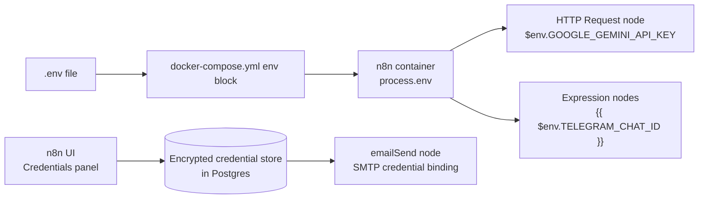
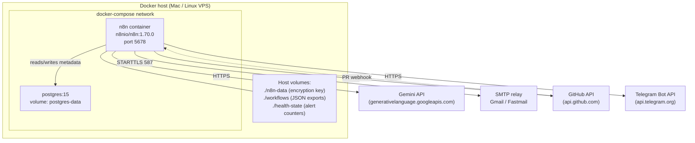
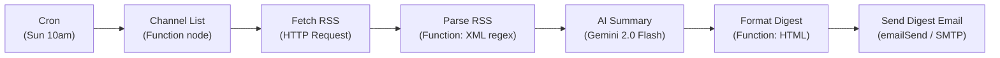
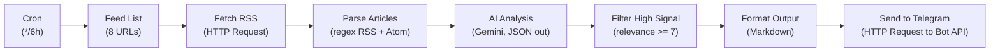
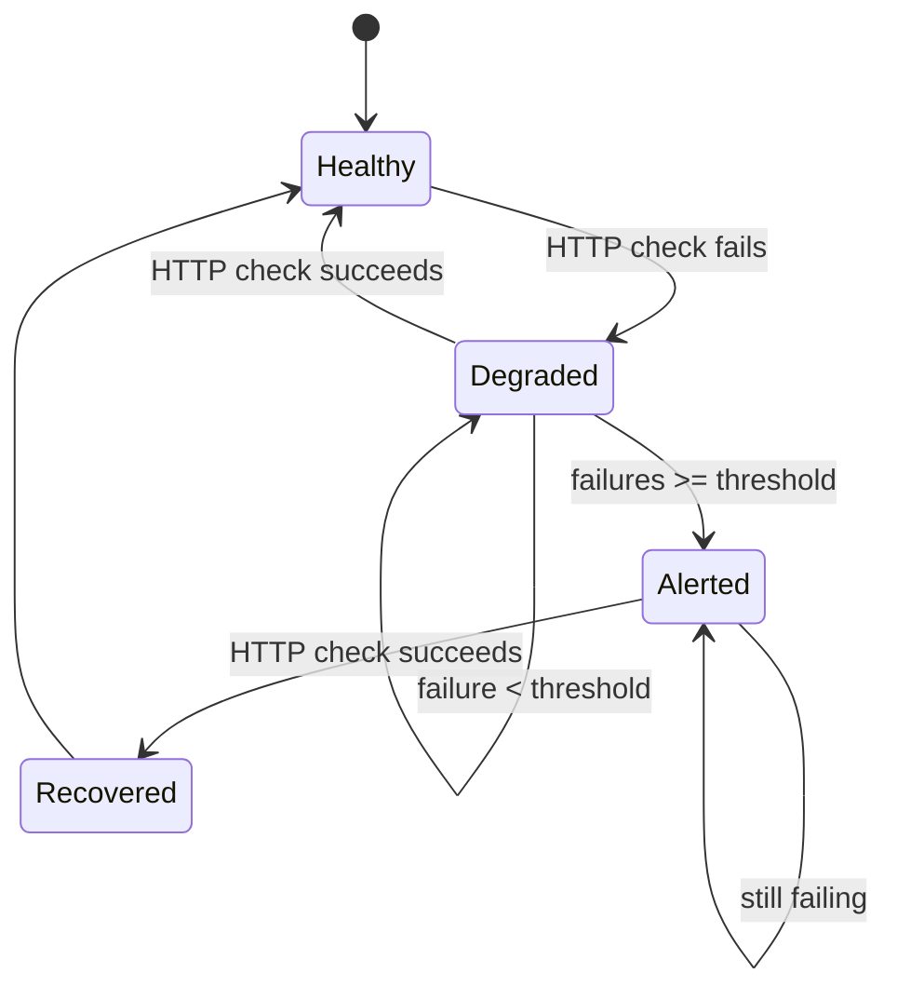

# n8n AI Workflow Templates

> Five importable workflows that connect AI to real business processes, plus the Docker stack to run them in about thirty minutes.

---

## Table of Contents

1. Why n8n for AI Workflows
2. Credentials Walkthrough (Gemini, SMTP, Telegram, GitHub)
3. Docker Setup and Architecture
4. Workflow 1: YouTube Monitor + AI Digest
5. Workflow 2: RSS Intelligence Feed
6. Workflow 3: AI Content Digest Generator
7. Workflow 4: Service Health Check + Alerts
8. Workflow 5: AI Code Review on PR
9. LLM Swapping (Gemini to OpenAI, Anthropic, Ollama)
10. Appendix A: Troubleshooting (ten failure modes with fixes)
11. Appendix B: Why We Pin n8n to a Specific Version
12. Appendix C: Cost Estimates
13. Appendix D: Going to Production

---

## Chapter 1: Why n8n for AI Workflows

n8n is the open-source workflow automation platform that lets you connect anything to anything. Unlike Zapier or Make, you self-host it, own your data, and can write arbitrary JavaScript or Python inside function nodes.

For AI workflows specifically, n8n has four advantages that are hard to replicate in hosted tools:

1. **Self-hosted means no API key exposure**. Your LLM keys stay on your server. Zapier and Make require uploading them to their infrastructure. For workloads that process internal data or customer PII, self-hosting is the only option that passes legal review.
2. **Function nodes for pre- and post-processing**. Parse messy API responses, filter results, reshape payloads, and clean up LLM output before feeding it downstream. Most AI automation bugs live in the glue between nodes, and n8n gives you full code control over that glue.
3. **Webhook triggers**. Other systems can kick off AI workflows over HTTP. This is how the code-review workflow in this pack triggers on a GitHub pull request event with zero polling.
4. **Cheap and predictable**. n8n itself is free. The only cost is the small VPS it runs on (a $5 DigitalOcean droplet is fine for up to a few thousand executions per day) and the LLM API calls the workflows make.

This guide ships five complete workflows as importable JSON files, plus the Docker Compose stack to run them.

### What You Need Before Starting

- Docker and Docker Compose v2 installed on a Mac, Linux box, or VPS
- An API key for at least one LLM. Gemini is the default because it is free up to a generous rate limit and costs roughly one-tenth of GPT-4o for equivalent quality on summarisation tasks
- Thirty minutes for first-run setup, including creating the n8n owner account and importing the workflows
- Optional: a Telegram bot token and chat ID if you want real-time alerts, an SMTP account for email digests, and a GitHub personal access token for the code-review workflow

If you only have the Gemini key, three of the five workflows are fully functional. The other two (content digest email, code review webhook) require additional credentials documented in Chapter 2.

---

## Chapter 2: Credentials Walkthrough

The single biggest reason buyers get stuck on n8n templates is credential setup. This chapter walks through every credential these workflows need, with the exact steps and the three most common failure modes for each one.

### 2.1 Google Gemini API Key

Gemini powers the AI analysis in four of the five workflows. Setup is short:

1. Open https://aistudio.google.com/app/apikey in a browser. Sign in with any Google account.
2. Click **Create API Key** and copy the value. It starts with `AIza`.
3. Open `content/docker/.env` in your editor and paste the key as the value of `GOOGLE_GEMINI_API_KEY`.
4. Save the file. No service restart is needed yet; you will run `./start.sh` once at the end of Chapter 3.


**Three common failure modes:**

- *403 Forbidden with body "API key not valid"*. You copied the key with a leading or trailing space. Open the `.env` file and check that the value has no quotes and no whitespace around the `=` sign.
- *429 Too Many Requests*. You are above Gemini's free-tier rate limit (currently 15 requests per minute for `gemini-2.0-flash`). The RSS workflow can easily trip this if you have many feeds. Fix: add a Wait node between Parse Articles and AI Analysis with a two-second delay, or upgrade to the paid tier.
- *Empty `candidates` array in the response*. Gemini's safety filters flagged the content. This usually happens on security advisories or news about violent events. Fix: add `"safetySettings": [{ "category": "HARM_CATEGORY_DANGEROUS_CONTENT", "threshold": "BLOCK_NONE" }]` inside the JSON body of the Gemini node. Do this only if you understand the implications.

### 2.2 SMTP for Email Workflows

Two workflows (YouTube Monitor, Content Digest) send email via n8n's `emailSend` node. n8n uses a credential object for SMTP, so this is the one place you will click through the UI:

1. Start the stack with `./start.sh` and open http://localhost:5678.
2. In the sidebar, click **Credentials**, then **New credential**.
3. Search for **SMTP** and pick it.
4. Fill in:
   - **User**: your email address (e.g. `you@gmail.com`)
   - **Password**: an app-specific password, not your regular account password
   - **Host**: `smtp.gmail.com` for Gmail, `smtp.fastmail.com` for Fastmail, etc.
   - **Port**: `587`
   - **SSL/TLS**: leave off (n8n will upgrade via STARTTLS on port 587)
5. Click **Save**. Then open each email workflow and bind the newly created credential to the `emailSend` node. The node will show a red badge until a credential is bound.

Gmail specifically requires an **App Password** generated at https://myaccount.google.com/apppasswords. Regular passwords stopped working for SMTP in 2022.

**Three common failure modes:**

- *"535 Authentication credentials invalid"*. You used your normal password instead of an app password. Generate an app password and paste it in.
- *"Connection timeout on port 25"*. Your VPS provider blocks outbound port 25 (DigitalOcean, Hetzner, and most others do). Fix: always use port 587 with STARTTLS or port 465 with SSL.
- *"certificate has expired" or "self-signed certificate"*. The SMTP host has a broken TLS chain. Only acceptable fix during development is to toggle **Ignore SSL Issues** in the SMTP credential. In production you should switch providers.

### 2.3 Telegram Bot Token

The RSS Intelligence and Health Check workflows send alerts via Telegram by default. This is the simplest notification channel to set up:

1. Open Telegram, search for `@BotFather`, and start a chat.
2. Send `/newbot` and follow the prompts. Give it a name and a unique username ending in `bot`.
3. BotFather will reply with a token like `1234567890:ABCdefGhIJKlmnoPQRstuVWXyz`. Copy it into `.env` as `TELEGRAM_BOT_TOKEN`.
4. Start a chat with your new bot and send it any message (the bot cannot message you first).
5. Open `https://api.telegram.org/bot<YOUR_TOKEN>/getUpdates` in a browser and find the `chat.id` field in the JSON response. It will be a number like `7022191561`.
6. Paste that number into `.env` as `TELEGRAM_CHAT_ID`.

**Three common failure modes:**

- *"Chat not found"*. You never sent the bot a message. Telegram will not deliver bot-initiated messages to a user who has not opted in. Fix: say hi to your bot once.
- *Empty `getUpdates` response*. More than 24 hours have passed since you messaged the bot, so Telegram dropped the buffered updates. Fix: message the bot again and reload the URL within a minute.
- *Markdown parse errors*. The RSS workflow uses `parse_mode: Markdown` and article titles with unescaped underscores or brackets will 400 the entire message. The bundled workflow already strips these characters with a regex in the Format Output node; if you rewrite that node, keep the strip.

### 2.4 GitHub Personal Access Token

Only the code-review workflow needs this.

1. Open https://github.com/settings/tokens and click **Generate new token (classic)**.
2. Scopes: check `repo` (full control of private repositories). If you only review public PRs, `public_repo` is enough.
3. Copy the token starting with `ghp_` and paste into `.env` as `GITHUB_TOKEN`.
4. The code-review workflow binds the token to the `Authorization: Bearer ...` header directly from the `$env` variable, so no n8n credential object is needed.

### 2.5 Credential Architecture Diagram



The pattern: everything that fits in an HTTP header or query string flows through `$env` with zero UI clicks. Only SMTP, which n8n insists on storing as a credential object, touches the UI.

---

## Chapter 3: Docker Setup and Architecture

### 3.1 Quick Start

```bash
# 1. Copy the docker/ directory wherever you want to run it
cp -r content/docker/ ~/n8n-ai-workflows/
cd ~/n8n-ai-workflows/

# 2. Create your .env from the template
cp .env.example .env
$EDITOR .env   # fill in the keys from Chapter 2

# 3. Start everything
./start.sh

# 4. Open n8n and create the owner account
open http://localhost:5678
```

The `start.sh` script validates that `GOOGLE_GEMINI_API_KEY` and `POSTGRES_PASSWORD` are set to non-placeholder values before calling `docker compose up`. It then polls `/healthz` until n8n reports ready or 60 seconds elapse.

### 3.2 Architecture Overview



Two containers, one shared Docker network, four volumes on the host. The n8n container talks to four external services; only GitHub talks back in via webhook (for the code review workflow).

### 3.3 Environment Variables Reference

| Variable | Required | Purpose |
|---|---|---|
| `GOOGLE_GEMINI_API_KEY` | yes | AI analysis in 4 of 5 workflows |
| `POSTGRES_USER` | yes | Postgres auth (default `n8n`) |
| `POSTGRES_PASSWORD` | yes | Postgres auth, pick a strong value |
| `POSTGRES_DB` | yes | Postgres db name (default `n8n`) |
| `GENERIC_TIMEZONE` | yes | Cron schedule timezone, e.g. `America/Los_Angeles` |
| `TZ` | yes | Container system timezone (keep in sync with `GENERIC_TIMEZONE`) |
| `TELEGRAM_BOT_TOKEN` | if using Telegram | From BotFather |
| `TELEGRAM_CHAT_ID` | if using Telegram | Your user or group chat ID |
| `DIGEST_FROM_EMAIL` | if using email workflows | `From:` header |
| `DIGEST_TO_EMAIL` | if using email workflows | Recipient for digests |
| `GITHUB_TOKEN` | if using code review | PAT with `repo` scope |
| `OPENAI_API_KEY` | no | Only if you swap LLM in Chapter 9 |
| `ANTHROPIC_API_KEY` | no | Only if you swap LLM in Chapter 9 |

### 3.4 Volume Layout

The Docker Compose file mounts four directories from the host into the `n8n` container:

| Host path | Container path | Purpose |
|---|---|---|
| `./n8n-data` | `/home/node/.n8n` | n8n internal data and encryption key. **Never delete this without backing it up**; losing the encryption key invalidates all stored credentials. |
| `./workflows` | `/home/node/workflows` | JSON exports of the five bundled workflows. Mount point for import. |
| `./credentials` | `/home/node/credentials` | Optional credential backup directory. |
| `./health-state` | `/home/node/.n8n/health-state` | Persistent failure counters for the health-check workflow. Without this mount, every container restart resets alert debouncing and you will get duplicate alerts. |

The Postgres container uses a named Docker volume (`postgres-data`) instead of a bind mount. You can back it up with `docker run --rm -v n8n-ai-workflows_postgres-data:/data -v $(pwd):/backup alpine tar czf /backup/pg.tar.gz /data`.

### 3.5 Postgres vs SQLite

n8n ships with SQLite as the default metadata store. These workflows require Postgres for three reasons:

1. **Execution history at scale**. The health-check workflow fires every five minutes. That is 8,640 executions per month per workflow. SQLite locks up under that write volume once you add more than a couple of concurrent workflows.
2. **Safe restarts**. Postgres handles mid-flight cron executions gracefully. SQLite on Docker can corrupt if the container is killed during a write.
3. **Backups**. `pg_dump` is a five-line cron job. SQLite backups require stopping the container or using VACUUM INTO, both of which add complexity.

The `docker-compose.yml` enforces this with `DB_TYPE=postgresdb` and the five `DB_POSTGRESDB_*` variables. If you see SQLite files in `./n8n-data`, something is wrong. Check that you ran `./start.sh` and not `docker run n8nio/n8n` by hand.

---

## Chapter 4: Workflow 1 -- YouTube Monitor + AI Digest

**What it does**: Monitors a list of YouTube channels via their public RSS feeds, summarises new videos with Gemini, and emails a weekly digest.

**Trigger**: Cron schedule (weekly, Sunday 10am in your configured timezone).

### 4.1 Flow Diagram



### 4.2 What to Tweak

- **Channels**: open the `Channel List` function node and edit the array. The bundled list has three developer channels; replace with yours. To find a channel ID, open `view-source:` on any video from the channel and search for `channelId`.
- **Frequency**: edit the cron expression on the trigger node. `0 10 * * 0` is Sunday 10am. `0 18 * * 5` would be Friday 6pm.
- **Summary length**: the prompt in the Gemini node says "exactly 3 sentences". Change to 5 or 1 as you like.
- **Recipient**: set `DIGEST_TO_EMAIL` in `.env`. The email node reads it via `$env`.

### 4.3 What You Should See in Logs

On a successful run, the Executions panel shows each node with an execution time under two seconds except for Gemini calls (5-15 seconds per video) and the email send (1-3 seconds). If Gemini takes longer than 30 seconds the HTTP Request will time out; the bundled node already has `timeout: 30000` set, but you can raise it.

Parse RSS is the most common failure point: YouTube occasionally changes their RSS format slightly. If you see zero video entries after a format change, open Parse RSS and compare the regex to a fresh `https://www.youtube.com/feeds/videos.xml?channel_id=...` response.

---

## Chapter 5: Workflow 2 -- RSS Intelligence Feed

**What it does**: Aggregates eight tech and AI RSS feeds every six hours, scores each article for relevance to your interests (1-10), filters for high-signal items, and pings your Telegram with the winners.

**Trigger**: Cron schedule (every 6 hours).

### 5.1 Flow Diagram



### 5.2 What to Tweak

- **Feed list**: edit the `Feed List` function node. Supports both RSS 2.0 and Atom.
- **Interests**: the `AI Analysis` node prompt contains three bullet points describing what you care about. Edit them freely.
- **Threshold**: `relevance >= 7` is a useful default. Raising to 8 cuts volume by roughly 60% based on our own usage.
- **Destination**: swap the Telegram node for `emailSend`, a Slack webhook, or a file write. The Format Output node produces a single string field named `message` that any sink can consume.

### 5.3 Rate Limit Caution

At eight feeds and 20 articles per feed, one run of this workflow makes up to 160 Gemini calls. Gemini's free tier allows 15 requests per minute, so a run needs roughly 11 minutes under the free tier. If you see 429 errors, insert a Wait node between Parse Articles and AI Analysis with a 4-second delay, or use the paid tier.

---

## Chapter 6: Workflow 3 -- AI Content Digest Generator

**What it does**: Reads saved articles from a mounted directory, groups them by category, and generates a weekly HTML digest ready to email (or post to a CMS).

**Trigger**: Cron schedule (weekly, Monday 9am) or manual.

### 6.1 Flow

Read markdown files from `/home/node/workflows/content-inbox`, parse YAML frontmatter, group by the `tags:` field, run a Gemini prompt per category asking for a theme sentence plus top-three picks, compile into HTML, and send via SMTP.

### 6.2 What to Tweak

- **Source directory**: edit `SOURCE_DIR` in the `Read Content Files` function node. Make sure the directory is bind-mounted into the container.
- **Frontmatter**: the node expects `title`, `url`, and `tags`. Add more fields as needed.
- **Prompt**: the Gemini node asks for a theme, top-three picks, and an emerging trend. Tailor to your newsletter voice.
- **Recipient**: set `DIGEST_TO_EMAIL`.

### 6.3 Common Mistake

If you run this with zero files in the source directory, the `Read Content Files` node returns an error object instead of empty, and the Gemini node will 400 on bad input. Fix: add an IF node after Read Content Files that checks for the error field and short-circuits.

---

## Chapter 7: Workflow 4 -- Service Health Check + Alerts

**What it does**: Pings a configurable list of HTTP endpoints every five minutes, tracks consecutive failures per service, and fires a Telegram alert when a service exceeds its failure threshold. Alerts are debounced (no spam) and recovery notifications are sent when a down service comes back up.

**Trigger**: Cron schedule (every 5 minutes).

### 7.1 State Machine



The state lives in a JSON file at `/home/node/.n8n/health-state/health-state.json`, which is volume-mounted to `./health-state` on the host. Without that mount every container restart would reset the failure counters and trigger duplicate alerts.

### 7.2 Configuration

The `Service List` function node contains an array of service objects:

```javascript
{
  name: 'API Server',
  url: 'https://api.example.com/health',
  expected_status: 200,
  expected_body: 'ok',    // optional
  timeout_ms: 10000,
  alert_after_failures: 3
}
```

Add as many as you like. The workflow loops over them automatically.

### 7.3 Debouncing Math

At five-minute intervals and `alert_after_failures: 3`, a service must be down for 10 minutes (three consecutive failed checks) before you get paged. That matches most SLOs for non-critical systems. For critical systems (payment API, auth service) use `alert_after_failures: 1` and accept occasional false positives.

---

## Chapter 8: Workflow 5 -- AI Code Review on PR

**What it does**: Receives a GitHub webhook on pull-request open or synchronise, fetches the PR diff, splits it into 4K-token chunks, runs a Gemini review per chunk, and posts the aggregated findings back as a PR comment.

**Trigger**: Webhook (POST to `/webhook/code-review`).

### 8.1 GitHub Webhook Setup

1. On GitHub, open your repo's **Settings -> Webhooks -> Add webhook**.
2. Payload URL: `https://your-n8n-host:5678/webhook/code-review` (must be reachable from GitHub; use ngrok or a public VPS).
3. Content type: `application/json`.
4. Events: **Pull requests** only.
5. Save. GitHub sends a ping event; n8n ignores it because the `action` field won't match `opened` or `synchronize`.

### 8.2 What to Tweak

- **Prompt**: the `AI Code Review` node has a four-point review checklist. Add or remove bullet points to match your team's priorities.
- **Chunk size**: 12,000 characters per chunk, roughly 4,000 tokens. Raise if your model has a larger context window.
- **Model**: swap to `gemini-2.0-pro` for deeper analysis at higher cost. See Chapter 9 for provider swaps.

### 8.3 Security Note

The webhook has no signature verification in the bundled workflow. If your n8n instance is public, anyone who finds the URL can trigger a code review against any PR URL you don't own (and burn your Gemini budget). Add a `Verify webhook signature` function node in front of the IF node. GitHub sends an `X-Hub-Signature-256` header; validate it with a shared secret set on both sides.

---

## Chapter 9: LLM Swapping

The workflows ship with Gemini 2.0 Flash because it is cheap and fast. Swapping is a two-field change in every HTTP Request node: the URL and the JSON body. Below are working snippets you can paste directly.

### 9.1 Gemini -> OpenAI

Replace the Gemini node's URL and body with:

```json
{
  "url": "=https://api.openai.com/v1/chat/completions",
  "sendHeaders": true,
  "headerParameters": {
    "parameters": [
      {"name": "Authorization", "value": "=Bearer {{ $env.OPENAI_API_KEY }}"},
      {"name": "Content-Type", "value": "application/json"}
    ]
  },
  "jsonBody": "={{ JSON.stringify({ model: 'gpt-4o-mini', messages: [{ role: 'user', content: `Your prompt here referencing ${$json.field}` }], temperature: 0.2 }) }}"
}
```

Downstream function nodes that read the response need one change: replace
`item.json?.candidates?.[0]?.content?.parts?.[0]?.text` with
`item.json?.choices?.[0]?.message?.content`.

### 9.2 Gemini -> Anthropic

```json
{
  "url": "=https://api.anthropic.com/v1/messages",
  "sendHeaders": true,
  "headerParameters": {
    "parameters": [
      {"name": "x-api-key", "value": "={{ $env.ANTHROPIC_API_KEY }}"},
      {"name": "anthropic-version", "value": "2023-06-01"},
      {"name": "Content-Type", "value": "application/json"}
    ]
  },
  "jsonBody": "={{ JSON.stringify({ model: 'claude-haiku-4-5', max_tokens: 1024, messages: [{ role: 'user', content: `Your prompt here` }] }) }}"
}
```

Response accessor becomes `item.json?.content?.[0]?.text`.

### 9.3 Gemini -> Ollama (Local)

For fully local runs, add an `ollama` service to docker-compose or install Ollama on the host. Then:

```json
{
  "url": "=http://host.docker.internal:11434/api/chat",
  "jsonBody": "={{ JSON.stringify({ model: 'llama3.1:8b', messages: [{ role: 'user', content: `Your prompt here` }], stream: false }) }}"
}
```

Response accessor: `item.json?.message?.content`. No API key needed; Ollama listens on localhost by default. On Docker Desktop, `host.docker.internal` resolves to the host; on Linux, add `extra_hosts: ["host.docker.internal:host-gateway"]` to the n8n service.

### 9.4 Swap Table

| Provider | Model for summaries | Model for code review | Rough cost per 1M tokens |
|---|---|---|---|
| Gemini | gemini-2.0-flash | gemini-2.0-flash | $0.10 in / $0.40 out |
| OpenAI | gpt-4o-mini | gpt-4o | $0.15-$2.50 in / $0.60-$10 out |
| Anthropic | claude-haiku-4-5 | claude-sonnet-4-5 | $0.80-$3 in / $4-$15 out |
| Ollama (local) | llama3.1:8b | qwen2.5-coder:14b | free, uses your CPU/GPU |

---

## Appendix A: Troubleshooting

### A.1 n8n will not start

```
docker compose logs n8n
```

Look for the last line before the container exits. The usual suspects:
- **"password authentication failed for user n8n"**: you changed `POSTGRES_PASSWORD` after the first run, but the Postgres volume still has the old password. Fix: `docker compose down -v` (destroys the Postgres volume, losing execution history) then `./start.sh`. Back up first if you care about history.
- **"address already in use: 5678"**: another process is using port 5678. Fix: `lsof -i :5678` to find it, or remap the port in `docker-compose.yml`.

### A.2 Workflow will not activate

n8n disables activation if any node has unresolved credentials. Open the workflow, look for red badges on nodes, and either bind a credential (SMTP) or set the missing env var in `.env` and restart.

### A.3 Gemini returns 429 Too Many Requests

You are past the free-tier rate limit (15 rpm). Options: add a Wait node with `amount: 4, unit: seconds` between Parse Articles and AI Analysis, upgrade to paid tier, or reduce the feed list.

### A.4 Webhook node receives nothing

Three causes in order of likelihood: (1) the webhook URL is not reachable from GitHub because your n8n runs on localhost; use ngrok or a real VPS; (2) `WEBHOOK_URL` env var is set to `localhost` not your public URL; (3) the `production` vs `test` URL distinction in n8n -- only the "production URL" is active when the workflow is activated.

### A.5 Docker OOM kill (exit code 137)

Gemini responses with large context can push the n8n container over the default 256MB memory limit on constrained hosts. Fix: add `mem_limit: 1g` under the n8n service in docker-compose.yml. Symptoms: container restarts mid-execution, last log line is `Killed`.

### A.6 Cron fires at the wrong time

Set `GENERIC_TIMEZONE` and `TZ` in `.env` to the same value (e.g. `America/Los_Angeles`). n8n reads `GENERIC_TIMEZONE` for the schedule trigger; the OS uses `TZ` for timestamps in logs. Mismatch causes confusion but not actual wrong firing.

### A.7 scheduleTrigger drifts across DST

The `scheduleTrigger` node uses IANA timezone data correctly for most expressions, but cron syntax with fixed hours (e.g. `0 9 * * 1`) shifts by one hour when DST changes. If your Monday 9am digest shows up at 8am after the shift, restart the n8n container once to force a timer rebuild. Consider using `interval` mode instead of `cronExpression` to avoid the issue entirely for non-wall-clock schedules.

### A.8 SMTP TLS handshake fails

Most common cause: port 465 requires full SSL, port 587 requires STARTTLS, and n8n picks based on the SSL/TLS toggle. If you set port 587 AND toggle SSL on, the handshake will fail. Correct combo: port 587 + SSL off (STARTTLS auto-upgrade), or port 465 + SSL on.

### A.9 Webhook loop (workflow calls itself)

If you add a webhook node that calls an HTTP endpoint exposed by the same n8n instance (e.g. for chained workflows), make sure the called workflow is not listening on the same path. An infinite loop will spike CPU and burn Gemini credits. Use the **Execute Workflow** node for chaining instead of HTTP Request.

### A.10 AI responses arrive as malformed JSON

Gemini, GPT, and Claude all occasionally wrap JSON in a ```json fence or add explanatory prose. The bundled RSS workflow strips fences with `text.replace(/\`\`\`json\\n?|\`\`\`\\n?/g, '').trim()` before `JSON.parse`. If you see parse errors, check that your custom prompts say "Respond with JSON only, no prose, no code fences" and that the downstream function node has a try/catch around the parse.

---

## Appendix B: Why We Pin n8n to a Specific Version

The bundled `docker-compose.yml` uses `n8nio/n8n:1.70.0`, not `:latest`. This is deliberate.

n8n ships breaking changes on a monthly cadence. In the last year alone:

- Schedule trigger node bumped from typeVersion 1.0 to 1.2 (expressions silently migrated, some timezone behaviour changed)
- HTTP Request node bumped from 4.1 to 4.2 (new response wrapping format; function nodes that expected `$input.first().json.data` sometimes needed `$input.first().json` instead)
- Webhook node bumped from 1 to 2 (binary data handling changed)
- Credential type names changed for Google services

If you run `:latest` and something breaks, you have no easy rollback because the n8n container has already migrated the Postgres schema to the new version. Pinning gives you a known-good baseline. When you want to upgrade, change the tag, test in a separate directory, then promote.

Rule of thumb: upgrade n8n once per quarter, read the changelog on https://docs.n8n.io/release-notes, and test in a staging clone of the stack before touching production.

---

## Appendix C: Cost Estimates

| Workflow | Frequency | Estimated monthly cost (Gemini Flash) |
|---|---|---|
| YouTube Monitor | Weekly, 10 videos | $0.05 |
| RSS Intelligence | 4x/day, 160 articles/run | $2-5 |
| Content Digest | Weekly, 50 articles | $0.10 |
| Health Check | Every 5m (no AI) | $0 |
| Code Review | Per PR (assume 20/month) | $0.40-$2.00 |

**Total on Gemini Flash: roughly $3-7 per month for all five workflows.**

Switching the RSS and Code Review workflows to GPT-4o increases this to roughly $30-40 per month for the same volume. Switching the summariser-level workflows (YouTube, Content Digest) is negligible.

---

## Appendix D: Going to Production

Short checklist for moving from a local Mac to a real VPS:

1. **Use a dedicated VPS**. A $5 DigitalOcean droplet or Hetzner CX11 is enough.
2. **Put n8n behind a reverse proxy with TLS**. Caddy or nginx, pointing to localhost:5678. Set `N8N_HOST` and `WEBHOOK_URL` to your public HTTPS URL.
3. **Back up Postgres nightly**. Cron a `pg_dump` piped to `gzip`, stored in S3 or B2.
4. **Pin n8n to a version** (you already are if you used the bundled compose file).
5. **Rotate the encryption key once**. `/home/node/.n8n/config` contains `encryptionKey`. If an attacker steals your `n8n-data` volume they can decrypt all your credentials.
6. **Set up alerting on the alerter**. The health-check workflow monitors other services, but nothing monitors n8n itself. Add a boring cron on a separate host that pings `http://your-n8n:5678/healthz`.
7. **Audit your webhooks**. Any webhook node on a public n8n is an unauthenticated endpoint unless you add signature verification. See Chapter 8 section 8.3.

Done. You have five production-grade AI workflows running for under $10 a month, fully owned, fully inspectable, with zero lock-in.

---

## Appendix E: Observability and Debugging

Once the workflows are running, you will want visibility beyond the n8n UI's Executions tab. Three patterns have served us well in production.

### E.1 Structured logs from function nodes

n8n's function nodes can call `console.log()` and the output shows up in `docker compose logs n8n`. This is underused. Add lines like `console.log(JSON.stringify({workflow: 'rss', stage: 'parse', count: articles.length}))` at the top and bottom of any non-trivial function node. When something breaks a week later, you will thank yourself. Ship these logs to Loki, Grafana Cloud, or even a local `tail -f` on a second terminal.

### E.2 Per-workflow metrics via a Prometheus endpoint

n8n exposes basic metrics at `/metrics` if you set `N8N_METRICS=true` in the environment. Add that to docker-compose.yml and scrape with Prometheus. The built-in metrics include execution count, execution duration, and queue depth. For custom workflow metrics, write a tiny function node that POSTs to a Pushgateway.

### E.3 Dead-letter pattern for failed executions

For any workflow that runs unattended, wrap the risky section in a try/catch inside a function node and write failures to a `dead-letter.jsonl` file on a mounted volume. Review weekly. The pattern catches the long-tail bugs (malformed RSS feeds, API schema drift, LLM output regressions) that random execution-history browsing misses.

---

## Appendix F: What This Pack Does Not Cover

Being explicit about scope saves frustration. This guide and these workflows intentionally skip:

- **Multi-tenant n8n** (user management beyond the owner account). n8n supports SSO and RBAC in the paid Enterprise edition; if you need that, buy it directly from n8n.io.
- **Vector store RAG workflows**. Covered elsewhere; the nodes exist (`Pinecone`, `Weaviate`, `Supabase`), but building a production RAG pipeline is a separate product.
- **Fine-tuning**. These workflows use zero-shot prompting because it is cheaper and easier to iterate on. If you need fine-tuned models, add a separate training pipeline.
- **Queue mode for high throughput**. For more than ~50 executions per minute, enable `EXECUTIONS_MODE=queue` and add a Redis container plus worker instances. Not needed for the bundled workflows.

The goal of this pack is to get a solo developer or small team from zero to five working AI workflows in under an hour. Anything beyond that is your call.
