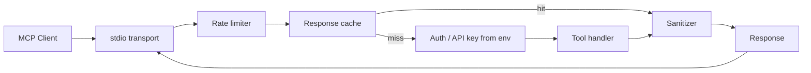
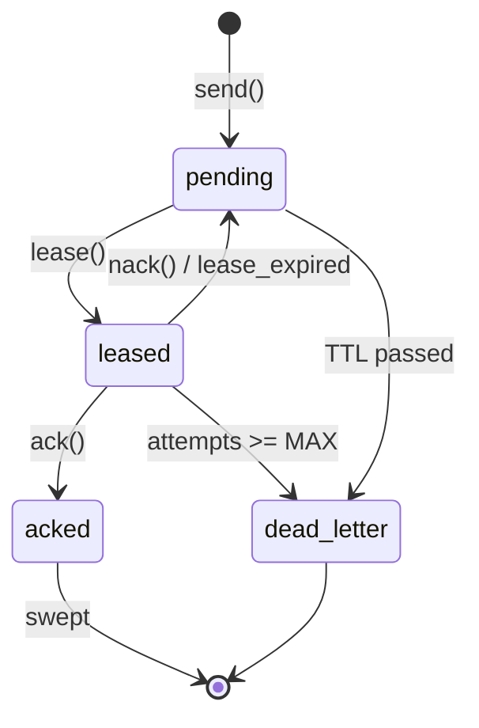
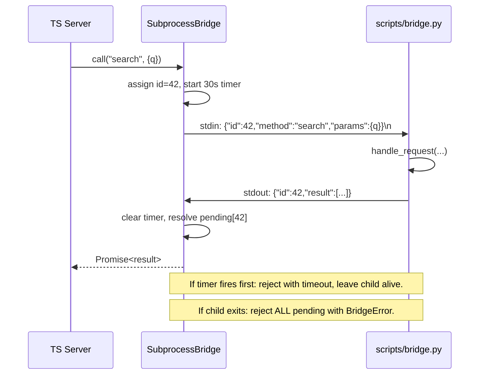
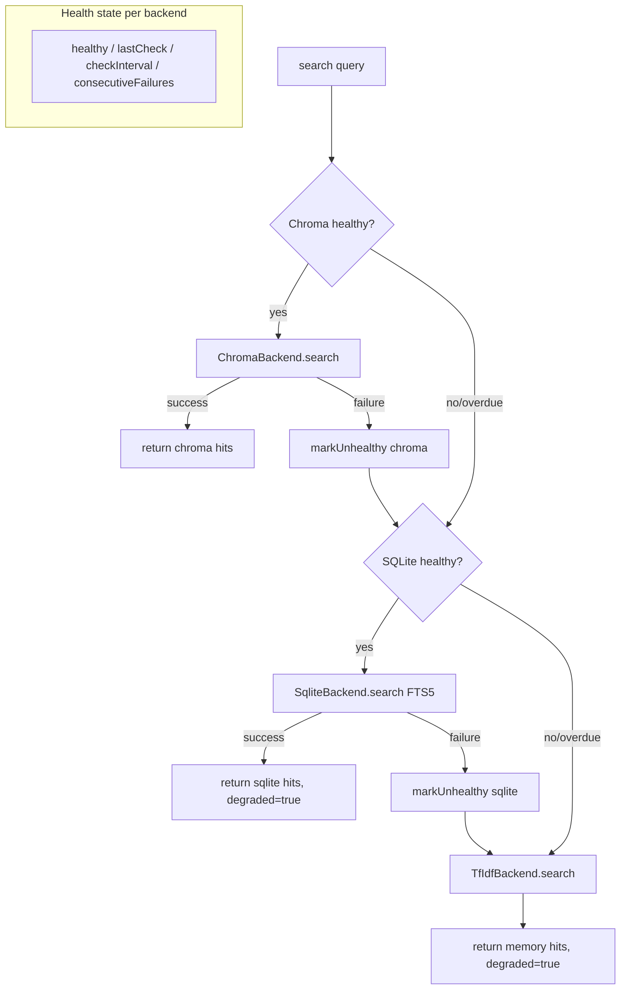

# Production MCP Server Kit

> Take MCP servers past the tutorial stage. Auth, rate limiting, Docker, health checks, and error handling from running 4+ servers in production.

---

## Chapter 1: The Production Gap

Every MCP tutorial shows you how to define a tool and return a result. None of them show you what happens when:

- Two sessions hit the same endpoint simultaneously
- Your API key gets leaked through error messages
- The server crashes at 3am and nobody notices
- Token costs spiral because there's no rate limiting
- A subprocess bridge hangs and blocks all requests

This guide fills that gap. It comes from running 4+ MCP servers in production: a semantic search engine (Effect-TS + ChromaDB), an inter-session message router (SQLite + WebSocket), and two utility servers that have survived months of daily use. Three of those production servers are the templates in this kit.

### What's Inside

- 3 production-ready server templates (`typed-server`, `api-proxy`, `stateful-hub`)
- Auth middleware patterns (API key validation, token checking)
- Rate limiting and health check implementations
- Docker + Compose deployment configs
- Error handling patterns that don't leak secrets (six regex classes, JWT included)
- Subprocess IPC bridge for Python/other language integration -- both sides (Python + a real `SubprocessBridge` TS class)
- Multi-backend fallback cascade with health-aware routing as a real, runnable file (`fallback.ts`)
- Three production incident debriefs and the patterns that came out of them
- Observability stubs (Prometheus shape) and graceful shutdown recipes

### The MCP request lifecycle

Every tool call in a production server traverses the same pipeline. Build it once, debug it for a month, then never think about it again:



The order matters. Rate limiting before cache means a bad actor can't blow your cache budget. Auth after cache means a hot path skips the credential roundtrip. Sanitization sits in front of every response so a leaked secret in an upstream error never reaches the client.

Every chapter that follows is a sub-pattern inside one of those nodes.

---

## Chapter 2: Template 1 -- Typed MCP Server (Effect-TS)

The gold standard for type-safe MCP servers. Every tool has validated input schemas, typed outputs, and explicit error cases.

### Why Effect-TS

1. **Schema validation at the boundary**: Invalid inputs are rejected before your code runs
2. **Dependency injection**: Services are injected via layers, making testing trivial
3. **Typed errors**: No more `catch (e: unknown)` -- errors are part of the type signature
4. **Composable**: Small services compose into larger ones without coupling

### Project Structure

```
typed-server/
  src/
    index.ts        -- Server entry point
    service.ts      -- Business logic layer
    tools.ts        -- Tool definitions with schemas
  package.json
  tsconfig.json
```

### Tool Definition Pattern

```typescript
import { McpServer } from "@effect/ai-mcp/McpServer";
import { Schema } from "effect";

// Input schema -- validated before your handler runs
const SearchInput = Schema.Struct({
  query: Schema.String.pipe(
    Schema.minLength(1),
    Schema.maxLength(1000)
  ),
  limit: Schema.optional(
    Schema.Number.pipe(Schema.int(), Schema.between(1, 100)),
    { default: () => 10 }
  ),
});

// Output schema -- guarantees response shape
const SearchResult = Schema.Struct({
  results: Schema.Array(Schema.Struct({
    id: Schema.String,
    content: Schema.String,
    score: Schema.Number,
  })),
  total: Schema.Number,
});

// Tool with dependency injection
const searchTool = McpServer.tool(
  "search",
  "Search the knowledge base",
  SearchInput,
  SearchResult,
  (input) => Effect.gen(function* () {
    const service = yield* MyService;
    return yield* service.search(input.query, input.limit);
  })
);
```

### Service Layer Pattern

Business logic lives in a service, injected via Effect layers:

```typescript
import { Context, Effect, Layer } from "effect";

class MyService extends Context.Tag("MyService")<
  MyService,
  {
    search: (query: string, limit: number) => Effect.Effect<SearchResult>;
    getDocument: (id: string) => Effect.Effect<Document>;
  }
>() {}

const MyServiceLive = Layer.succeed(MyService, {
  search: (query, limit) =>
    Effect.tryPromise(() => searchDatabase(query, limit)),
  getDocument: (id) =>
    Effect.tryPromise(() => fetchDocument(id)),
});
```

> **Sidebar: Why a Layer instead of a singleton?**
>
> Layers compose. If you have `KvDocStoreLive`, `EmbedderLive`, and `MetricsLive`, you compose them with `Layer.merge` and the resulting `AppLive` is a single value you provide to your runtime. Tests provide `KvDocStoreInMemory` instead. Nothing else changes. Compare with the typical `class Service { constructor(deps) }` approach where every test has to wire the constructor again.
>
> The `typed-server` template uses `Layer.effect(KvDocStore, Effect.gen(...))` so the SQLite handle is constructed lazily, once, and shared across all tool calls. The `Effect.try` blocks inside that layer convert thrown SQLite errors into `StorageError` -- a tagged error you can `catchTag` against without losing type information.

### Error Handling

Effect-TS surfaces errors as typed values, not thrown exceptions:

```typescript
const searchTool = McpServer.tool(
  "search",
  "Search the knowledge base",
  SearchInput,
  { failureMode: "return" },  // Return errors instead of crashing
  (input) => Effect.gen(function* () {
    const result = yield* service.search(input.query).pipe(
      Effect.catchTag("NotFound", () =>
        Effect.succeed({ results: [], total: 0 })
      ),
      Effect.catchTag("RateLimited", (e) =>
        Effect.fail(new ToolFailure(`Rate limited. Retry after ${e.retryAfter}s`))
      ),
    );
    return result;
  })
);
```

---

## Chapter 3: Template 2 -- Stateful Hub Server

For MCP servers that maintain state across requests: message queues, session registries, caches, or any service with persistent data.

### Architecture

```
Client -> MCP Protocol -> Hub Server -> SQLite (WAL mode)
                                     -> Health endpoint (/health)
                                     -> Cleanup cron (expired data)
```

### SQLite as the State Layer

Why SQLite over Redis/Postgres for MCP servers:

1. **Zero infrastructure**: No external process to manage
2. **WAL mode**: Concurrent reads during writes
3. **Prepared statements**: Pre-compiled queries for <1ms response times
4. **ACID transactions**: No corrupted state on crash

```typescript
import Database from "bun:sqlite";

const db = new Database("hub.db", { strict: true });
db.exec("PRAGMA journal_mode=WAL");
db.exec("PRAGMA busy_timeout=5000");
db.exec("PRAGMA synchronous=NORMAL");

// Schema
db.exec(`
  CREATE TABLE IF NOT EXISTS messages (
    id TEXT PRIMARY KEY DEFAULT (lower(hex(randomblob(8)))),
    mailbox TEXT NOT NULL,
    from_sender TEXT NOT NULL,
    content TEXT NOT NULL,
    status TEXT DEFAULT 'pending',
    created_at TEXT DEFAULT (datetime('now')),
    expires_at TEXT,
    FOREIGN KEY (mailbox) REFERENCES sessions(name)
  );
  CREATE INDEX IF NOT EXISTS idx_msg_mailbox ON messages(mailbox, status);
`);

// Prepared statements -- compile once, execute many
const sendMessage = db.prepare(`
  INSERT INTO messages (mailbox, from_sender, content, status, expires_at)
  VALUES (?, ?, ?, 'pending', datetime('now', '+24 hours'))
`);

const pollMessages = db.prepare(`
  UPDATE messages SET status = 'leased', leased_at = datetime('now')
  WHERE mailbox = ? AND status = 'pending'
  RETURNING *
`);
```

### Message Lifecycle Pattern



This lease-ack pattern prevents message loss. If a consumer crashes during processing, the message returns to `pending` after the lease expires. After `MAX_ATTEMPTS` failed leases (default 5), the message moves to a `dead_letters` table for human inspection. Run `SELECT * FROM dead_letters ORDER BY failed_at DESC LIMIT 20` to triage.

The actual schema lives in `templates/stateful-hub/src/schema.sql`. The relevant indexes are `idx_messages_session_status` (covers the lease query) and `idx_messages_expires_at` (covers the sweeper).

> **Sidebar: PRAGMAs you actually run in production**
>
> ```sql
> PRAGMA journal_mode = WAL;       -- concurrent reads during writes
> PRAGMA busy_timeout = 5000;      -- block 5s instead of failing on SQLITE_BUSY
> PRAGMA synchronous = NORMAL;     -- fsync at checkpoint, not every commit
> PRAGMA foreign_keys = ON;        -- referential integrity
> PRAGMA temp_store = MEMORY;      -- no temp file thrash on big sorts
> PRAGMA cache_size = -65536;      -- 64MB page cache (negative = KB)
> PRAGMA mmap_size = 268435456;    -- 256MB mmap window (read-only speedup)
> ```
>
> `WAL` is the headline win: writers and readers no longer block each other. The trade-off is a `-wal` and `-shm` sidecar file. `synchronous=NORMAL` is safe under WAL because the WAL itself is fsync'd at checkpoint -- you only lose the last few uncheckpointed transactions on a hard crash, not the database. `synchronous=FULL` is slower for almost no real durability gain in WAL mode.
>
> **Lock-busy retry strategy:** even with `busy_timeout=5000`, you will eventually see `SQLITE_BUSY` under contention. Wrap writes in a small retry loop with exponential backoff (10ms, 25ms, 60ms, 150ms, fail). Don't loop forever -- a busy lock that doesn't clear in 250ms is a sign of a stuck writer, not contention.

### Health Endpoints

```typescript
const server = Bun.serve({
  port: 9800,
  fetch(req) {
    const url = new URL(req.url);
    
    if (url.pathname === "/health") {
      const dbOk = db.prepare("SELECT 1").get() !== null;
      const messageCount = db.prepare(
        "SELECT COUNT(*) as c FROM messages WHERE status = 'pending'"
      ).get();
      
      return Response.json({
        status: dbOk ? "ok" : "degraded",
        pending_messages: messageCount.c,
        uptime: process.uptime(),
      });
    }
    // ... other routes
  }
});
```

---

## Chapter 4: Template 3 -- API Proxy Server

The simplest production pattern: an MCP server that wraps an external API with auth, caching, and rate limiting.

### Use Case

You have a REST API. You want Claude Code to use it. But you need:
- API key management (not in the prompt)
- Rate limiting (prevent runaway costs)
- Response caching (save tokens and money)
- Error sanitization (no key leaks in error messages)

### Implementation

```typescript
import { Server } from "@modelcontextprotocol/sdk/server/index.js";
import { StdioServerTransport } from "@modelcontextprotocol/sdk/server/stdio.js";

// In-memory rate limiter
const rateLimiter = new Map<string, { count: number; reset: number }>();
const RATE_LIMIT = 100; // requests per minute
const RATE_WINDOW = 60000; // 1 minute

function checkRateLimit(tool: string): boolean {
  const now = Date.now();
  const entry = rateLimiter.get(tool) || { count: 0, reset: now + RATE_WINDOW };
  
  if (now > entry.reset) {
    entry.count = 0;
    entry.reset = now + RATE_WINDOW;
  }
  
  entry.count++;
  rateLimiter.set(tool, entry);
  return entry.count <= RATE_LIMIT;
}

// Response cache
const cache = new Map<string, { data: unknown; expires: number }>();
const CACHE_TTL = 300000; // 5 minutes

function getCached(key: string): unknown | null {
  const entry = cache.get(key);
  if (entry && Date.now() < entry.expires) return entry.data;
  cache.delete(key);
  return null;
}

// Error sanitization -- NEVER leak API keys
function sanitizeError(error: Error): string {
  const message = error.message || "Unknown error";
  return message
    .replace(/sk-[a-zA-Z0-9]{20,}/g, "[API_KEY_REDACTED]")
    .replace(/Bearer\s+[a-zA-Z0-9_.+-]+/g, "Bearer [REDACTED]")
    .replace(/api[_-]?key[=:]\s*\S+/gi, "api_key=[REDACTED]");
}
```

### Auth Middleware Pattern

```typescript
// API key from environment, never from the tool input
const API_KEY = process.env.EXTERNAL_API_KEY;
if (!API_KEY) {
  console.error("EXTERNAL_API_KEY not set");
  process.exit(1);
}

// Headers with auth -- key never touches the MCP protocol
function apiHeaders(): Record<string, string> {
  return {
    "Authorization": `Bearer ${API_KEY}`,
    "Content-Type": "application/json",
  };
}

// Tool handler -- note: no auth parameters in the schema
server.setRequestHandler(CallToolRequestSchema, async (request) => {
  if (!checkRateLimit(request.params.name)) {
    return { content: [{ type: "text", text: "Rate limited. Try again in 60 seconds." }] };
  }
  
  const cacheKey = JSON.stringify(request.params);
  const cached = getCached(cacheKey);
  if (cached) return cached;
  
  try {
    const response = await fetch("https://api.example.com/v1/endpoint", {
      method: "POST",
      headers: apiHeaders(),
      body: JSON.stringify(request.params.arguments),
    });
    
    const data = await response.json();
    const result = { content: [{ type: "text", text: JSON.stringify(data) }] };
    cache.set(cacheKey, { data: result, expires: Date.now() + CACHE_TTL });
    return result;
  } catch (error) {
    return { content: [{ type: "text", text: sanitizeError(error) }] };
  }
});
```

---

## Chapter 5: Subprocess IPC Bridge

When your MCP server needs to call Python (or any other language), use a subprocess bridge with JSON-RPC over stdin/stdout.

### Why Not HTTP?

1. **No port management**: stdin/stdout doesn't need a port
2. **Process lifecycle**: Bridge dies when the server dies
3. **Lower latency**: No TCP overhead for local calls
4. **Simpler security**: No network exposure

### Sequence



The TypeScript side ships as `templates/typed-server/src/bridge.ts`. It is a real, import-ready class -- not a snippet. The companion Python side is `scripts/bridge.py`.

### Implementation

```typescript
import { spawn } from "child_process";

class SubprocessBridge {
  private process: ChildProcess;
  private pending = new Map<number, { resolve: Function; reject: Function }>();
  private nextId = 1;
  private buffer = "";

  constructor(command: string, args: string[]) {
    this.process = spawn(command, args, {
      stdio: ["pipe", "pipe", "pipe"],
    });

    // Buffer stdout and parse JSON-RPC responses
    this.process.stdout.on("data", (chunk) => {
      this.buffer += chunk.toString();
      this.processBuffer();
    });

    this.process.on("exit", (code) => {
      // Reject all pending requests
      for (const [id, { reject }] of this.pending) {
        reject(new Error(`Bridge process exited with code ${code}`));
      }
      this.pending.clear();
    });
  }

  private processBuffer() {
    const lines = this.buffer.split("\n");
    this.buffer = lines.pop() || "";
    
    for (const line of lines) {
      if (!line.trim()) continue;
      try {
        const response = JSON.parse(line);
        const pending = this.pending.get(response.id);
        if (pending) {
          this.pending.delete(response.id);
          if (response.error) pending.reject(new Error(response.error));
          else pending.resolve(response.result);
        }
      } catch (e) {
        // Non-JSON output (debug logs, etc.)
      }
    }
  }

  async call(method: string, params: unknown): Promise<unknown> {
    const id = this.nextId++;
    const request = JSON.stringify({ id, method, params }) + "\n";
    
    return new Promise((resolve, reject) => {
      this.pending.set(id, { resolve, reject });
      this.process.stdin.write(request);
      
      // Timeout after 30s
      setTimeout(() => {
        if (this.pending.has(id)) {
          this.pending.delete(id);
          reject(new Error(`Bridge call timed out: ${method}`));
        }
      }, 30000);
    });
  }

  destroy() {
    this.process.kill();
  }
}
```

### Python Side

```python
#!/usr/bin/env python3
"""Subprocess bridge: reads JSON-RPC from stdin, writes results to stdout."""
import json
import sys

def handle_request(method, params):
    if method == "search":
        # Your Python logic here
        return {"results": [...]}
    elif method == "embed":
        return {"embedding": [...]}
    else:
        raise ValueError(f"Unknown method: {method}")

def main():
    for line in sys.stdin:
        try:
            request = json.loads(line.strip())
            result = handle_request(request["method"], request.get("params", {}))
            response = {"id": request["id"], "result": result}
        except Exception as e:
            response = {"id": request.get("id"), "error": str(e)}
        
        sys.stdout.write(json.dumps(response) + "\n")
        sys.stdout.flush()  # Critical: don't buffer

if __name__ == "__main__":
    main()
```

---

## Chapter 6: Multi-Backend Fallback

Production servers need fallback strategies. When ChromaDB is down, fall back to SQLite. When SQLite is down, fall back to in-memory search.

The runnable version of everything below lives in `templates/api-proxy/src/fallback.ts` -- the snippets here are excerpts from that file. You can `import { FallbackSearch } from "./fallback"` and ship it.



### Pattern: Cascade with Degradation

```typescript
async function search(query: string): Promise<SearchResult> {
  // Try primary: vector search via ChromaDB
  try {
    return await chromaSearch(query);
  } catch (e) {
    console.error("ChromaDB unavailable, falling back to SQLite FTS");
  }

  // Try secondary: SQLite full-text search
  try {
    return await sqliteSearch(query);
  } catch (e) {
    console.error("SQLite unavailable, falling back to in-memory");
  }

  // Last resort: in-memory TF-IDF
  return inMemorySearch(query);
}
```

### Health-Aware Routing

Don't retry a dead backend on every request. Check health periodically:

```typescript
const backendHealth = {
  chroma: { healthy: true, lastCheck: 0, checkInterval: 30000 },
  sqlite: { healthy: true, lastCheck: 0, checkInterval: 10000 },
};

async function search(query: string): Promise<SearchResult> {
  const now = Date.now();
  
  // Only try Chroma if healthy or overdue for recheck
  if (backendHealth.chroma.healthy || 
      now - backendHealth.chroma.lastCheck > backendHealth.chroma.checkInterval) {
    try {
      const result = await chromaSearch(query);
      backendHealth.chroma.healthy = true;
      backendHealth.chroma.lastCheck = now;
      return result;
    } catch (e) {
      backendHealth.chroma.healthy = false;
      backendHealth.chroma.lastCheck = now;
    }
  }
  
  // ... cascade to next backend
}
```

---

## Chapter 7: Production Incident Debriefs

Patterns are easier to remember when they come with a scar. Three real incidents that produced three of the patterns in this kit.

### Incident 1: The day Chroma ran out of disk

**Symptom.** At 14:02 PT a search MCP server started returning empty result arrays. No errors, no exceptions, no log lines flagged. Claude Code sessions across the fleet started replying "I couldn't find any matching documents" to questions whose answers were definitely in the index. Two hours later a developer noticed the responses were oddly confident in their wrongness and started digging.

**Cause.** The Chroma container was on a 20GB volume that had been quietly filling for weeks. When it hit 100% the embeddings collection went read-only. The Python client didn't raise -- it returned `{"ids": [], "documents": [], "distances": []}`. The MCP server wrapped that in `results.length === 0` and replied "no hits."

**The bug behind the bug.** The fallback chain was *only* invoked on a thrown exception. An empty result is not an exception. We were treating the absence of data as a successful zero-hit query, which is correct semantically but wrong operationally when the cause is a wedged backend.

**Fix.**

1. Health-aware routing: ping `client.heartbeat()` (or any cheap endpoint) on a `checkInterval`, mark unhealthy on failure, reroute to SQLite.
2. Anomaly detection: if zero-hit rate over the last 100 queries is >85% and the corpus is non-empty, treat the backend as degraded even if it isn't throwing.
3. Disk alert: a `df -h` cron with a 70% warning, 85% page. We had no monitoring on the volume because "it was fine yesterday."

This is why `FallbackSearch` in `fallback.ts` has both a `healthy` flag and a `consecutiveFailures` counter. The flag flips on a single thrown error; the counter triggers exponential backoff so we don't hammer a sick backend at request rate. After five consecutive failures the recheck interval doubles each time, capped at five minutes.

**Lesson.** "Returns empty" is a failure mode. Treat it like one. Index the absence.

### Incident 2: The rate-limit cascade at 02:47

**Symptom.** A nightly batch job that normally finished by 03:00 was still running at 06:30, with a backlog of `429 Too Many Requests` from an upstream API. The MCP server's logs showed thousands of retries. The upstream had silently lowered our quota from 1000 RPM to 200 RPM 36 hours earlier and our rate limiter was still configured for 1000.

**Cause.** Two compounding failures:

1. The rate limiter was a fixed-window counter, so when the upstream said "no" we treated each 429 as a transient error and retried immediately, then hit the next window's allowance, then got 429'd for not respecting `Retry-After`, then retried again.
2. We didn't honor `Retry-After`. The upstream was sending it on every 429 response. We ignored the header and slept a hardcoded 1 second.

**The bug behind the bug.** Rate limiting is bidirectional. Your local limiter prevents *you* from sending too many requests; the upstream's `Retry-After` tells you when it will accept the next one. If you only do the first, you become a synchronized hammer at every retry interval. If you only do the second, you'll get hit before you start.

**Fix.**

1. Adaptive local limiter: when a 429 arrives, divide the local rate cap in half for the next 60 seconds. After three consecutive 200s in a row at the new rate, raise it back by 25%. AIMD (additive-increase, multiplicative-decrease) is the right shape.
2. Honor `Retry-After`. Always. Add jitter so 50 servers don't all wake up at the same millisecond.
3. Per-tool rate limits, not global. The reason this incident took so long to notice was that the limiter was global, so one runaway batch starved unrelated interactive queries.

The `api-proxy` template uses a per-tool fixed-window limiter as a starting point. In production, layer AIMD on top of it the first time you hit a flaky upstream.

**Lesson.** The remote system is part of your system. If its quotas can change at runtime, your limiter must too.

### Incident 3: The MCP server that leaked sockets at 3am

**Symptom.** A long-running stateful hub MCP server was OOM-killed every 36-48 hours. RSS climbed steadily from ~80MB to ~1.2GB, then the kernel reaped it. PM2 restarted it, the cycle repeated. We blamed memory at first; turned out it was file descriptors.

**Cause.** The hub spawned a Python subprocess via the bridge for every tool call instead of reusing a long-lived one. Each `spawn()` opened three pipes (stdin, stdout, stderr). Most calls completed; some hung waiting for input the Python side never produced because we hadn't called `flush()` after `print()`. The hung children were technically alive, holding their pipes, and weren't being reaped because we'd registered no `on('exit')` handler. After 10,000 calls we had 5,000 zombie children and 15,000 leaked pipe FDs.

**The bug behind the bug.** Two:

1. Python's `print()` is line-buffered when stdout is a TTY but block-buffered when stdout is a pipe. We were testing in a terminal and shipping into a subprocess. The bridge worked in dev and hung in prod.
2. We had no per-call timeout. A bridge call that never returned was a permanent leak.

**Fix.**

1. **One bridge process, many calls.** The bridge is a long-lived child; the TS side multiplexes JSON-RPC calls over the same stdin/stdout with monotonic ids.
2. **Always flush.** `sys.stdout.flush()` after every response, on the Python side. This is non-negotiable. Look at `scripts/bridge.py`.
3. **Per-call timeout with cleanup.** `setTimeout` rejects the pending promise *and* removes it from the pending map. The child stays alive (it's shared) but the leaked promise is gone.
4. **Exit handler.** `proc.on('exit', ...)` rejects all pending promises with `BridgeError("bridge dead")`. Without this, every pending call hangs forever after a child crash.
5. **Watchdog.** A health check that sends a no-op `ping` call every 30 seconds. If it doesn't return in 5 seconds, restart the bridge.

`SubprocessBridge` in `templates/typed-server/src/bridge.ts` ships with all five.

**Lesson.** "It works in dev" is the most expensive sentence in production engineering. Buffering, signal handling, and resource cleanup behave differently when stdout is a pipe, when there is no TTY, when systemd reaps your child, and when an OOM killer is involved. Test in the shape you ship in.

---

## Chapter 8: Observability

If you can't see it, you can't fix it. The four metrics that matter for an MCP server, in priority order:

1. **p99 tool-call latency** -- the user experience. p99 because p50 hides the long tail that makes Claude Code feel slow.
2. **Cache hit rate** -- proxies live and die on this. <30% means your TTL or your key shape is wrong.
3. **Sanitization trigger count** -- *every* trigger is interesting. A spike means someone is leaking secrets through error paths.
4. **Backend health flips** -- how often does a fallback backend transition healthy -> unhealthy? More than once an hour means something is wrong upstream that you should escalate before users notice.

### A small Prometheus stub

```typescript
// Tiny in-memory metrics. Replace with prom-client in real deployments.
const metrics = {
  toolCallTotal: new Map<string, number>(),
  toolCallDurationMs: new Map<string, number[]>(),
  cacheHits: 0,
  cacheMisses: 0,
  sanitizerTriggers: new Map<string, number>(),
  backendHealthFlips: 0,
};

function recordCall(tool: string, durationMs: number) {
  metrics.toolCallTotal.set(tool, (metrics.toolCallTotal.get(tool) ?? 0) + 1);
  const arr = metrics.toolCallDurationMs.get(tool) ?? [];
  arr.push(durationMs);
  if (arr.length > 1000) arr.shift();  // ring buffer
  metrics.toolCallDurationMs.set(tool, arr);
}

function p99(values: number[]): number {
  if (values.length === 0) return 0;
  const sorted = [...values].sort((a, b) => a - b);
  return sorted[Math.floor(sorted.length * 0.99)];
}

// /metrics endpoint -- Prometheus text format
function prometheusText(): string {
  const lines: string[] = [];
  lines.push("# HELP mcp_tool_calls_total Total tool calls");
  lines.push("# TYPE mcp_tool_calls_total counter");
  for (const [tool, n] of metrics.toolCallTotal) {
    lines.push(`mcp_tool_calls_total{tool="${tool}"} ${n}`);
  }
  lines.push("# HELP mcp_tool_call_p99_ms 99th percentile latency");
  lines.push("# TYPE mcp_tool_call_p99_ms gauge");
  for (const [tool, durs] of metrics.toolCallDurationMs) {
    lines.push(`mcp_tool_call_p99_ms{tool="${tool}"} ${p99(durs).toFixed(2)}`);
  }
  lines.push("# HELP mcp_cache_hit_rate Cache hit rate");
  lines.push("# TYPE mcp_cache_hit_rate gauge");
  const total = metrics.cacheHits + metrics.cacheMisses;
  lines.push(`mcp_cache_hit_rate ${total > 0 ? (metrics.cacheHits / total).toFixed(4) : "0"}`);
  lines.push("# HELP mcp_sanitizer_triggers_total Times the sanitizer redacted a secret");
  lines.push("# TYPE mcp_sanitizer_triggers_total counter");
  for (const [pattern, n] of metrics.sanitizerTriggers) {
    lines.push(`mcp_sanitizer_triggers_total{pattern="${pattern}"} ${n}`);
  }
  return lines.join("\n");
}
```

### Wiring it into the request lifecycle

```typescript
server.setRequestHandler(CallToolRequestSchema, async (request) => {
  const start = performance.now();
  const tool = request.params.name;
  try {
    return await handle(request);
  } finally {
    recordCall(tool, performance.now() - start);
  }
});
```

The `stateful-hub` template already exposes `/metrics` with a working Prometheus shape (counts of pending, leased, dead-letter rows). Use it as a template and bolt your own counters on.

### Alerts that are worth the pager

Keep the alert list small. Three is usually enough:

| Alert                       | Condition                                  | Why                           |
|-----------------------------|--------------------------------------------|-------------------------------|
| MCP server down             | `up == 0` for 2m                           | Restart needed                |
| p99 latency regression      | p99 > 5x baseline for 10m                  | Real user pain                |
| Sanitizer triggered         | `increase(triggers[5m]) > 0`               | Possible secret leak path     |

Everything else is a dashboard, not a page. If you get paged for cache hit rate dropping you'll start ignoring the pager.

> **Sidebar: Logs vs metrics vs traces**
>
> For an MCP server you almost always want metrics + structured logs and not distributed traces. Traces shine across service boundaries; an MCP server is mostly one process talking to one upstream. Spend the budget on per-tool histograms and a `request_id` you can grep across logs.

---

## Chapter 9: Graceful Shutdown

The most common production bug is also the smallest: when the orchestrator (PM2, systemd, Docker, Kubernetes) sends `SIGTERM`, your server should *finish what it started*, *refuse new work*, and *close its handles*. Most hand-rolled MCP servers do none of those things.

### The shutdown contract

```typescript
let shuttingDown = false;
const inflight = new Set<Promise<unknown>>();

server.setRequestHandler(CallToolRequestSchema, async (request) => {
  if (shuttingDown) {
    return { content: [{ type: "text", text: "server draining" }], isError: true };
  }
  const p = handle(request);
  inflight.add(p);
  try {
    return await p;
  } finally {
    inflight.delete(p);
  }
});

async function shutdown(signal: string) {
  if (shuttingDown) return;
  shuttingDown = true;
  console.error(`[shutdown] ${signal}: ${inflight.size} in-flight, draining...`);

  // 1. Stop the sweeper / cron / timers
  clearInterval(sweeper);

  // 2. Wait for in-flight work, but cap the wait
  const drainTimeout = new Promise((r) => setTimeout(r, 10_000));
  await Promise.race([Promise.allSettled([...inflight]), drainTimeout]);

  // 3. Close the HTTP health server (so the orchestrator stops routing to us)
  try { httpServer?.stop?.(); } catch {}

  // 4. Close the database (releases the WAL lock)
  try { db.close(); } catch {}

  // 5. Tear down subprocess bridges
  try { bridge?.destroy("SIGTERM"); } catch {}

  console.error("[shutdown] done");
  process.exit(0);
}

process.on("SIGTERM", () => shutdown("SIGTERM"));
process.on("SIGINT", () => shutdown("SIGINT"));
```

Five steps, in order:

1. Set the drain flag so new requests are rejected fast.
2. Stop your background sweepers and crons (they hold DB locks).
3. Wait for in-flight work, with a hard cap. 10 seconds is a reasonable default; pick one shorter than your orchestrator's `stopGracePeriod`.
4. Close the health endpoint so the load balancer stops routing.
5. Close downstream resources: SQLite (releases WAL), subprocess bridges, HTTP keepalives.

### Lease timeout behavior on shutdown

If a `stateful-hub`-style server shuts down mid-lease, the leased messages will eventually return to `pending` because their `leased_at + LEASE_MS` will fall in the past and the next sweep cycle on the *next* boot will pick them up. This is the "at-least-once delivery" guarantee. It is *not* "exactly once" -- a consumer that crashed after processing but before ack'ing will see the message again. Your handlers must be idempotent.

If you absolutely cannot tolerate redelivery, use a per-message processed-set keyed on the message id, and check it before doing the work. SQLite makes this trivial:

```sql
CREATE TABLE processed (id TEXT PRIMARY KEY, completed_at TEXT NOT NULL DEFAULT (datetime('now')));
```

```typescript
function processOnce(msg: Msg) {
  const exists = db.prepare("SELECT 1 FROM processed WHERE id = ?").get(msg.id);
  if (exists) return;
  doWork(msg);
  db.prepare("INSERT OR IGNORE INTO processed (id) VALUES (?)").run(msg.id);
}
```

### What about SIGKILL?

SIGKILL bypasses everything in this chapter. There is no handler. The OS reaps you immediately. The only mitigation is *making sure your data is recoverable* -- WAL mode + an idempotent consumer means you can survive any number of SIGKILLs without losing state. If you find yourself wishing for a SIGKILL handler, what you actually need is durable state.

> **Sidebar: Why your `process.on('SIGTERM')` doesn't fire**
>
> Three common reasons: (1) you registered it after a top-level `await` that hangs the event loop -- registrations only take effect when control returns to the loop; (2) you're under PM2 in fork mode and PM2 sends `SIGINT` first by default; (3) you're inside Docker and the process is PID 1, so signals are not forwarded unless you use `tini` or `--init`. Run `bash -c 'kill -TERM $$ &'; sleep 5` inside your container to verify.

---

## Chapter 10: Docker Deployment

The shipped Dockerfile and compose file in `content/docker/` target the `stateful-hub` template specifically. That template is the only one with an HTTP `/health` endpoint (the other two speak stdio only and should be invoked directly by an MCP client). Trying to Docker-wrap a stdio-only server is usually wrong -- run those in-process or under PM2/launchd, not in a container.

### Dockerfile

```dockerfile
FROM oven/bun:1.1 AS builder
WORKDIR /app
COPY package.json bun.lockb ./
RUN bun install --frozen-lockfile
COPY src/ src/
COPY tsconfig.json ./
RUN bun build src/index.ts --target=bun --outdir=dist

FROM oven/bun:1.1-slim
WORKDIR /app
COPY --from=builder /app/dist/index.js ./
COPY --from=builder /app/node_modules ./node_modules
EXPOSE 9800
HEALTHCHECK --interval=30s --timeout=5s \
  CMD curl -f http://localhost:9800/health || exit 1
CMD ["bun", "run", "index.js"]
```

### Docker Compose

```yaml
version: '3.8'
services:
  mcp-server:
    build: .
    container_name: mcp-server
    restart: unless-stopped
    ports:
      - "9800:9800"
    environment:
      - EXTERNAL_API_KEY=${EXTERNAL_API_KEY}
      - DB_PATH=/data/server.db
    volumes:
      - mcp-data:/data
    healthcheck:
      test: ["CMD", "curl", "-f", "http://localhost:9800/health"]
      interval: 30s
      timeout: 5s
      retries: 3

volumes:
  mcp-data:
```

### Environment-Driven Configuration

```typescript
const config = {
  port: parseInt(process.env.PORT || "9800"),
  dbPath: process.env.DB_PATH || "./server.db",
  apiKey: process.env.EXTERNAL_API_KEY || "",
  rateLimit: parseInt(process.env.RATE_LIMIT || "100"),
  cacheTtl: parseInt(process.env.CACHE_TTL || "300000"),
  logLevel: process.env.LOG_LEVEL || "info",
};

// Validate required config at startup
if (!config.apiKey) {
  console.error("EXTERNAL_API_KEY is required");
  process.exit(1);
}
```

---

## Chapter 11: Testing MCP Servers

### Unit Testing Tools

```typescript
import { describe, expect, test } from "bun:test";

describe("search tool", () => {
  test("rejects empty query", async () => {
    const result = await callTool("search", { query: "" });
    expect(result.isError).toBe(true);
  });

  test("respects limit parameter", async () => {
    const result = await callTool("search", { query: "test", limit: 5 });
    expect(result.content.results.length).toBeLessThanOrEqual(5);
  });

  test("sanitizes error messages", async () => {
    // Force an error with a fake API key in the response
    const result = await callToolWithError("search", { query: "test" });
    expect(result.content.text).not.toContain("sk-");
  });
});
```

### Integration Testing

```bash
#!/bin/bash
# Test health endpoint
STATUS=$(curl -s -o /dev/null -w "%{http_code}" http://localhost:9800/health)
if [ "$STATUS" != "200" ]; then
  echo "FAIL: Health check returned $STATUS"
  exit 1
fi

# Test tool via MCP protocol
echo '{"jsonrpc":"2.0","id":1,"method":"tools/call","params":{"name":"search","arguments":{"query":"test"}}}' | bun run src/index.ts
```

---

### What to actually test

For an MCP server, your test pyramid is upside-down compared to a typical web app. There is almost no UI to test, but a *lot* of small contracts that have to hold under failure. Spend your test budget here, in this order:

1. **Schema validation at the boundary.** Every tool input. Reject empty strings, oversized strings, integers out of range, unknown fields. The shipped templates use Effect's `Schema.decodeUnknown` for this; the test files (`templates/api-proxy/test/sanitizer.test.ts`, `templates/typed-server/test/index.test.ts`) demonstrate the pattern.
2. **Sanitization regexes.** Each pattern in `SECRET_PATTERNS` gets at least one positive test (does it redact the secret) and one negative test (does it leave normal text alone). Six patterns ship in `api-proxy/src/index.ts`; six tests in `test/sanitizer.test.ts`. JWT is the easiest one to forget -- the test file makes it impossible to.
3. **Tagged error handling.** Every `catchTag` should be exercised. `DocNotFound` and `StorageError` in `typed-server` each get a dedicated test. Effect's discriminated unions make this trivial: if you forget a tag, the type checker tells you.
4. **Fallback cascade.** A "chroma down + sqlite down" test should still return a result from in-memory TF-IDF. The `fallback.test.ts` file does this with a `null` chroma client and an unconfigured sqlite backend; it's the cheapest insurance you can buy against an outage.
5. **Lease/ack lifecycle.** Send -> lease -> nack -> lease again -> ack. Then send -> lease -> let it expire -> verify it's back to pending. Then send -> lease -> exceed `MAX_ATTEMPTS` -> verify it lands in `dead_letters`.
6. **Graceful shutdown.** Spawn the server, send `SIGTERM`, verify it exits within `drainTimeout` and that the SQLite WAL is checkpointed (no `-wal` and `-shm` files left over).

You will not have time to test everything. The list above is roughly ordered by ROI.

### Running the shipped tests

```bash
# api-proxy
cd templates/api-proxy
npm install
EXTERNAL_API_KEY=test-key npx vitest run

# typed-server
cd templates/typed-server
npm install
npx vitest run

# stateful-hub
cd templates/stateful-hub
bun install
bun test
```

The api-proxy test suite ships with 13 passing tests across `sanitizer.test.ts` and `fallback.test.ts`. The typed-server suite has four tests covering the tagged error machinery. Add your own as you build out the handlers; the templates are scaffolding, not finished products.

---

## Appendix A: Security Checklist

For every MCP server you deploy:

- [ ] API keys loaded from environment, never hardcoded
- [ ] Error messages sanitized (no key leaks)
- [ ] Rate limiting on all external API calls
- [ ] Input validation on all tool parameters
- [ ] Health endpoint for monitoring
- [ ] Process cleanup on exit (close DB connections, kill subprocesses)
- [ ] WAL mode enabled for SQLite
- [ ] Prepared statements for all SQL queries (no injection)
- [ ] JWT redaction in the sanitizer pattern set (see `eyJ[...]` regex)
- [ ] Graceful shutdown handler for SIGTERM and SIGINT
- [ ] In-flight request set drained before exit
- [ ] Subprocess bridges have per-call timeouts and exit handlers
- [ ] `/health` endpoint returns 503 when degraded (not just 200 always)
- [ ] `/metrics` endpoint exposed for the four metrics in Chapter 8
- [ ] Per-tool rate limits, not just a global cap
- [ ] Backup of the SQLite file on a schedule (`sqlite3 .backup` is online-safe under WAL)

## Appendix B: Performance Benchmarks

Measured on Apple M2, Bun 1.1:

| Operation | Latency |
|-----------|---------|
| Tool call (in-memory) | < 1ms |
| SQLite query (prepared) | 1-3ms |
| ChromaDB vector search | 50-200ms |
| Subprocess bridge call | 5-20ms |
| HTTP proxy + cache hit | < 1ms |
| HTTP proxy + cache miss | 100-500ms |
